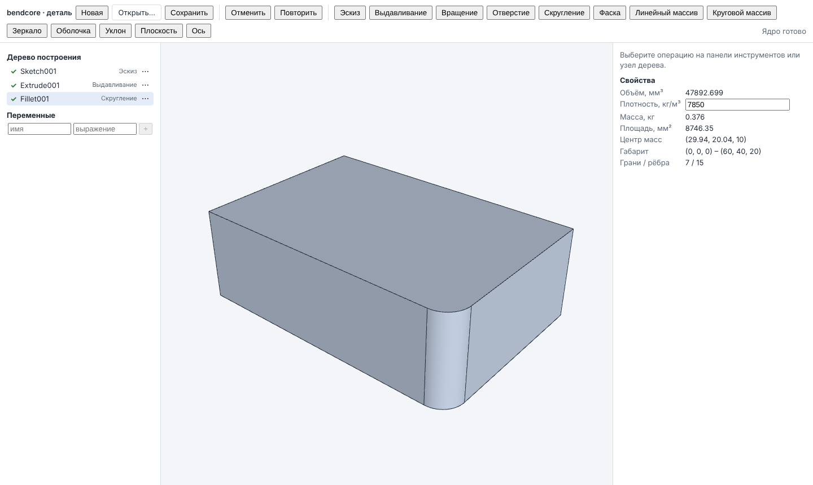
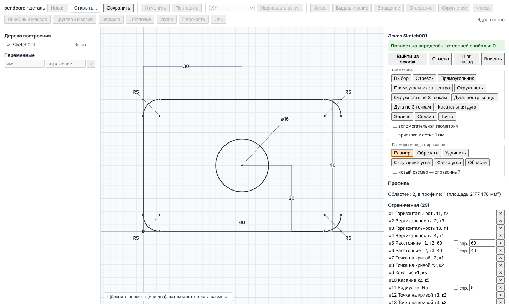
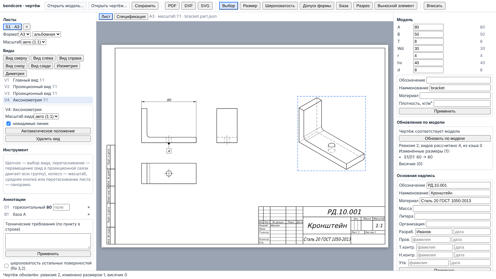
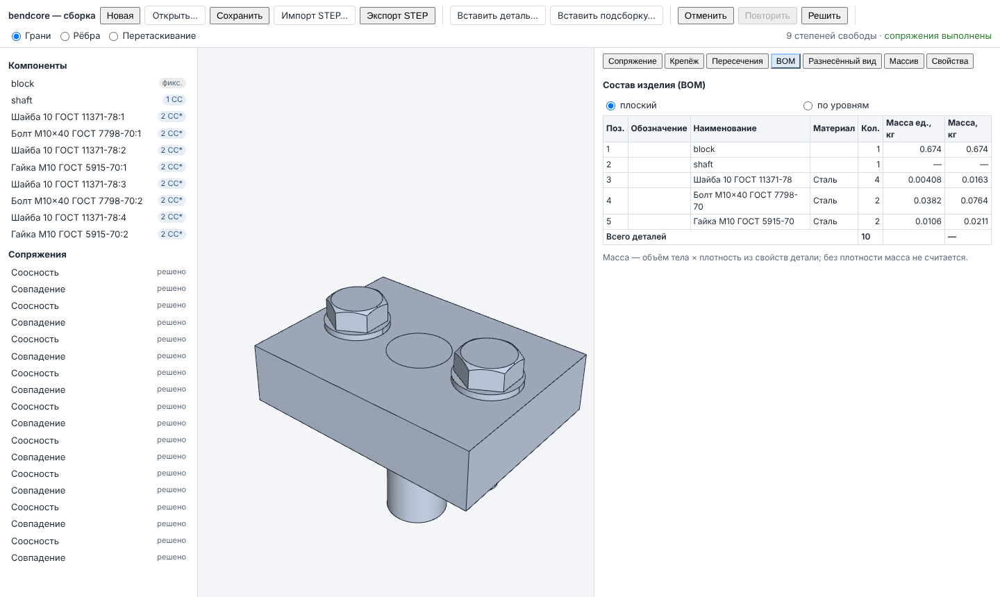

# 1. Быстрый старт

Раздел проводит через весь цикл: деталь → её чертёж → сборка с крепежом. Числа подобраны
так, чтобы результат можно было проверить по формулам в панели «Свойства».

## 1.1. Запуск оболочки

Оболочка — одна страница с вкладками документов (`web/app/`). Ей нужны четыре
WebAssembly-модуля ядра: ядро (`bendcore_kernel_wasm`), деталь (`bendcore_modeling_wasm`),
сборка (`bendcore_assembly_wasm`) и чертёж (`bendcore_drawing_wasm`).

1. Соберите модули (нужны emsdk, OCCT, собранный для WASM, и Eigen; подробности —
   `docs/ui/APP_SHELL.md`, раздел «Как тестировать»):

   ```bash
   source /path/to/emsdk/emsdk_env.sh
   emcmake cmake -S . -B build-wasm-all -G Ninja -DCMAKE_BUILD_TYPE=Release -DBENDCORE_WITH_OCCT=ON \
     -DBENDCORE_OCCT_DIR=/путь/к/occt-install-wasm -DBENDCORE_EIGEN_DIR=/usr/include/eigen3
   cmake --build build-wasm-all --target bendcore_kernel_wasm bendcore_modeling_wasm \
     bendcore_assembly_wasm bendcore_drawing_wasm
   ```

   Для модуля чертежа на машине сборки должен быть шрифт DejaVu Sans
   (`/usr/share/fonts/truetype/dejavu/DejaVuSans.ttf`): без шрифта чертёж не создаётся
   (`docs/ui/DRAWING_UI.md`, раздел «Шрифт»).

2. Установите зависимости и запустите оболочку:

   ```bash
   npm ci --ignore-scripts
   npm run dev:app
   ```

   Откройте `http://127.0.0.1:3200/`. По умолчанию модули берутся из
   `build-wasm-all/wasm_<модуль>`; другой каталог задаётся переменными
   `BENDCORE_KERNEL_WASM_DIR`, `BENDCORE_MODELING_WASM_DIR`, `BENDCORE_ASSEMBLY_WASM_DIR`,
   `BENDCORE_DRAWING_WASM_DIR`; порт — переменной `PORT`.

3. Откроется стартовая страница «Начало работы»: «Новая деталь», «Новая сборка»,
   «Просмотр STEP», «Открыть файл…», список последних файлов. Каждый документ открывается в
   своей вкладке; модуль ядра каждой вкладки работает в отдельном фоновом потоке (Web
   Worker), поэтому страница не замирает во время расчёта (раздел 2).

Каждый редактор доступен и отдельной страницей (для сосредоточенной работы и тестов):
`npm run dev:part-modeler` (порт 3110), `dev:assembly` (3120), `dev:drawing` (3150),
`dev:kernel-viewer` (3100). Отдельные страницы не дают переходов между документами,
черновиков и списка последних файлов.

## 1.2. Первая деталь: пластина с двумя отверстиями (10 минут)

Цель — пластина 60×40×20 мм с двумя сквозными отверстиями ⌀11 и скруглением R5 одного
вертикального ребра.



### Шаг 1. Эскиз до полной определённости

1. На стартовой странице нажмите «Новая деталь». Дождитесь надписи «Ядро готово» справа на
   панели инструментов.
2. В списке плоскостей на панели инструментов оставьте «XY» и нажмите «Нарисовать эскиз».
   Откроется редактор эскиза (sketch editor): плоскость по нормали, сетка, панель справа.
3. Выберите инструмент «Прямоугольник». Подведите курсор к началу координат — появится
   маркер привязки с подписью «начало координат». Щёлкните, затем щёлкните второй угол
   примерно в точке (50, 30). Редактор сам добавит четыре ограничения горизонтальности и
   вертикальности и закрепит угол в начале координат. Статус — «Недоопределён ·
   степеней свободы: 2», недоопределённые линии синие.
4. Выберите «Размер». Щёлкните нижнюю сторону, затем место текста под ней. Появится поле
   с измеренным значением — введите `60` и нажмите Enter. Так же щёлкните правую сторону,
   затем место текста справа, введите `40`, Enter.
5. Статус станет «Полностью определён · степеней свободы: 0», все линии — чёрные.
6. Нажмите «Выйти из эскиза». В дереве построения появится узел эскиза `Sketch001` с
   отметкой ✓.



Если ввести размер, противоречащий уже заданным (например, третий размер ширины 70),
статус станет «Переопределён», конфликтующее ограничение появится в списке «Конфликтующие
ограничения», его строка и текст будут красными. Отметьте у него «спр.» (справочный
размер) или удалите его — эскиз снова станет определённым (раздел 3).

### Шаг 2. Выдавливание

1. Нажмите «Выдавливание» на панели инструментов. Откроется панель операции; в разделе
   «Связи» уже выбран последний эскиз.
2. В поле «Расстояние, мм» введите `20`. «Режим» — «добавить», «Граница» — «на глубину».
3. Нажмите «Предпросмотр»: во вьюпорте появится тело, в «Свойствах» — объём 48 000 мм³.
4. Нажмите «ОК». Вся работа с открытой панелью записывается одной записью истории
   отмены.

### Шаг 3. Отверстие

1. Нажмите «Отверстие». В разделе «Элементы модели» у слота «Грань» нажмите «Выбрать во
   вьюпорте» и щёлкните верхнюю грань пластины; щёлкните «Готово».
2. Задайте «Диаметр, мм» = `11`, «X, мм» = `15`, «Y, мм» = `20`. Точка (X, Y, Z)
   проецируется на плоскость выбранной грани, поэтому Z можно не менять.
3. «Тип» — «простое», «Окончание» — «насквозь». «Предпросмотр», затем «ОК».

### Шаг 4. Второе отверстие массивом

1. Нажмите «Линейный массив». В «Связях» у слота «Операция» выберите отверстие
   (`Hole001`).
2. «Количество 1» = `2`, «Шаг 1, мм» = `30`, «Направление 1» — `X`; «Количество 2» оставьте
   `1`. «Предпросмотр», «ОК». Второе отверстие — в точке X = 45.

### Шаг 5. Скругление

1. Нажмите «Скругление». У слота «Рёбра» нажмите «Выбрать во вьюпорте» и щёлкните
   вертикальное ребро пластины в углу (60, 0). Ребро подсветится; повторный щелчок убирает
   его из выбора.
2. «Радиус, мм» = `5`. «Предпросмотр», «ОК».
3. Проверьте «Свойства»: объём должен быть
   60·40·20 − 2·π·5,5²·20 − (1 − π/4)·5²·20 ≈ **44 091,4 мм³**; при плотности 7850 кг/м³
   масса ≈ 0,346 кг.

Скругление ссылается на ребро по устойчивому имени, а не по номеру (раздел 5): если теперь
в меню узла эскиза выбрать «Редактировать эскиз» и изменить размер 60 на 80, скругление
останется на том же ребре.

### Шаг 6. Сохранение

Нажмите «Сохранить» (или Ctrl+S). Браузер скачает файл `деталь.bcpart.json` (формат
`bendcore-part`, версия 3). Отметка ● на вкладке исчезнет, файл появится в «Последних
файлах» стартовой страницы. Открыть его — «Открыть…» в редакторе детали или «Открыть
файл…» на стартовой странице (раздел 9).

Для сборки (п. 1.4) понадобится вторая деталь — ось. Нажмите вкладку «Начало» → «Новая
деталь» → «Нарисовать эскиз» → инструмент «Окружность»: центр — в начало координат
(привязка «начало координат»), второй щелчок — точка на окружности. Инструментом «Размер»
щёлкните окружность, затем место текста — получится диаметр; введите `11`. Выйдите из
эскиза, выдавите на 40 мм, сохраните.

## 1.3. Первый чертёж пластины

1. Во вкладке пластины нажмите «Создать чертёж». Откроется вкладка чертежа с пустым листом
   А3 альбомной ориентации, рамкой и основной надписью (title block) формы 1.
2. В левой панели «Виды» выберите «вид спереди» и нажмите «Главный вид». Затем нажмите
   «Вид сверху» и «Вид слева» — проекционные виды (projected views) встают в проекционную
   связь по методу первого угла (ЕСКД): вид сверху — под главным, вид слева — справа от
   него. «Изометрия» добавляет аксонометрический вид.
3. Размеры. Выберите инструмент «Размер» на панели инструментов. Щёлкните левое и правое
   вертикальные рёбра главного вида — появится горизонтальный размер 60. На виде сверху
   щёлкните окружность отверстия и нажмите Enter — появится размер ⌀11. В списке
   «Аннотации» в поле «поле» у размера можно ввести поле допуска ISO 286, например `H7`
   (запись «⌀11H7»).
4. Основная надпись — правая панель. В «Свойствах детали» задайте обозначение,
   наименование, материал и плотность («Применить»): графы обозначения, наименования,
   материала и массы заполнятся из модели. В блоке основной надписи заполните фамилии
   «Разраб.», «Пров.» и т. д. и нажмите «Применить».
5. Нажмите «PDF» на панели инструментов: браузер скачает векторный PDF всех листов в
   масштабе. «DXF» и «SVG» выгружают текущий лист.
6. «Сохранить» (Ctrl+S) скачивает два файла: документ чертежа `*.drawing.json` и модель
   `*.part.json` с текущими параметрами — чертёж открывается только вместе с моделью.

Если затем изменить деталь (параметр модели в правой панели чертежа), чертёж покажет
«Модель изменилась»; кнопка «Обновить по модели» пересчитает виды и размеры и выведет отчёт
вида «S1/D1: 60 → 80» (раздел 8).



## 1.4. Первая сборка

1. Держите открытыми вкладки обеих деталей (пластины и оси). На стартовой странице нажмите
   «Новая сборка».
2. В списке «— деталь из открытых —» выберите пластину и нажмите «Вставить». Первая деталь
   пустой сборки фиксируется. Выберите ось и нажмите «Вставить» — она встанет рядом
   (на 20 мм правее габарита сборки). В дереве: «фикс.» у пластины и «6 СС» у оси.
3. Сопряжения (mates). В панели «Сопряжение», режим вьюпорта «Грани»:
   - щёлкните цилиндрическую грань оси (слот A), затем стенку первого отверстия пластины
     (слот B). Предложена «Соосность»; нажмите «Добавить сопряжение»;
   - щёлкните нижний торец оси и нижнюю грань пластины — предложено «Совпадение»; «Добавить
     сопряжение».

   Строка состояния покажет «1 степень свободы»: ось может только вращаться. В режиме
   «Перетаскивание» её можно повернуть мышью — решатель удержит сопряжения.
4. Крепёж. Откройте панель «Крепёж»: по умолчанию ГОСТ, «Болт ГОСТ 7798», M10, длина 40,
   шайбы ГОСТ 11371 под головку и под гайку, гайка ГОСТ 5915. Снимите флажок «во все
   отверстия этого диаметра и направления» (иначе болт встанет и в отверстие с осью),
   щёлкните стенку второго отверстия, нажмите «Поставить крепёж». Головка ставится со
   стороны камеры. Рядом с описанием показывается «(таблица требует сверки)» —
   **⚠ размеры крепежа не сверены со стандартами** (раздел 7).
5. Плотность. В панели «Свойства» выберите пластину, задайте плотность 7850 и примените;
   то же для оси. Без плотности масса детали в BOM не считается.
6. Состав изделия (BOM). Панель «BOM», «плоский»: пластина 1, ось 1, болт 1, шайба 2,
   гайка 1, всего 6; массы единицы и общая.
7. «Пересечения» → «Проверить»: пересечений быть не должно (ось касается стенки отверстия
   — это касание).
8. «Сохранить» скачивает `<имя>.bcasm.json` со встроенной геометрией деталей.



## Где проверено

- Запуск и порты: `package.json` (скрипты `dev:*`), `web/app/webpack.config.js`.
- Эскиз до полной определённости, конфликт, «спр.»: `tests/e2e-modeling/sketch_editor.spec.ts`
  (тест 1).
- Выдавливание, скругление по ребру во вьюпорте, правка размера эскиза 60 → 80:
  `tests/e2e-modeling/part_modeling.spec.ts`, `tests/e2e-app/app_shell.spec.ts` (сценарий 1).
- Отверстие по грани и точке, линейный массив: `src/modeling/document/part_features.cpp`
  (`HoleFeature`, `LinearPatternFeature`), `tests/modeling/test_modeling_features_hole.cpp`,
  `test_modeling_features_pattern.cpp`. Сквозного теста интерфейса для этих двух панелей нет.
- «Создать чертёж», главный вид и вид сверху, PDF: `tests/e2e-app/app_shell.spec.ts`;
  размеры, основная надпись, обновление по модели: `tests/e2e-drawing/drawing_editor.spec.ts`.
- Сборка: вставка «деталь из открытых» — `tests/e2e-app/app_shell.spec.ts`; соосность,
  совпадение, 1 СС, крепёж М10×40, BOM, плотность — `tests/e2e-assembly/assembly.spec.ts`;
  значения по умолчанию панели крепежа — `src/ui/assembly/AssemblyPanels.tsx`.
