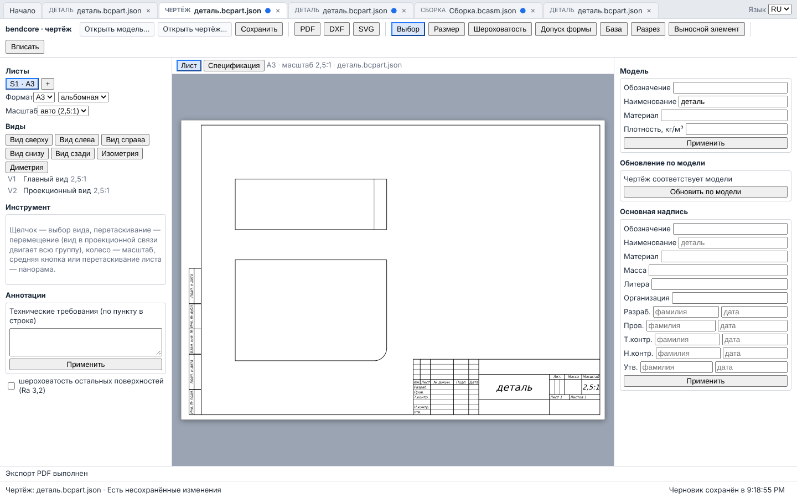

# 2. Оболочка и файлы

Оболочка (application shell) объединяет редакторы детали, сборки, чертежа и просмотр STEP
в одной странице с вкладками.

## 2.1. Стартовая страница

Вкладка «Начало» всегда первая. На ней:

| Блок | Что делает |
|---|---|
| «Создать» | «Новая деталь», «Новая сборка», «Просмотр STEP» — открывают новую вкладку |
| «Открыть» | «Открыть файл…» — выбор одного или нескольких файлов JSON. Тип определяется по полю `format` внутри файла, а не по расширению: `bendcore-part` — деталь, `bendcore-assembly` — сборка, `bendcore-drawing` — чертёж. Чертёж выбирается **вместе с файлом своей модели**, иначе выводится «Чертёж … открывается вместе с файлом его модели» |
| «Последние файлы» | до 12 записей, новые сверху; запись появляется при сохранении (Ctrl+S или кнопка) и при открытии файла; «Убрать из списка» — крестик у записи |
| «Несохранённые черновики» | появляется, если в прошлой сессии остались несохранённые изменения: «Восстановить» или «Отбросить» (раздел 11) |
| Горячие клавиши | строка-подсказка внизу страницы (раздел 12) |

Файл, который не является JSON или имеет другой `format`, не открывается; в строке статуса
появляется уведомление «Не удалось определить тип файла … ».

## 2.2. Вкладки

- Каждая вкладка — свой редактор и свой экземпляр модуля ядра в отдельном фоновом потоке.
  Неактивные вкладки скрыты, но продолжают жить: состояние, история отмены и выбор не
  теряются при переключении.
- Точка ● у имени — в документе есть несохранённые изменения.
- Контекстное меню вкладки (правый щелчок): «Закрыть вкладку», «Закрыть остальные».
  Закрытие изменённой вкладки спрашивает подтверждение; черновик при этом удаляется.
- Переходы между документами:
  - деталь → «Создать чертёж»: чертёж открывается по текущему состоянию детали (вместе с
    кэшем геометрии — деталь не перестраивается заново);
  - сборка → «Открыть деталь компонента»: открывает вкладку детали, из которой был вставлен
    выбранный компонент. Для компонента из STEP, из подсборки или из сборки, открытой с
    диска, команда сообщает, что деталь bendcore недоступна: файл сборки хранит только
    геометрию (BRep), а исходный документ детали держит в памяти редактор.

Каждая вкладка занимает не меньше 128 МБ памяти WebAssembly; при многих открытых вкладках
закрывайте ненужные.

## 2.3. Строка статуса и уведомления

Внизу страницы: тип и имя активного документа, «Есть несохранённые изменения» /
«Сохранено», время записи черновика, уведомления (ошибки хранилища, неизвестный тип файла,
необработанные ошибки). Ошибки ядра (код и текст, например `InvalidInput: …`)
показываются в строке ошибки самого редактора, под его панелью инструментов.

## 2.4. Долгие операции и «Прервать»

Если вызов ядра длится дольше 300 мс, на панели инструментов редактора появляется
индикатор: вид операции («перестроение», «загрузка», «решение сборки», «проверка
пересечений», «расчёт видов (HLR)», «экспорт») и прошедшие секунды. Доля выполненного не
показывается — ядро её не сообщает.

Кнопка «Прервать» немедленно останавливает фоновый поток, затем редактор запускает его
заново и загружает документ из снимка после последней завершённой операции. Что теряется:

| Редактор | Теряется при прерывании |
|---|---|
| Деталь | прерванное изменение; всё, что сделано в открытой панели операции или в эскизе; история отмены/повтора; выбор |
| Сборка | прерванное изменение; история отмены; результат проверки пересечений; разнесённый вид сбрасывается |
| Чертёж | прерванное изменение; отчёт обновления по модели |

Перезапуск занимает несколько секунд: модуль ядра загружается заново.

## 2.5. Язык

Переключатель «Язык» (RU/EN) в полосе вкладок. Выбор запоминается в браузере. На
английский переводятся оболочка, индикатор, уведомления и команды «Создать чертёж» /
«Открыть деталь компонента»; панели редакторов остаются на русском.

## 2.6. Типы файлов

| Документ | Формат (`format`, версия) | Имя по умолчанию при сохранении |
|---|---|---|
| Деталь | `bendcore-part`, 3 | `деталь.bcpart.json` |
| Сборка | `bendcore-assembly` | `<имя сборки>.bcasm.json` |
| Чертёж | `bendcore-drawing`, 2 | `<обозначение>.drawing.json` + модель `<обозначение>.part.json` или `.assembly.json` |

Сохранение — всегда скачивание файла браузером; запись в произвольное место диска не
поддерживается. Подробности форматов и обмена — раздел 9.

## Где проверено

- Стартовая страница, вкладки, меню вкладки, язык: `src/ui/app/AppShell.tsx`,
  `src/ui/app/i18n.ts`; тип файла — `detectKind` в `src/ui/app/storage.ts`; до 12 последних
  файлов — `RECENT_LIMIT` там же. Тесты: `src/ui/app/__tests__/appLogic.test.ts`,
  `tests/e2e-app/app_shell.spec.ts` (сценарии 1 и 3).
- Индикатор (300 мс) и прерывание: `src/ui/app/BusyIndicator.tsx`, `src/ui/worker/wasmClient.ts`,
  таблица снимков — `docs/ui/APP_SHELL.md`; сценарий 3 `tests/e2e-app/app_shell.spec.ts`
  (долгий HLR, «Прервать», чертёж восстановлен).
- Имена файлов: `src/ui/modeling/PartModelerApp.tsx` (`NEW_FILE_NAME`),
  `src/ui/assembly/AssemblyApp.tsx`, `src/ui/drawing/DrawingEditorApp.tsx` (`onSave`).
