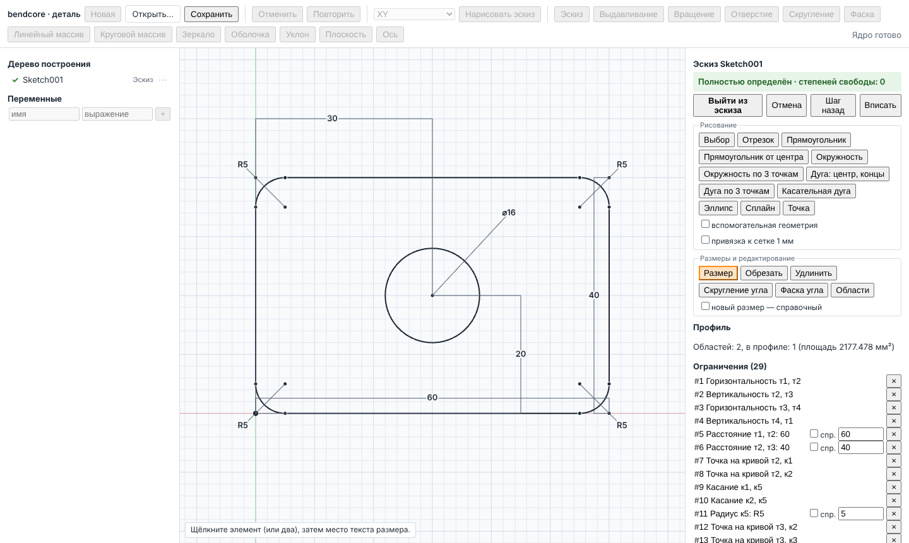

# 3. Эскиз

Эскиз (sketch) — плоский контур с геометрическими ограничениями (constraints) и размерами
(dimensions), по которому строятся выдавливание, вращение и отверстия. Решатель
ограничений — PlaneGCS внутри ядра; на экране показывается решение ядра, а не геометрия,
нарисованная интерфейсом.

## 3.1. Как создать и открыть эскиз

Есть два способа.

1. **Редактор эскиза** (рекомендуется). Выберите плоскость в списке на панели
   инструментов детали — «XY», «XZ», «YZ» или «выбранная грань» (сначала щёлкните плоскую
   грань во вьюпорте) — и нажмите «Нарисовать эскиз». Существующий эскиз открывается
   командой «Редактировать эскиз» в меню узла дерева (⋯ или правый щелчок).
   - «Выйти из эскиза» — применить, перестроить деталь; всё сделанное в эскизе — одна
     запись истории отмены.
   - «Отмена» — выйти без изменений (новый эскиз исчезает).
   - «Шаг назад» (Ctrl+Z) — отменить последнее действие внутри эскиза.
   - «Вписать» — показать весь эскиз.
2. **Панель «Эскиз»** (кнопка «Эскиз» на панели инструментов) — эскиз по шаблону:
   прямоугольник (угол X/Y, ширина, высота), окружность (центр, радиус) или полилиния
   (вершины «x; y» по одной в строке); параметры размещения — плоскость, смещение, начало.
   Числа — выражения (раздел 6). «Редактировать» у такого узла меняет только размеры, не
   структуру: имена граней и рёбер и ссылки ниже по дереву сохраняются.

Плоскости эскиза: XY (нормаль +Z), XZ (нормаль −Y, ось X эскиза = +X, Y = +Z), YZ (нормаль
+X, X = +Y), плоская грань (нормаль наружу из материала), вспомогательная плоскость
(операция «Плоскость»); параметр «Смещение, мм» сдвигает плоскость по нормали.

## 3.2. Вид и навигация

Плоскость показывается по нормали, тело на входе узла — под ортографической камерой.
Колесо — масштаб к курсору; средняя или правая кнопка — сдвиг; «Вписать». Сетка с шагом
1-2-5·10ⁿ мм, оси X и Y, начало координат.

## 3.3. Привязки

Радиус захвата 8 пикселей. Порядок приоритета: точка (конец, центр, точка) →
пересечение кривых → середина → начало координат → точка на кривой → горизонталь или
вертикаль от предыдущей точки инструмента → сетка 1 мм (флажок «привязка к сетке 1 мм»).
У курсора показывается маркер с подписью привязки.

## 3.4. Инструменты рисования

| Инструмент | Щелчки | Примечание |
|---|---|---|
| «Отрезок» | начало, конец, … | цепочка продолжается до Esc или двойного щелчка |
| «Прямоугольник» | первый угол, противоположный угол | 4 ограничения H/V |
| «Прямоугольник от центра» | центр, угол | ещё симметрия углов относительно центра |
| «Окружность» | центр, точка на окружности | |
| «Окружность по 3 точкам» | три точки | |
| «Дуга: центр, концы» | центр, начало, конец | |
| «Дуга по 3 точкам» | начало, конец, точка на дуге | |
| «Касательная дуга» | конец отрезка или дуги, конец дуги | начинается касательно к кривой, которая кончается в выбранной точке |
| «Эллипс» | центр, конец большой оси, точка на эллипсе | |
| «Сплайн» | полюса, Enter — завершить | B-сплайн по полюсам (контрольным точкам), степень min(3, n − 1) |
| «Точка» | положение | отдельные точки служат центрами отверстий (раздел 4) |

Флажок «вспомогательная геометрия» (construction geometry) рисует кривые, которые не
участвуют в профиле. Кнопка «Вспомогательная ⇄ основная» переключает выбранные кривые.

**Автоматические ограничения при рисовании:** привязка к точке — совпадение с ней; к началу
координат — закреплённая точка (0, 0); к середине — «Середина»; к кривой — «Точка на
кривой»; к пересечению — две «Точки на кривой»; отрезок в пределах 2° от оси —
горизонтальность или вертикальность; окружность с ободом на точке — точка на окружности;
касательная дуга — касание.

## 3.5. Ограничения

Инструмент «Выбор»: щелчок выбирает точку или кривую, Shift — добавить к выбору. Панель
«Выбрано» предлагает только ограничения, применимые к выбору:

| Ограничение | Применяется к |
|---|---|
| Совпадение, Середина, Точка на кривой | точке и точке / кривой |
| Горизонтальность, Вертикальность | отрезку или двум точкам |
| Параллельность, Перпендикулярность | двум отрезкам |
| Касание | двум кривым |
| Равенство (длин, радиусов) | двум отрезкам, двум окружностям/дугам |
| Симметрия (ось) / Симметрия (точка) | двум точкам и оси / двум точкам и центру |
| Концентричность | двум окружностям/дугам |
| Закрепление | точке |
| Поворот | точкам (ставится круговым массивом) |

Удаление — кнопка «Удалить» или Delete; номера остальных ограничений пересчитываются.
Список «Ограничения (N)» внизу панели — все ограничения с номерами, значениями и кнопкой
удаления.

## 3.6. Размеры

Размеры — тоже ограничения: расстояние, по X, по Y, расстояние точки до кривой, радиус,
диаметр, угол, длина дуги, большая и малая полуоси эллипса.

1. Инструмент «Размер»: щёлкните элемент (или два), затем место текста.
   - окружность — диаметр, дуга — радиус, отрезок — длина;
   - две точки — по месту текста: выше или ниже обеих — размер по X, правее или левее —
     по Y, иначе — расстояние.
2. Новый размер сначала ставится справочным: ядро измеряет его, и поле показывает текущее
   значение. Введите значение или выражение с переменными документа (раздел 6) и нажмите
   Enter — размер станет управляющим (driving).
3. Флажок «новый размер — справочный» оставляет размер справочным (reference, driven):
   он только измеряет.
4. Двойной щелчок по тексту размера — правка выражения. Текст можно перетащить (смещение
   хранится только до перезагрузки страницы). В списке: значение, «спр.» — переключение
   «справочный ⇄ управляющий» (управляющий получает измеренное значение), удаление.

Углы задаются в градусах.

## 3.7. Определённость и диагностика

Статус над кнопками:

| Статус | Значение | Цвет элементов |
|---|---|---|
| «Полностью определён · степеней свободы: 0» | нет свободных параметров и нет лишних ограничений | чёрные |
| «Недоопределён · степеней свободы: N» | остаются N степеней свободы | недоопределённые — синие |
| «Переопределён» | есть конфликтующие или избыточные ограничения | конфликтующие — красные, избыточные — оранжевые |
| «… · решатель не сошёлся» | решение не найдено | |

Списки «Конфликтующие ограничения» и «Избыточные ограничения» перечисляют номера; их строки
и тексты размеров подсвечены. Как исправить:

- **Конфликт** (например, ширина задана дважды разными числами): удалите одно из
  перечисленных ограничений или сделайте его справочным («спр.»). Эскиз с конфликтом в
  детали не строится — узел получает состояние «ошибка» с номерами ограничений.
- **Избыточность** (то же значение задано дважды): эскиз строится, узел получает
  «предупреждение»; удалите лишнее ограничение.
- **Недоопределённость**: эскиз строится, но может «поплыть» при правках. Добавляйте
  размеры и ограничения к синим элементам, пока число степеней свободы не станет 0.

Определённость элемента ядро оценивает эвристически (по зависимым параметрам разложения
PlaneGCS): в вырожденных положениях (совпадающие точки) элемент может быть показан
недоопределённым, хотя он определён.

## 3.8. Перетаскивание

В инструменте «Выбор» свободную точку можно тянуть мышью: каждое положение решается ядром,
ограничения сохраняются (точка, которая может двигаться лишь вдоль одного направления,
следует за курсором в нём). Закреплённую точку тянуть нельзя. Перетаскивания кривой целиком
и изменения радиуса мышью нет.

## 3.9. Инструменты редактирования

| Инструмент | Как | Что получается |
|---|---|---|
| «Обрезать» (trim) | щелчок по участку кривой, который нужно удалить | участок между ближайшими пересечениями с любыми кривыми эскиза (включая вспомогательные и проекции рёбер) удаляется; отрезок, дуга, окружность, эллипс, дуга эллипса, сплайн; окружность становится дугой, эллипс — дугой эллипса, замкнутый сплайн — незамкнутым (нужно ≥ 2 пересечений); средний участок — кривая делится на две |
| «Удлинить» (extend) | щелчок по кривой у конца | конец отрезка, дуги, дуги эллипса или сплайна продлевается до ближайшего пересечения |
| «Скругление угла» | поле «Радиус, мм», щелчок по вершине двух отрезков | касательная дуга; вершина угла остаётся «виртуальной», размеры до неё сохраняются |
| «Фаска угла» | поля «Катет 1, мм», «Катет 2, мм», щелчок по вершине | новый отрезок |
| «Эквидистанта» | выбрать цепочку (отрезки, дуги, дуги эллипса, сплайны) или одну замкнутую кривую, поле «Эквидистанта, мм» (плюс — влево по направлению цепочки, минус — вправо), флажок «в обе стороны», «Углы: продлить / скруглить» | смещённая цепочка с одним размером «Смещение»: правка этого размера смещает всю цепочку (и вторую сторону); остальные смещения показаны в списке как «= размер #k» |
| «Зеркало (ось — последний отрезок)» | выбрать кривые, последним — отрезок-ось | отражённые копии, связанные симметрией и равенством радиусов / малых полуосей |
| «Линейный массив» | выбрать кривые, «Шаг X», «Шаг Y», «Количество» | копии со сдвигом, связанные размерами |
| «Круговой массив (центр — точка)» | выбрать кривые и одну точку-центр, «Количество», «Шаг угла, °» | повёрнутые копии; копия k — исходная, повёрнутая на k·шаг вокруг центра |
| «Проекция рёбер» | щелчок по ребру или грани тела, видимого под эскизом | проекция ребра (грани — всех её рёбер) на плоскость эскиза; её точки закреплены, при изменении модели проекция пересчитывается |

Эскиз с конфликтом ограничений не редактируется этими инструментами. Копии зеркала и массивов
и смещения эквидистанты следуют за исходными кривыми при изменении размеров.

**Что происходит с ограничениями при обрезке.** Сохранённый конец кривой остаётся той же
точкой со всеми ограничениями; новый конец получает «Точку на кривой» с режущей кривой (кроме
сплайна-резака); удалённый конец передаёт свои горизонтальность и вертикальность новому концу.
Две части разрезанного отрезка лежат на одной прямой, дуги — общий центр и равные радиусы,
дуги эллипса — общие центр, фокус и равные полуоси. Размеры окружности и эллипса переходят на
получившуюся дугу. У сплайна новые полюса держат форму относительно сохранённого конца, а конец
у разреза скользит по режущей кривой. Подробно — `docs/modeling/SKETCH.md`, «Правила
ограничений обрезки и удлинения».

**Эквидистанта сплайна и эллипса** — приближение сплайном (точность 1e-6 размера эскиза);
при правке размера «Смещение» точно смещаются отрезки, дуги и окружности, а сплайн-смещение
сохраняет свою форму. В режиме «продлить» выпуклый угол рядом со сплайном всё равно
скругляется.

## 3.10. Профиль и области

Блок «Профиль» показывает замечания профиля (незамкнутый контур, ветвление — больше двух
концов в точке, пересечение или наложение кривых не в общем конце, вырожденная кривая,
самопересечение сплайна; `docs/modeling/SKETCH_PROFILE.md`, «Диагностика»), число
областей и площадь выбранных. По умолчанию в профиль входят «материальные» области
(внешние контуры и острова). Инструмент «Области»: щелчок внутри области включает или
исключает её; выбранные залиты. Хотя бы одна область должна остаться выбранной.

Эскиз без замкнутых кривых допустим (например, только точки для отверстий), но
выдавливание такого эскиза завершится ошибкой «has no closed profile».

## 3.10а. Импорт DXF в эскиз

Кнопка «Импорт DXF…» под кнопками редактора эскиза открывает панель «Импорт DXF».

1. Выберите файл `.dxf` (ASCII, любой версии от R12 до R2018). Ядро читает его и показывает
   слои файла с числом кривых на каждом; по умолчанию выбраны все слои, кроме замороженных и
   выключенных. Снимите флажки слоёв, которые не нужны (размеры, оси, рамка).
2. «Единицы»: если в файле есть `$INSUNITS`, выбран вариант «из файла» (например, «дюйм из
   файла ($INSUNITS = 1)»); можно выбрать другие. Для файла без единиц (так пишут R12 и многие
   старые программы) показывается предупреждение и берутся миллиметры — выберите нужные.
3. «Допуск совпадения концов, мм» (по умолчанию 0,001): концы отрезков и дуг ближе допуска
   становятся одной точкой эскиза, поэтому контур из отдельных LINE и ARC замыкается.
   «Закрепить точки» — все импортированные точки закреплены (эскиз сразу определён).
4. Сводка под параметрами обновляется при каждом изменении: число отрезков, дуг, окружностей
   и полилиний, точек и совмещённых концов, габарит, «Все контуры замкнуты» или «Незамкнутых
   концов: N», типы, которые не поддерживаются (SPLINE, ELLIPSE, INSERT, HATCH…), пропущенные
   тексты и примитивы пространства листа.
5. «Вставить в эскиз» добавляет кривые к уже нарисованным одним шагом («Шаг назад» убирает
   весь импорт). Строка «Импортировано кривых: N; незамкнутых концов: M» — незамкнутые концы
   выделены на эскизе: здесь контур разорван, увеличьте допуск или дорисуйте отрезок.

Полилинии с выпуклостью (bulge) превращаются в дуги, окружности — в окружности. Ограничения
(горизонтальность, касание) не распознаются — эскиз недоопределён, пока вы не добавите
размеры или не закрепите точки. Подробно — `docs/ui/SKETCH_EDITOR.md`, «Импорт DXF».

## 3.11. Ограничения редактора эскиза

- Сплайн задаётся полюсами, а не точками, через которые он проходит; точка на сплайне и
  касание сплайна вне концов не поддерживаются.
- Рамочного выбора нет.
- Эскиз на грани или на вспомогательной плоскости, который ещё ни разу не построился, не
  открывается (неизвестна система координат).
- Проекция рёбер: проецируются рёбра тела, на котором рисуется эскиз; во время редактирования
  проекции закреплены в положениях последнего построения узла (модель в это время не
  меняется). Сплайн-проекция требует, чтобы при изменении модели у ребра сохранилось число
  полюсов; ребро, перпендикулярное плоскости эскиза, пропускается.
- Смещения текстов размеров не сохраняются в файле.
- Импорт DXF: сплайны, эллипсы, блоки, штриховки, размеры и тексты не импортируются;
  пересекающиеся кривые не разрезаются; импортированные точки не совмещаются с точками, уже
  бывшими в эскизе.

## Где проверено

- Интерфейс: `src/ui/modeling/sketch/SketchEditor.tsx`, `drawTools.ts`, `snap.ts`,
  `sketchModel.ts`, `sketchLabels.ts`; описание — `docs/ui/SKETCH_EDITOR.md`.
- Тесты: `tests/e2e-modeling/sketch_editor.spec.ts` (определённость, конфликт, «спр.»,
  области, все инструменты кривых, касательная дуга, перетаскивание, обрезка, «Шаг назад»,
  «Отмена»); `tests/e2e-modeling/sketch_tools.spec.ts` (эквидистанта со скруглением и правкой
  размера, обрезка эллипса, круговой массив, проекция грани и её пересчёт);
  `tests/wasm/sketch_editor.test.mjs` (диагностика, перетаскивание, скругления, фаска, зеркало,
  массив, эквидистанта, проекция); `src/ui/modeling/sketch/__tests__/sketchEditorLogic.test.ts`,
  `sketchTools.test.ts`; ядро — `tests/modeling/test_modeling_sketch_tools.cpp` (длины, точки
  пересечения, площади против формул).
- Импорт DXF: `src/wasm/dxf_sketch_bindings.cpp`, `src/ui/modeling/sketch/DxfImportPanel.tsx`;
  тесты `tests/wasm/dxf_sketch.test.mjs` (файлы ezdxf и лист `bendcore_drawing_v2`, площадь и
  объём против формул), `tests/e2e-modeling/dxf_import.spec.ts`,
  `src/ui/modeling/sketch/__tests__/dxfImport.test.ts`.
- Решатель и инструменты ядра: `docs/modeling/SKETCH.md`, тесты `test_sketch2d`, `test_planegcs`.
- Панель шаблонов эскиза: `src/ui/modeling/FeaturePanel.tsx`, `tests/e2e-app/app_shell.spec.ts`.
