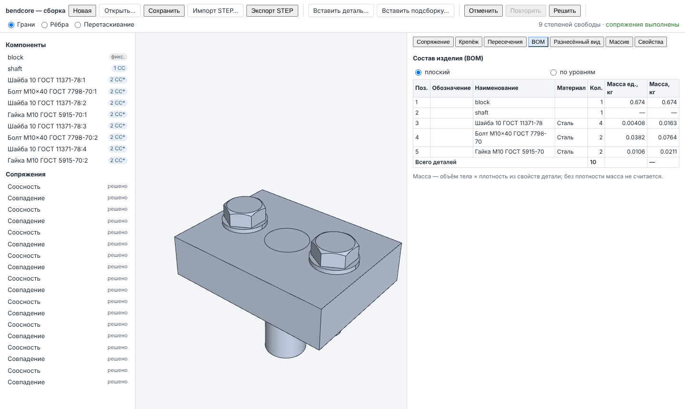

# 7. Сборка

Документ сборки (assembly) содержит вхождения (occurrences) деталей и подсборок, сопряжения
(mates) между ними, массивы компонентов и разнесённые виды. После каждой правки решатель
сопряжений пересчитывает положения; правка, которую решить нельзя, отклоняется и в историю
не попадает.

## 7.1. Панель инструментов

| Кнопка | Действие |
|---|---|
| «Новая», «Открыть…», «Сохранить» | документ сборки `bendcore-assembly` (JSON). «Открыть…» принимает несколько файлов: все регистрируются как источники подсборок по имени файла, открывается первый |
| «Импорт STEP…», «Экспорт STEP» | сборка из STEP со структурой; экспорт по схеме AP214 (раздел 9) |
| «Вставить деталь…» | документ детали `.json` или `.step/.stp` |
| «— деталь из открытых —» + «Вставить» | (в оболочке) деталь из открытой вкладки или из последних файлов |
| «Вставить подсборку…» | файл сборки как подсборка |
| «Открыть деталь компонента» | (в оболочке) открыть вкладку детали выбранного компонента (раздел 2) |
| «Отменить», «Повторить» | история; подсказка — имя шага |
| «Решить» | принудительно перерешить сопряжения |
| «Грани / Рёбра / Перетаскивание» | режим вьюпорта: что выбирает щелчок, или перетаскивание компонента |
| Итог | «N степеней свободы» и «сопряжения выполнены» / «есть противоречия» |

Первая деталь пустой сборки фиксируется; следующие ставятся рядом с габаритом сборки (на
20 мм правее по +X, низом на уровне низа сборки). Повернуть деталь при вставке из
интерфейса нельзя — поверните её перетаскиванием или сопряжениями.

## 7.2. Дерево сборки

- **Компоненты**: вложенные вхождения подсборок — с отступом; значок степеней свободы:
  «фикс.», «1 СС», «6 СС»… При наведении: «Фиксировать» / «Освободить», «Подавить» / «Вкл.»,
  удаление.
- **Сопряжения** с состоянием: «решено», «избыточно», «противоречит», «не решено», «ссылка
  потеряна», «подавлено»; подавление и удаление; щелчок показывает элементы сопряжения в
  панели.
- **Массивы**: вид, исходный компонент и число экземпляров; удаление.

Delete удаляет выбранный компонент, Esc сбрасывает выбор и слоты сопряжения.

## 7.3. Сопряжения

Панель «Сопряжение»: щелчки во вьюпорте заполняют слоты A и B (повторный щелчок убирает
элемент). Типы, которые не принимают выбранную пару, недоступны; предлагается
естественный тип.

| Тип | Допустимые пары | Значение |
|---|---|---|
| «Совпадение» (coincident) | плоскость–плоскость, точка–точка/плоскость/ось, ось–ось | — |
| «Соосность» (concentric) | цилиндр/ось – цилиндр/ось | — |
| «Расстояние» | плоскость–плоскость, точка–плоскость/точка | мм |
| «Угол» | любые два элемента с направлением (плоскость, ось, цилиндр) | ° |
| «Параллельность», «Перпендикулярность» | то же | — |
| «Касание» | плоскость–цилиндр/сфера, цилиндр–цилиндр; флажок «внутреннее касание (цилиндры)» | — |
| «Жёсткая связь» (rigid) | любые | — |

«Ориентация» («Сторона» для касания): «ближайшая», «сонаправлено», «встречно». Круговое
ребро даёт ось и центр. Два элемента одного компонента сопрячь нельзя — «Добавить
сопряжение» недоступна. Значения — числа, не выражения.

## 7.4. Степени свободы и диагностика

Свободный компонент имеет 6 степеней свободы (degrees of freedom, DOF); фиксированный — 0.
Решатель делит сборку на независимые подсистемы и считает степени свободы по каждой.
Значок «*» означает, что показано число степеней свободы **подсистемы** из нескольких
сопряжённых компонентов: разложения по отдельным компонентам решатель не даёт.

| Состояние сопряжения | Что значит | Что делать |
|---|---|---|
| «избыточно» | сопряжение ничего не добавляет (например, параллельность поверх соосности) | удалите или подавите его |
| «противоречит» | сопряжения подсистемы несовместимы (расстояние 10 поверх совпадения) | отчёт перечисляет участников; подавите или измените одно из них |
| «не решено» | решатель не сошёлся | проверьте значения, подвиньте компонент ближе к нужному положению и нажмите «Решить» |
| «ссылка потеряна» | элемент детали, на который ссылается сопряжение, не найден | подсказка у сопряжения показывает причину; удалите сопряжение и создайте заново |

Особенности решателя: он локальный — из текущего положения находит ближайшую ветвь
решения («вверх/вниз» у кривошипа, знак угла); угол не различает ±θ. В вырожденных
положениях (мёртвые точки) степеней свободы может показываться больше, чем в общем
положении. При противоречии ориентаций отчёт может назвать одно сопряжение, а не весь
набор.

## 7.5. Перетаскивание

Режим «Перетаскивание»: нажмите на деталь и тяните. Точка захвата движется в плоскости
захваченной грани (если грань плоская и не видна с ребра) или в плоскости, обращённой к
камере; на каждом шаге решатель удерживает сопряжения. Отпускание — один шаг истории
«Drag component». Фиксированную деталь тянуть нельзя; перетаскиваются вхождения верхнего
уровня (вложенное двигает свою подсборку). Для движения, перпендикулярного обеим
плоскостям, нужно несколько жестов.

## 7.6. Массивы компонентов

Панель «Массив», исходный компонент — выбранный в дереве:

| Вид | Поля |
|---|---|
| «линейный» | «Направление (x, y, z)», «Шаг, мм», «Количество (с исходным)» |
| «круговой» | «Ось: направление (x, y, z)», «Ось: точка (x, y, z)», «Угловой шаг, °», «Количество (с исходным)» |
| «по отверстиям детали» | исходное отверстие — щелчок по его грани во вьюпорте; экземпляры ставятся в отверстия того же массива детали |

Экземпляры массивов не участвуют в сопряжениях. Массив по отверстиям берёт смещение
перпендикулярно оси: отверстия на разных уровнях по оси дают экземпляры на уровне
исходного.

## 7.7. Крепёж из библиотеки

Панель «Крепёж» («Библиотека крепежа») ставит пакет «болт/винт — шайбы — гайка» в
отверстия:

1. Система: «ГОСТ» или «ISO» (смена системы сохраняет конструкцию через соответствующие
   стандарты).
2. «Болт / винт», «Размер» (ряд таблицы), «Длина, мм», «Шайба под головку», «Шайба под
   гайку», «Гайка» («нет» — без элемента). Под полями — обозначение и масса единицы.
3. Щёлкните цилиндрическую грань отверстия (слот «Отверстие»). Ось установки — ось
   отверстия; головка — со стороны камеры.
4. Флажок «во все отверстия этого диаметра и направления» (включён по умолчанию) или только
   выбранное отверстие. «Поставить крепёж».

Изделия с одинаковым обозначением используют одно определение — в BOM это одна позиция.

| Вид | ГОСТ | ISO | Ряд |
|---|---|---|---|
| Болт с шестигранной головкой | 7798-70 | 4014, 4017 | ГОСТ М6–М24; ISO М3–М24 |
| Винт с цилиндрической головкой и шестигранным углублением | 11738-84 | 4762 | М3–М24 |
| Гайка шестигранная | 5915-70 | 4032 | М3–М24 |
| Шайба плоская | 11371-78, исп. 1 | 7089 | 3–24 |
| Шайба пружинная | 6402-70 | — | **5–12** |
| Штифт цилиндрический | 3128-70 | 2338 | 3–20 |

Размер вне ряда — ошибка со списком доступных размеров (без экстраполяции). Короткий болт
(не хватает длины на пакет) и отсутствие отверстия нужного радиуса — ошибка, документ не
меняется.

> **⚠ Требует сверки.** Все таблицы крепежа записаны без доступа к официальным изданиям
> стандартов и помечены «не сверено» (`verified = false`); в панели рядом с описанием
> выводится «(таблица требует сверки)». Не используйте размеры и массы крепежа для
> выпуска документации, пока таблицы не сверены (`docs/STANDARDS_VERIFICATION.md`,
> `docs/assembly/FASTENERS.md`, раздел 1).

Ограничения: только крупный шаг резьбы; классы прочности, покрытия и исполнения не
задаются; предпочтительный ряд длин не проверяется; пакет ставится в отверстия с плоскими
торцами, перпендикулярными оси (цековка и зенковка с плоским дном распознаются как вход);
штифты пакетом не ставятся — их сопрягают вручную.

## 7.8. Проверка пересечений

Панель «Пересечения» → «Проверить»: сводка (число пересечений, касаний, пар, отобранных по
габаритам, объём пересечений) и список пар. Детали с пересечением подсвечиваются красным,
касания — жёлтым (флажок «показывать касания»); щелчок по паре подсвечивает только её.
Любая правка сборки сбрасывает отчёт. Для больших плотных сборок проверка занимает время
(точная булева операция на каждую пару-кандидата) — индикатор позволяет её прервать.

## 7.9. Состав изделия (BOM)

Панель «BOM»: «плоский» — по одной строке на деталь; «по уровням» — с подсборками и
номерами позиций вида 1.1. Колонки: «Поз.», «Обозначение», «Наименование», «Материал»,
«Кол.», «Масса ед., кг», «Масса, кг»; итог «Всего деталей» и общая масса.

Масса = объём тела × плотность из свойств детали. **Без плотности масса не считается**:
задайте её в панели «Свойства».

## 7.10. Свойства компонента

Панель «Свойства»: имя вхождения; обозначение, наименование, материал и плотность
определения детали (общие для всех её вхождений). Эти данные попадают в BOM и в
спецификацию.

## 7.11. Разнесённый вид

Панель «Разнесённый вид» (exploded view): шаги «выбранный компонент — направление ±X/±Y/±Z
— смещение» («Добавить шаг для выбранного компонента»), имя, «Создать вид». Ползунок от 0
до числа шагов (шаг 0,05) показывает промежуточные положения; документ при этом не
меняется. Смещаются только вхождения верхнего уровня.

## 7.12. Подсборки

«Вставить подсборку…» добавляет файл сборки как подсборку. Подсборка решается как жёсткое
тело (гибких подсборок нет) и доступна только для чтения — правьте её в её собственном
документе. При открытии сборки внешние подсборки берутся только из файлов, выбранных
вместе с ней в «Открыть…».

## Где проверено

- Интерфейс: `src/ui/assembly/AssemblyApp.tsx`, `AssemblyTree.tsx`, `AssemblyPanels.tsx`,
  `mateRules.ts` (допустимые пары), `labels.ts`; описание — `docs/ui/ASSEMBLY_UI.md`.
- Сквозные тесты: `tests/e2e-assembly/assembly.spec.ts` (вставка, соосность и совпадение,
  1 СС, перетаскивание с поворотом 45°…135°, крепёж М10×40, пересечений 0, плотность, BOM,
  Ctrl+Z / Ctrl+Y, разнесённый вид, сохранение и открытие, недоступная «Добавить» для
  одного компонента).
- API: `tests/wasm/assembly_document.test.mjs` (избыточные и противоречивые сопряжения,
  линейный массив, подсборка ×2, STEP туда и обратно, ошибки крепежа).
- Решатель: `docs/assembly/SOLVER.md` (раздел 5 «Ограничения»); документ —
  `docs/assembly/ASSEMBLY_DOCUMENT.md` (раздел 12); крепёж и статус таблиц —
  `docs/assembly/FASTENERS.md`, коды стандартов — `src/wasm/assembly_bindings.cpp`.
- Массив по отверстиям, круговой массив, касание и угол сквозным тестом интерфейса не
  покрыты — проверены нативными тестами `tests/assembly_v2/test_assembly_document_patterns.cpp`,
  `test_solver.cpp`, `test_assembly_document_mates.cpp`.
- Схема экспорта STEP из интерфейса (AP214 по умолчанию): `src/ui/assembly/AssemblyApp.tsx`
  (`exportStep()` без параметров), `src/wasm/assembly_bindings.cpp`.
