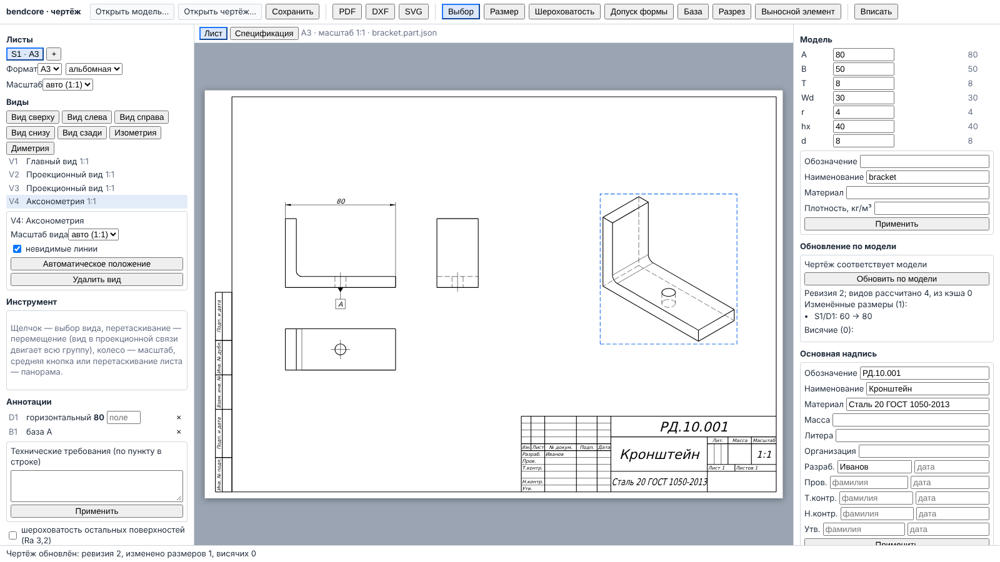

# 8. Чертёж

Документ чертежа (drawing) строится по документу детали или сборки. Виды — проекции модели
с удалением невидимых линий (hidden line removal, HLR), выполненные ядром; размеры и знаки
привязаны к элементам модели по устойчивым именам и пересчитываются при обновлении по
модели. Лист на экране — то же SVG, что уходит в экспорт.

## 8.1. Создание и открытие

| Способ | Что получается |
|---|---|
| «Создать чертёж» на странице детали (в оболочке) | чертёж текущего состояния детали, один пустой лист А3 альбомный |
| «Открыть модель…» | документ детали или сборки (JSON); сборка — только со встроенной геометрией деталей (так её сохраняет страница сборки) |
| «Открыть чертёж…» | выберите **два** файла: документ чертежа и его модель |

После открытия сохранённого чертежа выполняется первое обновление: если модель изменилась
с прошлого сеанса, отчёт покажет, что именно.

Для работы модулю нужен шрифт DejaVu Sans (раздел 8.13); без него чертёж не создаётся.

## 8.2. Листы

Левая панель «Листы»: вкладки листов, «+» — новый лист А3, «Формат» (А0–А4),
ориентация («альбомная» / «книжная»), «Масштаб» — «авто» (наибольший масштаб ряда
ГОСТ 2.302, при котором виды помещаются) или значение ряда (10:1, 5:1, 4:1, 2,5:1, 2:1,
1:1, 1:2, 1:2,5, 1:4, 1:5, 1:10, 1:20), «Удалить лист».

Рамка с полями 20/5 мм, основная надпись 185×55 мм в правом нижнем углу: первый лист —
форма 1 ГОСТ 2.104, последующие — форма 2а. Масштаб в основной надписи — масштаб листа.

Дополнительные форматы (А4×3 и т. д.) и форматы ISO 216 есть в ядре, но в интерфейсе не
выбираются.

## 8.3. Виды

Блок «Виды»:

1. **Главный вид** (base view): выберите стандартный вид («вид спереди», «сверху», …) и
   нажмите «Главный вид». На листе — ровно один главный вид.
2. **Проекционные виды**: «Вид сверху», «Вид слева», «Вид справа», «Вид снизу», «Вид сзади».
   Расположение — по методу первого угла (ЕСКД, ГОСТ 2.305): вид сверху — под главным,
   слева — справа от него, справа — слева, снизу — над главным, сзади — справа от вида
   слева.
3. **Аксонометрия**: «Изометрия» и «Диметрия» (ГОСТ 2.317, приведённые коэффициенты),
   вне проекционной связи.

Список видов показывает обозначение, тип и масштаб. Свойства выбранного вида: «Масштаб
вида» (только для вида вне проекционной связи), «Невидимые линии» (штриховые),
«Автоматическое положение», удаление (вместе с зависимыми видами и аннотациями; также
клавиша Delete).

**Перемещение**: в инструменте «Выбор» перетащите вид. Вид в проекционной связи двигает
всю группу (связь сохраняется); вид вне связи — только себя. Зазор между видами группы
мышью не меняется.

Навигация по листу: колесо — масштаб вокруг курсора, средняя кнопка или перетаскивание
свободного места листа — панорама, «Вписать».

## 8.4. Разрезы и выносные элементы

**«Разрез»** (section): выберите «Положение разреза» — «слева от вида», «справа от вида»,
«над видом», «под видом» или «вне проекционной связи» — и щёлкните точку на виде. Секущая
плоскость проходит через эту точку; разрез в проекционной связи изображается как
проекционный вид с выбранной стороны, разрез вне связи ориентирован как вид спереди. На
исходном виде ставится обозначение секущей плоскости (разомкнутая линия, стрелки, буквы),
над разрезом — надпись «А–А». Буквы назначаются по порядку без Ё, З, Й, О, Х, Ъ, Ы, Ь.
Штриховка — по ГОСТ 2.306 для металлов (45°, шаг по площади фигуры).

**«Выносной элемент»** (detail view): задайте «Радиус, мм модели» и щёлкните центр на виде.
На исходном виде — окружность с буквой, сам элемент — в увеличенном масштабе (по
умолчанию ближайший масштаб ряда не меньше 2× масштаба листа) с надписью «Б (4:1)».

Не реализованы: местный, ступенчатый и ломаный разрезы, наложенные и вынесенные сечения,
обозначение дополнительного вида стрелкой, линии обрыва; штриховка неметаллов; условности
ГОСТ 2.305 разд. 9 (рёбра жёсткости, валы и крепёж в разрезе штрихуются). В разрезе
сборки все детали штрихуются одинаково — ГОСТ 2.306 требует разного направления или шага
у смежных деталей, поэтому разрезы сборок для выпуска не годятся.

## 8.5. Размеры

Инструмент «Размер»: щёлкните два ребра одного вида — размер создаётся сразу; для одной
окружности или дуги — щелчок и Enter (или кнопка «Размер»). Повторный щелчок по ребру
снимает выбор, Esc — отмена.

| Выбор | Размер |
|---|---|
| окружность | диаметр «⌀» |
| дуга | радиус «R» |
| два очерка одного цилиндра (вид сбоку) | диаметр |
| две непараллельные прямые | угол |
| две вертикальные прямые, прямая и окружность, две окружности по горизонтали | горизонтальный |
| две горизонтальные прямые и т. п. | вертикальный |
| параллельные наклонные прямые | не ставится (ошибка) |

Размерная линия ставится снаружи вида. Значение берётся из геометрии вида, а не из
параметров модели. Оформление по ГОСТ 2.307: числа 3,5 мм, десятичная запятая, линии от
контура ≥ 10 мм.

Список «Аннотации» показывает тип, текст и состояние размера; «висячий» размер — с
причиной (раздел 8.11). Удаление — «×».

В интерфейсе нет: размеров к вершинам, цепочкой и от базы, между наклонными
параллельными прямыми (в ядре есть), перетаскивания размеров мышью, автоматической
расстановки без пересечений.

## 8.6. Допуски и посадки

В списке «Аннотации» у размера поле «поле»: введите обозначение поля допуска ISO 286 /
ГОСТ 25347 (`H7`, `h6`, `k6` …) и уйдите из поля — запись «⌀11H7». Поддерживаются квалитеты
IT01…IT18 для размеров до 500 мм; основные отклонения валов a…h, js, k, m, n, p, r, s и
отверстий A…H, JS, K, M, N, P, R, S. Не реализованы j/J, t…zc / T…ZC, CD, EF, FG и размеры
свыше 500 мм (ошибка `InvalidInput`).

> **⚠ Требует сверки.** Таблицы IT и основных отклонений и эталоны тестов выписаны без
> доступа к официальному тексту ISO 286 / ГОСТ 25346–25347; особенно строки r, s свыше 50 мм
> и a, b, c свыше 250 мм. Правило записи нулевого отклонения (ГОСТ 2.307) и размеры стрелок
> тоже не сверены. Проверяйте отклонения по таблицам стандарта.

## 8.7. Шероховатость

Инструмент «Шероховатость»: вид обработки («с удалением материала», «без удаления
материала», «вид обработки не устанавливается»), параметр (например, `Ra`) и значение
(`3,2`); щёлкните прямолинейное ребро. Знак ставится на самом длинном видимом участке
ребра, снаружи от центра вида. Флажок «шероховатость остальных поверхностей» ставит знак
«остальное» в правом верхнем углу листа.

У вогнутых контуров знак может оказаться со стороны материала — проверьте положение.

## 8.8. Допуски формы и расположения, базы

**«База»** (datum): «Буква базы», щелчок по прямолинейному ребру — треугольник и рамка с
буквой (ГОСТ 2.308).

**«Допуск формы»** (geometric tolerance): характеристика из 14 по ГОСТ 2.308 / ISO 1101
(прямолинейность, плоскостность, круглость, цилиндричность, форма заданного профиля и
поверхности, параллельность, перпендикулярность, наклон, позиционный, соосность,
симметричность, биение, полное биение), «Допуск» (значение), «Базы» (буквы); щелчок по
прямолинейному ребру. Рамка ставится горизонтально в 12 мм от линии с соединительной
линией и стрелкой. Допуск ориентации, расположения и биения без базы, а также допуск формы
с базой отвергаются; знак на окружности не ставится.

> **⚠ Требует сверки:** размеры знаков шероховатости (ГОСТ 2.309), рамок допусков и баз
> (ГОСТ 2.308), отступы знака «остальное» выбраны по рисункам стандартов.

## 8.9. Технические требования

Поле «Технические требования (по пункту в строке)» и «Применить». Текст ставится над
основной надписью колонкой до 185 мм, пункты нумеруются «1.», один пункт не нумеруется;
если текст не помещается до верха рамки — ошибка.

## 8.10. Основная надпись и свойства модели

Правая панель:

- «Свойства детали»: обозначение, наименование, материал, плотность — «Применить».
  Свойства хранятся в документе чертежа (в файле детали их нет).
- «Основная надпись»: «Обозначение», «Наименование», «Материал», «Масса», «Литера»,
  «Организация» и подписи «Разраб.», «Пров.», «Т.контр.», «Н.контр.», «Утв.» (фамилия и
  дата) — «Применить». Пустые графы обозначения, наименования, материала и массы
  заполняются из модели (подсказка в поле). Масса — в килограммах без единицы. У
  сборочного чертежа к обозначению добавляется «СБ», материал не пишется.

Наименование — одна строка; графы 24–26 не реализованы.

> **⚠ Требует сверки:** размеры граф основной надписи форм 1 и 2а и число строк изменений
> ГОСТ 2.104 (`docs/drawing/DRAWING_MODEL.md`).

## 8.11. Обновление по модели

Изменение модели (параметр в правой панели, правка детали) чертёж сразу не меняет. Блок
«Обновление по модели» показывает «Модель изменилась: видов к пересчёту …» или «Чертёж
соответствует модели». Кнопка «Обновить по модели» пересчитывает виды (неизменённые берутся
из кэша) и выводит отчёт: ревизия модели, виды пересчитанные и из кэша, изменённые размеры
(«S1/D1: 60 → 80»), висячие размеры и знаки с причиной.

**Висячий** (dangling) размер или знак — элемент модели, на который он ссылался, удалён,
подавлен, расщепился или не изображён на виде (например, ребро видно в точку). Висячий
размер не выводится на лист. Что делать: удалите его и поставьте заново; если элемент
вернулся (операцию сняли с подавления), следующее обновление восстановит размер.

## 8.12. Позиции и спецификация (сборочный чертёж)

Если модель — сборка:

- вкладка «Спецификация» показывает спецификацию по ГОСТ 2.106 по разделам (документация,
  сборочные единицы, детали, стандартные изделия) с позициями, обозначениями,
  наименованиями, количеством и примечаниями; для детали — причина, почему спецификации нет;
- флажок «Перечень составных частей» выводит перечень по ISO 7573 на поле листа;
- при экспорте PDF листы спецификации (форма 1, основная надпись форм 2 и 2а) добавляются
  после листов чертежа.

Позиции (ГОСТ 2.109), номера всегда совпадают со спецификацией:

- **автоматически** — выберите вид в списке видов и включите флажок «позиции по
  спецификации»: на видимых линиях составных частей этого вида ставятся линии-выноски с
  полками, колонной справа от вида;
- **вручную** — инструмент «Позиция» (доступен для сборки): щёлкните по линии детали — точка
  выноски, затем по месту полки на листе. Номер — позиция этой детали в спецификации; если для
  детали есть ручная позиция, автоматическая для неё на листе не ставится. В списке аннотаций
  ручная позиция показана с номером; «↺» возвращает полку на место по умолчанию, «×» удаляет
  позицию. Если ребро пропало с вида или деталь подавлена, позиция становится висячей и не
  рисуется;
- при изменении состава сборки номера пересчитываются при обновлении по модели;
- вкладка «Спецификация» показывает в колонке «на листе», сколько раз каждая позиция есть на
  текущем листе, и перечисляет позиции, у которых номера на листе нет.

Графа «Зона» не заполняется; листа регистрации изменений и раздела «Переменные данные для
исполнений» нет.

> **⚠ Требует сверки:** ширины граф спецификации формы 1, высоты строк, графы формы 2
> ГОСТ 2.104 (`docs/drawing/SPECIFICATION.md`).

Сборочный чертёж, спецификация и позиции проверены нативными тестами, тестом node и сквозным
тестом интерфейса на узле «вал + втулка + болты, шайбы, гайки».

## 8.13. Экспорт

| Кнопка | Результат |
|---|---|
| «PDF» | векторный PDF 1.4 всех листов (для сборки — и листов спецификации), масштаб 1:1 к формату листа, шрифт DejaVu Sans встроен целиком (файл ≈ 0,8 МБ), текст копируется и ищется |
| «DXF» | текущий лист, DXF AutoCAD R2000 (AC1015, ASCII), единицы — мм, слои по типам линий |
| «SVG» | текущий лист, SVG 1.1, `viewBox` в мм листа |

Шрифт: ГОСТ 2.304 тип Б не используется (нет свободного шрифта с пермиссивной лицензией);
вместо него DejaVu Sans со сжатием и наклоном 75°. Высота прописных выдерживается точно,
начертание букв — нет. Цвет в PDF и SVG — чёрный; цвет слоя — только в DXF. Эллипсы и
сплайны выводятся ломаными. Печать — через PDF.

## 8.14. Сохранение

«Сохранить» (Ctrl+S) скачивает один файл `<обозначение>.bcdrw.json` (формат
`bendcore-drawing-file`): документ чертежа (`bendcore-drawing`, версия 2) и модель (деталь или
сборка) с текущими параметрами. Обозначение берётся из основной надписи и записывается
латиницей; если его нет — по имени модели. Вычисленные виды не сохраняются — после открытия их
пересчитывает обновление.

Модель хранится внутри файла чертежа, поэтому изменения файла детали, сделанные после
создания чертежа, чертёж сам не видит. Чтобы перенести их, нажмите «Заменить модель…» и
выберите новый файл модели: чертёж откроется на нём, отчёт обновления покажет изменённые и
висячие размеры; «Сохранить» запишет чертёж уже с новой моделью.

Чертёж прежнего формата (два файла `*.drawing.json` и модель) открывается кнопкой «Открыть
чертёж…» при выборе обоих файлов сразу; строка состояния сообщает, что при сохранении он будет
записан одним файлом.

## 8.15. Ограничения редактора чертежа

- Нет отмены и повтора правок чертежа (Ctrl+Z не действует).
- Метод проецирования (первый/третий угол), зазор между видами и отступы — настройки
  документа; в интерфейсе не меняются (по умолчанию — первый угол, ЕСКД).
- Расчёт видов однопоточный: тяжёлые модели считаются заметное время (индикатор
  «расчёт видов (HLR)», «Прервать»).

## Где проверено

- Интерфейс: `src/ui/drawing/DrawingEditorApp.tsx` (панели, инструменты, экспорт,
  сохранение), `labels.ts` (виды, характеристики, масштабы), `sheetGeometry.ts`; описание —
  `docs/ui/DRAWING_UI.md`.
- Тесты: `tests/e2e-drawing/drawing_editor.spec.ts` (виды, размер 60, база, основная
  надпись, перемещение изометрии, обновление 60 → 80, PDF и DXF);
  `tests/wasm/drawing_document.test.mjs` (метод первого угла, размеры ⌀8H7, R4, 90°,
  шероховатость, допуски, разрез «А–А», выносной элемент, экспорт PDF/DXF/SVG, обновление,
  отказ для несуществующей детали); `src/ui/drawing/__tests__/sheetGeometry.test.ts`.
- Стандарты и ограничения: `docs/drawing/VIEWS.md`, `ANNOTATIONS.md`, `DRAWING_DOCUMENT.md`,
  `DRAWING_MODEL.md`, `SPECIFICATION.md`, `EXPORT.md`; сверка — `docs/STANDARDS_VERIFICATION.md`.
- Позиции: флажок вида и инструмент «Позиция» в `DrawingEditorApp.tsx` (`setView` /
  `autoBalloons`, `addBalloon`, `setBalloon`); сквозной тест
  `tests/e2e-drawing/assembly_balloons.spec.ts`, тест node «positions» в
  `tests/wasm/drawing_document.test.mjs`, нативный
  `DrawingDocumentAssembly.ManualPositionFollowsTheSpecification`. Файл чертежа —
  `src/ui/drawing/drawingFile.ts`, тест `src/ui/drawing/__tests__/drawingFile.test.ts`.
  Спецификация в PDF по умолчанию — `src/wasm/drawing_bindings.cpp` (`exportPdf`,
  `specification` = true).
