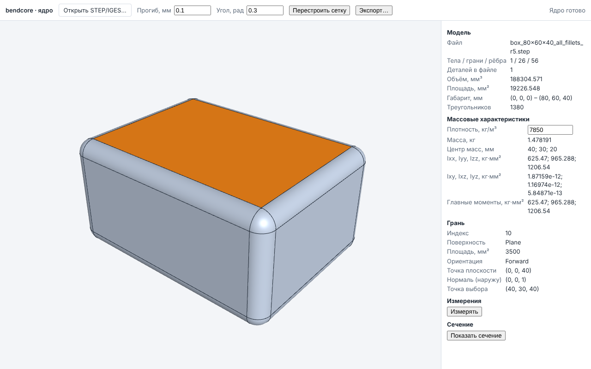

# 9. Импорт и экспорт

## 9.1. Сводная таблица

| Формат | Импорт в интерфейсе | Экспорт в интерфейсе | Где ещё есть |
|---|---|---|---|
| `bendcore-part` (JSON, v3) | «Открыть…» детали, «Открыть файл…» оболочки, «Вставить деталь…» сборки | «Сохранить» детали | — |
| `bendcore-assembly` (JSON) | «Открыть…», «Вставить подсборку…» сборки; «Открыть модель…» чертежа | «Сохранить» сборки | — |
| `bendcore-drawing` (JSON, v2) | «Открыть чертёж…» (с файлом модели) | «Сохранить» чертежа | — |
| STEP (AP203/214/242) | «Импорт STEP/IGES…» оболочки (деталь без истории или сборка); «Импорт STEP/IGES…» и «Вставить деталь…» сборки; «Просмотр STEP» | «Экспорт…» детали (через оболочку), сборки и импортированной модели: AP214 или AP242, единица мм/м/дюйм | ядро C++: чтение формы, сборки XCAF |
| PDF | — | «PDF» чертежа (все листы) | — |
| DXF | в эскиз детали: «Импорт DXF…» редактора эскиза (отрезки, дуги, окружности, полилинии с выпуклостью; слои, единицы, допуск совпадения концов) | «DXF» чертежа (текущий лист, R2000) | библиотека чтения DXF `bendcore_dxf` (C++); подложкой листа чертежа не импортируется |
| SVG | — | «SVG» чертежа (текущий лист) | — |
| IGES (5.3) | как STEP: «Импорт STEP/IGES…» оболочки и сборки, «Вставить деталь…» сборки | «Экспорт…»: тела (тип 186) или поверхности (тип 144) | ядро C++ `readIgesAssembly` / `writeIgesAssembly` |
| STL | **нет** (как опорная сетка не импортируется) | «Экспорт…»: двоичный или ASCII, прогиб и угол сетки | ядро C++ `bendcore_kernel_analysis` |
| 3MF | **нет** | «Экспорт…»: по объекту на деталь (вхождение) с цветом, мм; в веб-версии ZIP без сжатия | то же |

## 9.2. Собственные форматы

- **Деталь** хранит историю построения: переменные, дерево операций с выражениями, эскизы,
  ссылки (имя + сигнатура). При открытии деталь перестраивается. Из оболочки («Создать
  чертёж») деталь передаётся с кэшем геометрии BRep, чтобы не перестраивать. Файлы версий 1
  и 2 открываются с миграцией (старый тип `PrismCut` превращается в эскиз + вырез);
  сохраняется всегда версия 3. Плотность и смещения текстов размеров эскиза в файл детали
  не входят. История отмены не сохраняется.
- **Сборка** хранит компоненты, сопряжения, фиксацию, массивы, разнесённые виды, свойства
  деталей и по умолчанию встроенную геометрию деталей (BRep). Документ детали, из которого
  вставлен компонент, в файл сборки не входит.
- **Чертёж** хранит листы, определения видов, размеры и знаки со ссылками на модель, хэш
  модели и последние значения размеров; геометрия видов пересчитывается при открытии.
  Сохраняется и открывается вместе с файлом модели.

Ошибки открытия: не JSON, чужой формат, нет обязательных полей → `ParseError`; версия новее
поддерживаемой, неизвестный тип операции → `Unsupported`.

## 9.3. STEP

**Просмотр STEP** (стартовая страница) — вьюпорт ядра: открыть `.step/.stp`, показать
сетку, выбрать грань щелчком; панели «Модель» (тела, грани, рёбра, объём, площадь,
габарит, треугольники) и «Грань» (тип поверхности, площадь, ориентация, параметры —
радиус цилиндра, нормаль плоскости и т. п.); параметры сетки и «Перестроить сетку».

**Сборка**: «Импорт STEP…» создаёт сборку из структуры файла (имена, положения, цвета);
«Вставить деталь…» с файлом `.step` вставляет его как деталь (без истории построения:
ссылки сопряжений на такую деталь опираются на номер и тип элемента). «Экспорт STEP»
записывает структуру, имена, обозначения (PRODUCT `id`), наименования и цвета. В STEP **не
пишутся** сопряжения, фиксация, массивы, разнесённые виды, материал и плотность; подавленные
вхождения пропускаются. Отражение и масштаб в положениях при импорте отвергаются.

## 9.3a. Импорт STEP/IGES и экспорт (STEP, IGES, STL, 3MF)

Подробно — `docs/ui/DATA_EXCHANGE.md`.

**Импорт.** Стартовая страница → «Импорт STEP/IGES…» (`.step`, `.stp`, `.igs`, `.iges`).
Файл с одной деталью открывается вкладкой «Деталь без истории»: модель, тела/грани/рёбра,
объём, площадь, габарит, массовые характеристики, «Экспорт…». Дерева построения у такой
детали нет — это тело из файла. Файл с несколькими телами или сборкой открывается во вкладке
сборки (имена, цвета, положения); строка состояния сообщает «N деталей — открыт как сборка».
IGES из одних поверхностей (так пишут многие CAD) сшивается в тело — предупреждение показывается
под панелью инструментов. IGES не хранит структуру изделия: каждое тело становится деталью.

**Экспорт.** «Экспорт…» — в полосе вкладок оболочки (для активной детали, сборки или
импортированной модели), в панели инструментов сборки и просмотрщика. В диалоге — формат и его
параметры:

| Формат | Параметры | Что попадает в файл |
|---|---|---|
| STEP | протокол AP214 или AP242; единица мм, м, дюйм | тело (B-rep), имя; у сборки — структура, имена, обозначения, цвета |
| IGES | тела (тип 186) или поверхности (тип 144); единица | тела, имена, цвета; сборка — телами на своих местах |
| STL | двоичный или ASCII; прогиб, мм; угол, ° | одна треугольная сетка (вся сборка — одной сеткой) |
| 3MF | прогиб, угол | по объекту на деталь/вхождение, цвета, единица мм |

Сетка STL/3MF вписана в поверхность: её объём меньше объёма тела не более чем на площадь ×
прогиб. Деталь экспортируется в последнем завершённом состоянии (без открытой панели операции
или эскиза). В отдельной странице редактора детали (`web/part-modeler`) экспорта нет — только
в приложении (оболочке).

**Массовые характеристики.** Масса, центр масс, моменты инерции относительно центра масс
(Ixx, Iyy, Izz, произведения инерции) и главные моменты считает ядро:
- деталь — кнопка «Массовые характеристики» в полосе вкладок, плотность в панели;
- импортированная модель — раздел в панели «Модель»;
- сборка — вкладка «Свойства»: плотности задаются у деталей; детали без плотности
  перечислены и в массу не входят.

## 9.3в. Справочная сетка STL/3MF

Скан, модель из другой программы или файл для 3D-печати можно поставить в деталь или сборку как
**справочную сетку**: она видна полупрозрачной, по ней можно мерить и снимать контур, но она не
тело — не входит в массу, состав изделия (BOM), проверку пересечений, булевы операции и экспорт.

1. Деталь или сборка → панель «Справочные сетки» → «Вставить сетку STL…» → файл `.stl`
   (двоичный или текстовый) или `.3mf`. Файл встраивается в документ: при сохранении он
   записывается внутрь файла детали/сборки, отдельный файл больше не нужен.
2. Если сетка выглядит в 25,4 раза меньше — выберите «Единицы файла: дюймы» (STL не хранит
   единиц; 3MF хранит, и его координаты уже в мм). Смещение X, Y, Z и поворот вокруг X, Y, Z →
   «Применить». Видимость и непрозрачность — флажок и ползунок.
3. Измерения: «Измерять» → «Расстояние между элементами» → щёлкните по сетке: выбирается точка
   на треугольнике, возле вершины — сама вершина. Вторым элементом может быть точка сетки или
   грань/ребро детали.
4. Деталь: «Сечение в эскиз» — плоскость XY, XZ или YZ и смещение → в дереве появляется эскиз,
   контур которого — вспомогательные линии по сечению сетки. По ним рисуется свой профиль.
5. Сборка: сетка ставится смещением и поворотом; сопряжения к сетке не поддерживаются.

Пределы: файл до 128 МБ и до 4 млн треугольников; битый файл (обрезан, мусор, ошибка в
строке ASCII, нет треугольников ненулевой площади) не вставляется, сообщение говорит причину.
Нулевые треугольники отбрасываются (их число показано). Объём показывается только у замкнутой
сетки. 3MF из компонентов не поддерживается; в браузере 3MF читается только без сжатия.

## 9.3б. Импорт DXF в эскиз

Редактор эскиза → «Импорт DXF…» (раздел 3.10а): файл `.dxf` → выбор слоёв, единиц (из
`$INSUNITS` или вручную), допуска совпадения концов → сводка ядра (число кривых, незамкнутые
концы, неподдерживаемые типы) → «Вставить в эскиз». Дальше эскиз работает как нарисованный:
выдавливание, вращение, размеры, ограничения.

| В DXF | В эскизе |
|---|---|
| LINE | отрезок |
| ARC | дуга (против часовой стрелки) |
| CIRCLE | окружность |
| LWPOLYLINE, POLYLINE (2D) | отрезки и дуги по сегментам, выпуклость → дуга; замкнутая — с замыкающим сегментом |
| TEXT, MTEXT | не импортируются (считаются в сводке) |
| SPLINE, ELLIPSE, INSERT (блоки), HATCH, DIMENSION | не поддерживаются (перечислены в сводке) |
| пространство листа | не импортируется |

Ошибки: двоичный DXF — «Двоичный DXF не поддерживается»; повреждённый файл — «Ошибка чтения
файла» с номером строки в подробностях; неизвестный слой или код единиц — «Неверные входные
данные». Как подложка листа чертежа DXF пока не импортируется.

## 9.4. PDF, DXF, SVG

См. раздел 8.13. PDF — векторный, размер страницы по формату листа (А4 = 595,28 ×
841,89 pt), открывается сторонними программами в масштабе 1:1; DXF — R2000, `$INSUNITS` =
4 (мм), проверяется на совместимость с ezdxf в тестах.

## Где проверено

- Кнопки и расширения: `src/ui/assembly/AssemblyApp.tsx` (`IMPORT_ACCEPT`, `exportFile()`), `src/ui/kernel/KernelViewerApp.tsx`, `src/ui/drawing/DrawingEditorApp.tsx`
  (`onExport`), `src/ui/modeling/PartModelerApp.tsx`.
- Состав API модулей WASM (`exportFile`, `importModel`, `importIges`, `massProperties`,
  `ModelingKernel.dxfSketch`): `src/wasm/bendcore_*_api.d.mts`.
- Справочная сетка: `test_kernel_reference_mesh`, `test_modeling_document_reference_mesh`,
  `test_assembly_document_reference_mesh`, `tests/wasm/reference_mesh.test.mjs`,
  `tests/e2e-modeling/reference_mesh.spec.ts`, `tests/e2e-assembly/reference_mesh.spec.ts`;
  описание — `docs/kernel/ANALYSIS.md` (раздел 7), `docs/modeling/PART_DOCUMENT.md`,
  `docs/assembly/ASSEMBLY_DOCUMENT.md` (раздел 14).
- Импорт DXF в эскиз: `tests/wasm/dxf_sketch.test.mjs` (файлы ezdxf и `bendcore_drawing_v2`),
  `tests/e2e-modeling/dxf_import.spec.ts`; описание — `docs/ui/SKETCH_EDITOR.md`, «Импорт DXF».
- Обмен данными: `src/ui/exchange/`, `src/ui/app/AppShell.tsx`, `src/ui/kernel/KernelViewerApp.tsx`;
  тесты `tests/wasm/exchange.test.mjs`, `tests/e2e-app/exchange.spec.ts`, `test_kernel_iges`,
  `test_kernel_zip_archive`.
- Форматы: `docs/modeling/PART_DOCUMENT.md` («Формат файла»), `docs/assembly/ASSEMBLY_DOCUMENT.md`
  (разделы 9, 10), `docs/drawing/DRAWING_DOCUMENT.md` («Формат файла»), `docs/drawing/EXPORT.md`;
  STL/3MF — `docs/kernel/ANALYSIS.md`, раздел 3; DXF — `docs/drawing/DXF_IMPORT.md`.
- Тесты: `tests/wasm/assembly_document.test.mjs` (STEP туда и обратно — те же 18 положений),
  `tests/wasm/drawing_document.test.mjs` (`pdfinfo`, `pdftotext`, DXF), `tests/e2e-kernel/kernel_viewport.spec.ts`,
  `test_kernel_mesh_export` (STL/3MF, нативно).
