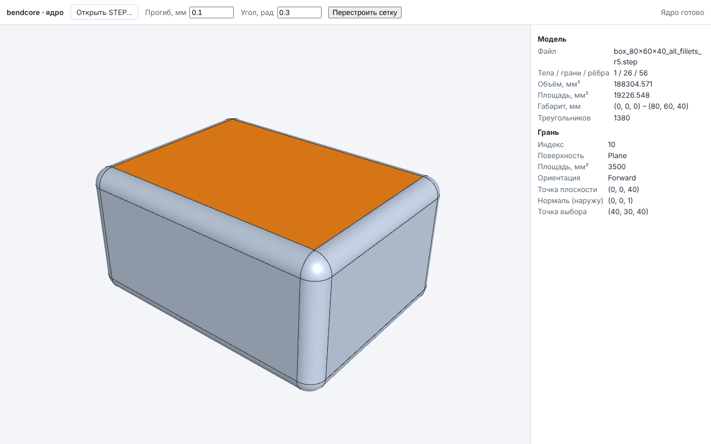

# 9. Импорт и экспорт

## 9.1. Сводная таблица

| Формат | Импорт в интерфейсе | Экспорт в интерфейсе | Где ещё есть |
|---|---|---|---|
| `bendcore-part` (JSON, v3) | «Открыть…» детали, «Открыть файл…» оболочки, «Вставить деталь…» сборки | «Сохранить» детали | — |
| `bendcore-assembly` (JSON) | «Открыть…», «Вставить подсборку…» сборки; «Открыть модель…» чертежа | «Сохранить» сборки | — |
| `bendcore-drawing` (JSON, v2) | «Открыть чертёж…» (с файлом модели) | «Сохранить» чертежа | — |
| STEP (AP203/214/242) | «Импорт STEP…» и «Вставить деталь…» сборки; «Просмотр STEP» | «Экспорт STEP» сборки (AP214) | ядро C++: чтение формы, сборки XCAF |
| PDF | — | «PDF» чертежа (все листы) | — |
| DXF | **нет** | «DXF» чертежа (текущий лист, R2000) | библиотека чтения DXF `bendcore_dxf` (C++), в интерфейс не выведена |
| SVG | — | «SVG» чертежа (текущий лист) | — |
| STL, 3MF | **нет** | **нет** | экспорт в ядре C++ (`bendcore_kernel_analysis`), в WASM-модули не входит |
| IGES | **нет** | **нет** | только в наследуемом коде трубного модуля (`src/step_reader.cpp`); в ядре и интерфейсе нет |

## 9.2. Собственные форматы

- **Деталь** хранит историю построения: переменные, дерево операций с выражениями, эскизы,
  ссылки (имя + сигнатура). При открытии деталь перестраивается. Из оболочки («Создать
  чертёж») деталь передаётся с кэшем геометрии BRep, чтобы не перестраивать. Файлы версий 1
  и 2 открываются с миграцией (старый тип `PrismCut` превращается в эскиз + вырез);
  сохраняется всегда версия 3. Плотность и смещения текстов размеров эскиза в файл детали
  не входят. История отмены не сохраняется.
- **Сборка** хранит компоненты, сопряжения, фиксацию, массивы, разнесённые виды, свойства
  деталей и по умолчанию встроенную геометрию деталей (BRep). Документ детали, из которого
  вставлен компонент, в файл сборки не входит.
- **Чертёж** хранит листы, определения видов, размеры и знаки со ссылками на модель, хэш
  модели и последние значения размеров; геометрия видов пересчитывается при открытии.
  Сохраняется и открывается вместе с файлом модели.

Ошибки открытия: не JSON, чужой формат, нет обязательных полей → `ParseError`; версия новее
поддерживаемой, неизвестный тип операции → `Unsupported`.

## 9.3. STEP

**Просмотр STEP** (стартовая страница) — вьюпорт ядра: открыть `.step/.stp`, показать
сетку, выбрать грань щелчком; панели «Модель» (тела, грани, рёбра, объём, площадь,
габарит, треугольники) и «Грань» (тип поверхности, площадь, ориентация, параметры —
радиус цилиндра, нормаль плоскости и т. п.); параметры сетки и «Перестроить сетку».

**Сборка**: «Импорт STEP…» создаёт сборку из структуры файла (имена, положения, цвета);
«Вставить деталь…» с файлом `.step` вставляет его как деталь (без истории построения:
ссылки сопряжений на такую деталь опираются на номер и тип элемента). «Экспорт STEP»
записывает структуру, имена, обозначения (PRODUCT `id`), наименования и цвета. В STEP **не
пишутся** сопряжения, фиксация, массивы, разнесённые виды, материал и плотность; подавленные
вхождения пропускаются. Отражение и масштаб в положениях при импорте отвергаются.

STEP детали из страницы детали не экспортируется.

## 9.4. PDF, DXF, SVG

См. раздел 8.13. PDF — векторный, размер страницы по формату листа (А4 = 595,28 ×
841,89 pt), открывается сторонними программами в масштабе 1:1; DXF — R2000, `$INSUNITS` =
4 (мм), проверяется на совместимость с ezdxf в тестах.

## Где проверено

- Кнопки и расширения: `src/ui/assembly/AssemblyApp.tsx` (`accept=".step,.stp"`,
  `exportStep()`), `src/ui/kernel/KernelViewerApp.tsx`, `src/ui/drawing/DrawingEditorApp.tsx`
  (`onExport`), `src/ui/modeling/PartModelerApp.tsx`.
- Состав API модулей WASM (нет STL/3MF/IGES/чтения DXF): `src/wasm/bendcore_*_api.d.mts`.
- Форматы: `docs/modeling/PART_DOCUMENT.md` («Формат файла»), `docs/assembly/ASSEMBLY_DOCUMENT.md`
  (разделы 9, 10), `docs/drawing/DRAWING_DOCUMENT.md` («Формат файла»), `docs/drawing/EXPORT.md`;
  STL/3MF — `docs/kernel/ANALYSIS.md`, раздел 3; DXF — `docs/drawing/DXF_IMPORT.md`.
- Тесты: `tests/wasm/assembly_document.test.mjs` (STEP туда и обратно — те же 18 положений),
  `tests/wasm/drawing_document.test.mjs` (`pdfinfo`, `pdftotext`, DXF), `tests/e2e-kernel/kernel_viewport.spec.ts`,
  `test_kernel_mesh_export` (STL/3MF, нативно).
