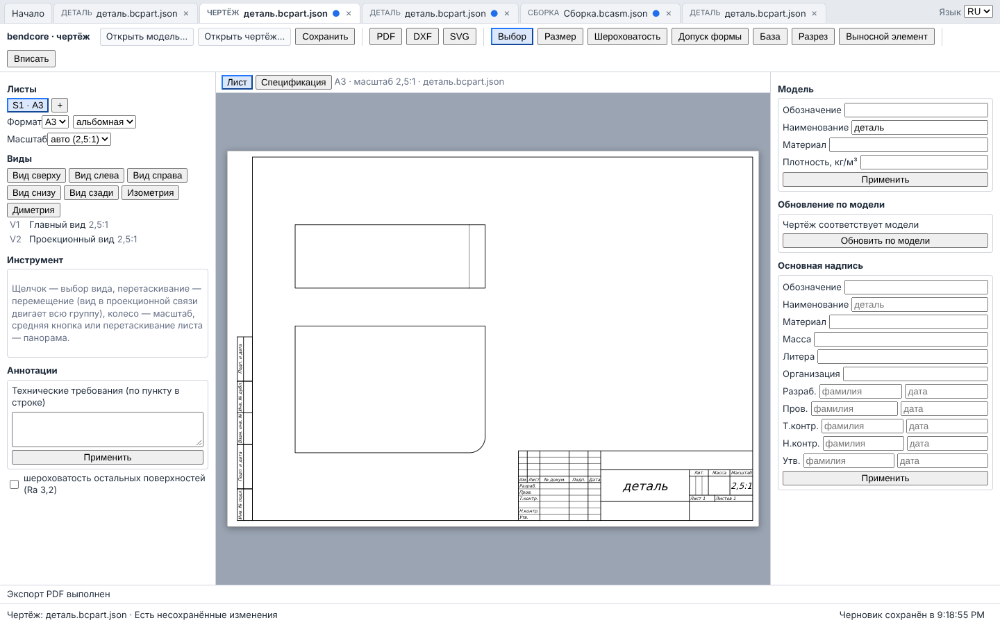

# Руководство пользователя bendcore

Руководство описывает работу в браузерном интерфейсе bendcore: деталь, эскиз, сборка
(сборочная единица), чертёж и обмен файлами. Описано только то, что есть в коде текущей
ветки и проверено тестами; у каждого раздела в конце — блок «Где проверено» со ссылками на
исходники и тесты. Сведения для разработчиков (API модулей, сборка, алгоритмы) — в
`docs/ui/`, `docs/modeling/`, `docs/assembly/`, `docs/drawing/`, `docs/kernel/`.

## Кому предназначено

- Инженеру-конструктору, который проектирует детали и узлы и выпускает по ним чертежи.
  Предполагается знакомство с параметрическими CAD-системами (SolidWorks, Inventor,
  КОМПАС-3D, NX и т. п.) и с оформлением конструкторской документации по ЕСКД.
- Инженеру по качеству и техническому писателю, которые проверяют поведение интерфейса.

Единицы во всём интерфейсе: длины — миллиметры, углы — градусы, плотность — кг/м³,
масса — килограммы.

## Оглавление

| № | Раздел | Содержание |
|---|---|---|
| 1 | [Быстрый старт](01_QUICK_START.md) | запуск оболочки; первая деталь, первый чертёж, первая сборка |
| 2 | [Оболочка и файлы](02_APP_SHELL.md) | стартовая страница, вкладки, строка статуса, долгие операции, язык, типы файлов |
| 3 | [Эскиз](03_SKETCH.md) | инструменты рисования, привязки, ограничения, размеры, определённость, редактирование, области профиля |
| 4 | [Операции детали](04_FEATURES.md) | выдавливание, вращение, отверстие, скругление, фаска, массивы, зеркало, оболочка, уклон, плоскость, ось |
| 5 | [Дерево построения](05_FEATURE_TREE.md) | редактирование, подавление, откат, перенос, ошибки перестроения, топологические ссылки |
| 6 | [Переменные и выражения](06_VARIABLES.md) | переменные документа, синтаксис выражений, функции |
| 7 | [Сборка](07_ASSEMBLY.md) | вставка, сопряжения, степени свободы, диагностика, перетаскивание, массивы, крепёж, пересечения, BOM, разнесённый вид |
| 8 | [Чертёж](08_DRAWING.md) | листы, виды, разрезы, размеры, допуски и посадки, шероховатость, допуски формы, базы, ТТ, позиции, спецификация, обновление по модели, экспорт |
| 9 | [Импорт и экспорт](09_IMPORT_EXPORT.md) | собственные форматы, STEP, IGES, DXF, STL, 3MF, PDF, SVG |
| 10 | [Измерения и масса](10_MEASURE_MASS.md) | свойства детали, массы в BOM и основной надписи, материалы |
| 11 | [Черновики и восстановление](11_DRAFTS_RECOVERY.md) | автосохранение, восстановление после перезагрузки, прерывание операции |
| 12 | [Горячие клавиши](12_HOTKEYS.md) | клавиши оболочки, эскиза, сборки, чертежа |
| 13 | [Известные ограничения](13_LIMITATIONS.md) | чего нет в этой версии и как это обойти |

## Ограничения версии (кратко)

Полный перечень — раздел 13. Главное, что нужно знать до начала работы:

1. **Данные стандартов не сверены.** Таблицы крепежа (ГОСТ 7798, 11738, 5915, 11371, 6402,
   3128; ISO 4014, 4017, 4762, 4032, 7089, 2338), допусков ISO 286 / ГОСТ 25346–25347, графы
   основной надписи ГОСТ 2.104 и спецификации ГОСТ 2.106, размеры знаков ГОСТ 2.305, 2.307,
   2.308, 2.309 и свойства встроенных материалов записаны без доступа к официальным изданиям
   (`docs/STANDARDS_VERIFICATION.md`). Перед выпуском документации проверяйте числа по
   действующим стандартам. В разделах 7 и 8 такие места отмечены знаком **⚠ требует сверки**.
2. **Нет операций** кинематического выдавливания (sweep), по сечениям (loft), ребра
   жёсткости, резьбовых отверстий и условного изображения резьбы, булевых операций между
   телами; дерево детали линейное (раздел 4).
3. **Импорт и экспорт в интерфейсе** — собственные JSON-форматы, STEP (сборка, просмотр),
   PDF/DXF/SVG (чертёж). IGES, STL, 3MF и импорт DXF в интерфейсе отсутствуют (раздел 9).
4. **Чертёж без отмены.** В редакторе чертежа нет команд «Отменить/Повторить»; позиции
   (номера на полках) ставятся только программно; разрезы — только простые плоскостью,
   параллельной виду (раздел 8).
5. **Измерений во вьюпорте нет**: расстояния, углы и сечение модели плоскостью реализованы
   в ядре, но в интерфейс не выведены (раздел 10).
6. Все данные (последние файлы, черновики) хранятся только в этом браузере; сохранение
   документа — скачивание файла.
7. Внутренние панели редакторов только на русском; на английский переводятся оболочка и
   уведомления.

## Как пользоваться руководством

- Названия кнопок и полей даны в кавычках так, как они написаны в интерфейсе: «Нарисовать
  эскиз», «Предпросмотр», «Обновить по модели».
- Термин при первом упоминании сопровождается английским эквивалентом в скобках, чтобы
  было проще сопоставить с документацией других систем.
- Блок «Где проверено» указывает исходный файл интерфейса и тест, который проверяет
  описанное поведение. Если поведение не покрыто тестом, это сказано явно.

## Где проверено

- Состав страниц и их назначение: `README.md` (раздел «Интерфейс в браузере»),
  `docs/ui/APP_SHELL.md`.
- Перечень данных, требующих сверки: `docs/STANDARDS_VERIFICATION.md`.
- Типы операций детали: `src/modeling/document/part_features.cpp`,
  `src/modeling/document/sketch_features.cpp` (реестр типов), `src/ui/modeling/labels.ts`
  (подписи на панели инструментов).
