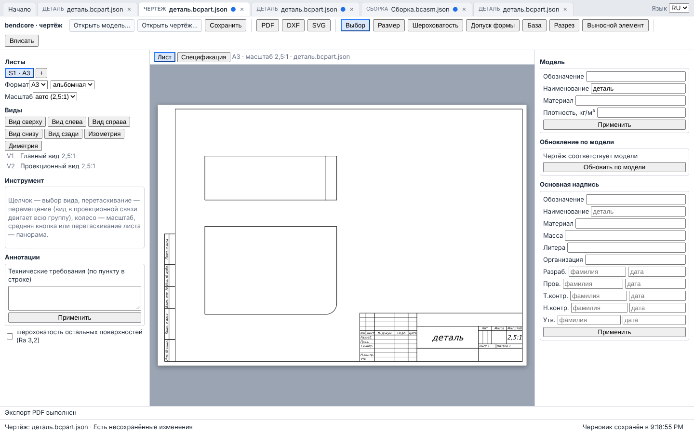

# Оболочка приложения и WASM в Web Worker

Фаза 5 `docs/ROADMAP_GENERAL_CAD.md` (UX, надёжность). Три части:

1. **Воркер.** Каждый WASM-модуль (ядро, деталь, сборка, чертёж) работает в отдельном
   Web Worker. Основной поток вызывает тот же JS API (`src/wasm/*_api.mjs`) асинхронно:
   каждый метод возвращает `Promise`, ошибки ядра — тот же `KernelError { code, detail }`.
   Долгая операция показывает индикатор и прерывается кнопкой «Прервать».
2. **Оболочка** `web/app/` + `src/ui/app/`: стартовая страница, вкладки документов, переходы
   «деталь → чертёж» и «сборка → деталь компонента», общая строка статуса и уведомлений,
   горячие клавиши, RU/EN.
3. **Автосохранение** черновиков в IndexedDB и восстановление после перезагрузки страницы.



## Состав

| Файл | Назначение |
|---|---|
| `src/ui/worker/protocol.ts` | сообщения `init`/`call` → `ready`/`init-failed`/`result`/`error`; `encodeResult` (ссылки на объекты, список transferable), `serializeError`, группы долгих операций `LONG_OPERATIONS` |
| `src/ui/worker/workerHost.ts` | сторона воркера: реестр объектов (0 — API модуля, далее документы/формы), выполнение вызовов по порядку |
| `src/ui/worker/wasmWorker.ts` | точка входа воркера (`wasm-worker.js`): импорт glue модуля по URL, шрифт для чертежа, `WorkerHost` |
| `src/ui/worker/wasmClient.ts` | сторона страницы: `WasmClient.start`, типы `Remote<T>`, ожидание ответов, `onActivity`, `cancel()` |
| `src/ui/worker/startWorker.ts`, `idle.ts`, `latestRunner.ts` | запуск воркера страницы; ожидание покоя для тестов; «последний выигрывает» для перетаскиваний |
| `src/ui/{kernel,modeling,assembly,drawing}/*Loader.ts` | загрузчики модулей теперь возвращают `WasmClient` |
| `src/ui/app/AppShell.tsx`, `AppShell.css`, `appEntry.tsx` | оболочка, единые стили (палитра, индикатор, уведомления) |
| `src/ui/app/editorHost.ts` | контракт «оболочка ↔ редактор» (`EditorHostProps`, `DocumentFile`) |
| `src/ui/app/BusyIndicator.tsx` | индикатор долгой операции с кнопкой «Прервать» |
| `src/ui/app/hotkeys.ts` | горячие клавиши (`hotkeyAction`, `useHotkeys`) |
| `src/ui/app/i18n.ts`, `src/ui/app/messages/` | словари RU/EN по областям, `translate`, `caption`, контекст языка |
| `src/ui/app/faultReport.ts` | `useFaultReport`: сбой модуля редактора → оболочке |
| `src/ui/app/storage.ts` | IndexedDB: последние файлы, черновики; определение типа файла |
| `web/app/` | webpack-конфигурация (все четыре модуля), шаблон, Playwright |
| `web/wasm-worker.config.js` | общая для всех страниц сборка входа `wasm-worker` |
| `src/ui/worker/__tests__/workerProtocol.test.ts`, `src/ui/app/__tests__/appLogic.test.ts` | Jest |
| `tests/e2e-app/app_shell.spec.ts` | сквозные сценарии Playwright |

## Воркер: протокол

```
страница                                   воркер (wasm-worker.js)
WasmClient.start(worker, 'drawing', url) → {type:'init', module, baseUrl}
                                             import(url + 'bendcore_drawing.mjs'), шрифт, loadDrawingKernel
                                         ← {type:'ready', info}
client.root.createFromPart(json)         → {type:'call', id, target:0, method, args}
                                             WorkerHost: objects[0].createFromPart(...)
                                         ← {type:'result', id, value:{__bcRemote:1, className:'DrawingHandle'}}
drawing.sheetPicture('S1')               → {type:'call', id, target:1, ...}
                                         ← {type:'result', id, value} (+ transfer: буферы typed arrays)
ошибка ядра                              ← {type:'error', id, error:{name, code, detail}} → reject(new KernelError(code, detail))
```

- Результат копируется структурным клонированием; буферы типизированных массивов, которые
  целиком принадлежат массиву, **передаются** (transferable, без копирования). Вид на часть
  большего буфера (например, кучу WASM) сначала копируется, чтобы куча не была отсоединена.
- Экземпляр класса в результате (документ, форма, чертёж; также `loadDocument().document`,
  `load().drawing`) регистрируется в воркере и приходит ссылкой; на странице это прокси
  `Remote<T>`: те же методы, каждый возвращает `Promise`. Свойства-геттеры (`handle`,
  `disposed`) через прокси недоступны; у прокси есть `remoteId`, `remoteClass`.
- `dispose()` удаляет объект из реестра; вызов удалённого объекта → `KernelError('Disposed')`.
- Вызовы одного воркера выполняются строго по порядку прихода. Редакторы дополнительно
  выстраивают составные действия (несколько вызовов) в очередь `run`, чтобы действия не
  перемежались; перетаскивание и предпросмотр эскиза используют `LatestRunner`: при занятом
  воркере промежуточные положения пропускаются, последнее решается всегда.
- Аргументы копируются (не передаются): вызывающий может продолжать пользоваться своими
  массивами.
- `KernelErrorCode` дополнен кодами клиента: `Cancelled` (вызов прерван `cancel()`),
  `WorkerFailed` (воркер упал или не запустился) и `ModuleFault` (вызов закончился ловушкой
  WebAssembly — см. «Сбой модуля»).

Сборка: каждая страница (`web/{kernel-viewer,part-modeler,assembly,drawing,app}`) собирает
второй вход `wasm-worker` → `wasm-worker.js` (классический воркер со своим runtime, без общих
чанков; `web/wasm-worker.config.js`). Glue модуля по-прежнему не входит в бандл: воркер
импортирует его по URL сборки, glue находит `.wasm` рядом с собой.

## Индикатор и отмена долгих операций

`BusyIndicator` (в панели инструментов каждого редактора) подписан на `client.onActivity` и
появляется, если вызов длится дольше 300 мс: группа операции (`LONG_OPERATIONS`:
перестроение, загрузка, решение сборки, пересечения, расчёт видов HLR, экспорт), время. Ядро
не сообщает долю выполненного, поэтому индикатор неопределённый (спиннер и секунды).

**«Прервать»** — `client.cancel()`: воркер завершается немедленно (`Worker.terminate()`, также
посреди расчёта в WASM), ожидающие вызовы отклоняются `KernelError('Cancelled')`, затем
редактор запускает новый воркер и загружает документ **из последнего снимка**. Что именно
восстанавливается:

| Редактор | Снимок | Когда снимается | Что теряется при отмене |
|---|---|---|---|
| Деталь | `doc.save()` (JSON детали) | после каждого завершённого изменения **вне транзакции** (панель операции и эскиз закрыты) | прерванное изменение; всё, что сделано в открытой панели операции или эскизе (их транзакция); история отмены/повтора; выбор |
| Сборка | `doc.save()`; источники вставленных деталей заново регистрируются | после каждого завершённого изменения | прерванное изменение; история отмены; результат проверки пересечений; разнесённый вид сбрасывается |
| Чертёж | `save()` + `saveModel()` | после каждого завершённого изменения | прерванное изменение; отчёт обновления по модели |

Снимок — то же содержимое, что сохраняется в файл; размеры, ссылки на рёбра и параметры
восстанавливаются полностью. Если снимка ещё нет, создаётся новый пустой документ. Если
перезапуск не удался, редактор показывает ошибку `Cancelled` с причиной.

## Оболочка

`npm run dev:app` (порт 3200). Решение по существующим страницам: `web/kernel-viewer`,
`web/part-modeler`, `web/assembly`, `web/drawing` **остаются** отдельными страницами для своих
наборов Playwright и сосредоточенной работы; оболочка встраивает те же компоненты
(`PartModelerApp`, `AssemblyApp`, `DrawingEditorApp`, `KernelViewerApp`) как вкладки. Без
свойств `EditorHostProps` редактор ведёт себя как раньше (всегда активен, новый документ).

- **Стартовая страница:** новая деталь, новая сборка, просмотр STEP; «Открыть файл…»
  (тип по полю `format`: `bendcore-part`, `bendcore-assembly`, файл чертежа
  `bendcore-drawing-file` `.bcdrw.json` — чертёж вместе с моделью, `docs/ui/DRAWING_UI.md`,
  «Файл чертежа»; чертёж прежнего формата `bendcore-drawing` выбирается вместе с файлом модели
  и переводится в новый формат); последние файлы (IndexedDB, до 12, новые сверху; запись —
  при сохранении Ctrl+S/кнопкой и при открытии файла в редакторе); предложение восстановить
  черновики.
- **Вкладки:** каждая — свой редактор и свой воркер; неактивные вкладки скрыты, но живут
  (состояние не теряется). Точка ● — несохранённые изменения. Контекстное меню вкладки:
  «Закрыть», «Закрыть остальные». Закрытие изменённой вкладки спрашивает подтверждение и
  удаляет её черновик.
- **Деталь → «Создать чертёж»:** JSON детали с кэшем BRep (`save({includeCache:true})`, чертёж
  не перестраивает деталь) открывается во вкладке чертежа (`createFromPart`).
- **Сборка:** «деталь из открытых» вставляет деталь из открытой вкладки или из последних
  файлов (`insertPart`, `format: 'part-json'`); **«Открыть деталь компонента»** открывает
  вкладку детали с тем JSON, из которого вставлен выбранный компонент. Файл сборки хранит
  только BRep, поэтому JSON деталей держит редактор (`DocumentFile.parts`, сохраняется в
  черновике и в списке последних файлов, но не в файле сборки): для компонента из STEP, из
  подсборки или из открытого с диска файла сборки команда сообщает, что деталь bendcore
  недоступна.
- **Строка статуса:** тип и имя документа, «есть несохранённые изменения» / «сохранено»,
  время записи черновика, уведомления (ошибки хранилища, неизвестный тип файла, необработанные
  отклонения Promise). Ошибки ядра по-прежнему показываются в строке ошибки редактора.
- **Язык:** выбор RU/EN в полосе вкладок, хранится в `localStorage` (с try/catch).

### Горячие клавиши

| Клавиши | Действие |
|---|---|
| Ctrl+Z / Ctrl+Y (Ctrl+Shift+Z) | отменить / повторить (деталь, сборка; в эскизе — шаг эскиза) |
| Ctrl+S | сохранить документ (скачать файл, запись в последние файлы, снятие отметки ●) |
| Ctrl+O | открыть файл (на стартовой странице — диалог оболочки, в редакторе — его «Открыть») |
| Esc | деталь: отменить панель операции; сборка: сбросить выбор и слоты сопряжения; чертёж: инструмент «выбор», сброс выбранных рёбер и вида |
| Delete | деталь: удалить выбранный узел дерева; сборка: удалить выбранный компонент; чертёж: удалить выбранный вид |
| F | показать всё (деталь, сборка) |

Клавиши, набранные в поле ввода, остаются полю (кроме Esc). Слушает только активная вкладка.
Контекстные меню: дерево построения детали («Изменить», «Редактировать эскиз», «Подавить»,
«Удалить», «Перенести выше/ниже», «Откатить до этой операции» — `src/ui/modeling/treeActions.ts`),
вкладки оболочки. На macOS вместо Ctrl работает Cmd.

### Локализация

Словари по областям — `src/ui/app/messages/`: `shell.ts` (оболочка, индикатор, уведомления,
сбой модуля), `part.ts` (редактор детали: панель инструментов, панели операций, дерево и его
контекстное меню `menu.*`, переменные, свойства), `sketch.ts`, `assembly.ts` (в том числе
`menu.fix` / `menu.unfix` дерева сборки), `drawing.ts`, `viewer.ts` (просмотр STEP). Каждая
пара — `xxRu` (эталон, `as const`) и `xxEn: Record<keyof typeof xxRu, string>`, поэтому
пропущенный английский ключ — ошибка типа. `src/ui/app/i18n.ts` сливает их в `ru` и `en`,
даёт `translate`, `useI18n()` и `caption(t, prefix, name)` — подпись имени, которое сообщает
ядро (тип операции `part.feature.Extrude`, параметр `part.param.distance`, тип сопряжения,
вид чертежа и т. п.); имени без подписи показывается как есть, поэтому операция, которую ядро
добавит в каталог позже, появляется на панели инструментов под своим именем ядра
(`toolbarTypes` в `src/ui/modeling/labels.ts`). Чистые функции, которые строят тексты
(`sketchDimensions`, `missingInputs`, `describeConstraint`, `dofText`, `refLabel`), принимают
`t` и по умолчанию дают русский текст; ошибки инструментов эскиза (`DrawError`) и выбора рёбер
на листе несут ключ сообщения. Отдельные страницы `web/*` работают без переключателя — на
русском; в оболочке язык переключает и все панели редакторов (строки статуса, уже показанные
до переключения, остаются на прежнем языке).

Проверка — `src/ui/app/__tests__/i18nCoverage.test.ts`: ключи RU и EN совпадают в каждой
области, ни один ключ не определён в двух областях, каждый ключ из `t('…')` существует,
каждый ключ словаря используется (по имени или по префиксу `caption(t, '…')` / `` `….${…}` ``),
в исходниках `src/ui/{app,modeling,assembly,drawing,kernel,worker}` вне комментариев нет
кириллицы и нет латинских слов в тексте JSX и в атрибутах `title`/`placeholder`/`aria-label`
(кроме обозначений форматов и стандартов: PDF, DXF, SVG, ISO, STEP, BOM, XY…). Ключи `menu.*`
используются контекстными меню деревьев детали и сборки; неиспользуемые `menu.hide`,
`menu.show`, `menu.openPart` удалены («Открыть деталь компонента» — `action.openComponentPart`).

## Автосохранение и восстановление

- Редактор после каждого завершённого изменения сообщает оболочке снимок документа и признак
  «отличается от сохранённого/открытого файла» (`onChange`). Оболочка раз в 2 с
  (`AUTOSAVE_MS`) и при `pagehide`/`beforeunload`/`visibilitychange → hidden` пишет в
  IndexedDB (`bendcore-app`, хранилище `drafts`, ключ — id вкладки) черновики изменённых
  документов и удаляет черновики сохранённых и закрытых. Запись при закрытии страницы
  начинается синхронно в обработчике; IndexedDB завершает транзакцию после ухода страницы.
- При следующем открытии оболочка читает черновики и предлагает «Восстановить» (вкладки
  открываются с тем же id и отметкой ●) или «Отбросить» (черновики удаляются).
- Черновик детали снимается вне транзакции: незавершённая панель операции или эскиз в
  черновик не попадают (как и при отмене операции).
- IndexedDB недоступен (приватный режим, запрет данных сайта): оболочка работает без последних
  файлов и автосохранения и пишет причину на стартовой странице и в строке статуса; все вызовы
  хранилища в `try/catch`.

## Обмен данными (импорт STEP/IGES, «Экспорт…», массы)

Подробно — `docs/ui/DATA_EXCHANGE.md`.

- Стартовая страница: «Импорт STEP/IGES…» (`data-testid="import-model"`) открывает вкладку
  «Деталь без истории» (`KernelViewerApp` с `importFile`); если файл — сборка (несколько тел
  или корень-сборка), вкладка заменяется вкладкой сборки (`AssemblyApp.importFile`), строка
  уведомлений сообщает число деталей.
- Полоса вкладок: «Экспорт…» (`shell-export`) для детали, сборки и импортированной модели.
  Сборка и просмотрщик открывают свой диалог (`EditorHostProps.exportRequest`); деталь
  экспортирует оболочка через `PartExchange` (общий модуль детали, загружающий JSON последнего
  завершённого состояния детали) — редактор детали не менялся.
- «Массовые характеристики» (`shell-mass`) для вкладки детали — панель поверх правой части
  редактора (`shell-mass-panel`): плотность, масса, центр масс, моменты инерции.
- Модуль детали оболочки запускается при первом экспорте или расчёте масс (ещё ≥ 128 МБ памяти
  WASM) и живёт до закрытия страницы.

## Сбой модуля

Вызов ядра может завершиться так, что состояние модуля больше не определено:

| Где | Как проявляется | Код в интерфейсе |
|---|---|---|
| native | `occt_fault_guard` (`src/kernel/occt_fault_guard.*`) переводит SIGSEGV/SIGBUS/SIGFPE внутри чтения BRep/STEP в исключение OCCT; читатель возвращает ошибку с кодом `Fault` (`ErrorCode::Fault`, `docs/kernel/KERNEL_CORE.md`), модули передают код без изменений. Если сбой перехватила собственная точка OCCT, наружу выходит только `ParseError`/`OperationFailed` | `Fault` — по коду (`MODULE_FAULT_CODES`, `src/ui/worker/protocol.ts`); текст ошибки не разбирается |
| WASM | сигналов нет: выход за линейную память, неверный косвенный вызов, деление на ноль, `abort()` — `WebAssembly.RuntimeError` из вызова; до этой фазы воркер отвечал кодом `Error`, и модуль продолжал работать на испорченной памяти | `ModuleFault` |
| WASM | воркер упал целиком (событие `error`: нехватка памяти, ошибка вне вызова) | `WorkerFailed` |

Поведение:

1. `WorkerHost` превращает `RuntimeError` в ошибку `ModuleFault` («WebAssembly trap: …»); после
   `ModuleFault` или ошибки ядра с кодом `Fault` он отказывает во всех последующих вызовах
   (`ModuleFault` «the module stopped at an earlier fault: Fault: …»); `WasmClient` при
   `ModuleFault` или `Fault` закрывается (все ожидающие и новые вызовы отклоняются той же
   ошибкой) и один раз вызывает слушателей `onFault(error, module)`. `isModuleFault` —
   `ModuleFault`, `Fault`, `WorkerFailed`, только по коду. `cancel()` и `dispose()` сбоем не
   считаются. Тесты Jest: `src/ui/worker/__tests__/workerProtocol.test.ts` («a kernel Fault
   closes the client like a trap…», «the host refuses every call after a kernel Fault»,
   «module faults are told by the code only» — `ParseError` с текстом SIGSEGV больше не сбой).
2. Редактор передаёт сбой оболочке (`useFaultReport`, `EditorHostProps.onFault`).
3. Оболочка сразу (не дожидаясь таймера автосохранения) записывает в IndexedDB черновик
   вкладки — последний документ, который редактор сообщил после завершённого изменения, то
   есть состояние до вызова, вызвавшего сбой, — и показывает над редактором карточку
   `fault-card`: какой модуль, код и текст ошибки, что состояние модуля может быть
   повреждено, когда записан черновик (или почему не записан).
4. «Перезапустить модуль и восстановить из черновика» читает черновик из IndexedDB и заново
   монтирует редактор вкладки с ним (новый воркер, новый экземпляр модуля); вкладка остаётся
   с отметкой ●, если документ не был сохранён. Без хранилища редактор получает последний
   снимок из памяти оболочки. Черновик остаётся в IndexedDB и после перезагрузки страницы
   предлагается к восстановлению, пока документ не сохранён.

На отдельных страницах `web/*` (без оболочки) ошибка показывается в строке ошибки редактора;
перезапуск — перезагрузка страницы.

Регрессионный вход: `tests/regression/fuzz/wasm/assembly_brep_trap.bcasm.json` — файл сборки,
у которого во встроенном двоичном BRep изменён один байт; в WASM `loadDocument` даёт
`RuntimeError: memory access out of bounds` (`tests/regression/fuzz/wasm/README.md`).

## Тесты для автоматизации

`window.bendcoreApp.getState()` — вкладки, активная вкладка, время черновика, предложенные
черновики, последние файлы, язык; `window.bendcoreApp.idle()` ждёт, пока ни у одного воркера
страницы нет вызовов в полёте два кадра подряд. У страниц редакторов появились `idle()`
(`bendcoreKernelViewer`, `bendcorePartModeler`, `bendcoreAssembly`) и
`window.bendcoreDrawingEditorIdle()`; `bendcoreAssembly.faces()` теперь асинхронная. Наборы
`tests/e2e-{kernel,modeling,assembly,drawing}` читают состояние после `idle()`.

## Как тестировать

```bash
source /root/emsdk/emsdk_env.sh
emcmake cmake -S . -B build-wasm-all -G Ninja -DCMAKE_BUILD_TYPE=Release -DBENDCORE_WITH_OCCT=ON \
  -DBENDCORE_OCCT_DIR=/home/user/bendcore/third_party/occt-install-wasm-checked -DBENDCORE_EIGEN_DIR=/usr/include/eigen3
cmake --build build-wasm-all --target bendcore_kernel_wasm bendcore_modeling_wasm bendcore_assembly_wasm bendcore_drawing_wasm

npx jest src/ui/worker src/ui/app                     # протокол, словари, клавиши, последние файлы
npm run test:e2e:app                                  # оболочка (по умолчанию build-wasm-all/wasm_*)
BENDCORE_KERNEL_WASM_DIR=build-wasm-all/wasm_kernel npm run test:e2e:kernel   # и т. д. для
                                                      # modeling, assembly, drawing
BENDCORE_DOC_SCREENSHOT=$PWD/docs/ui/img/app_shell.png npm run test:e2e:app   # снимок документации
```

Сценарии `tests/e2e-app/app_shell.spec.ts`:

1. Деталь: эскиз 60×40 → выдавливание 20 → скругление R5 ребра, выбранного во вьюпорте
   (объём сверяется с аналитикой `60·40·20 − (1−π/4)·25·20`); Ctrl+S скачивает файл
   `bendcore-part`, отметка ● снимается, файл в последних; «Создать чертёж» → главный вид и
   вид сверху → PDF начинается с `%PDF-`; вторая деталь; сборка из обеих через «деталь из
   открытых» (2 компонента); «Открыть деталь компонента» открывает вкладку детали; чертёж
   сохраняется одним файлом `.bcdrw.json` (`bendcore-drawing-file`, модель внутри) и открывается
   со стартовой страницы во второй вкладке с теми же видами; RU/EN — переключатель меняет
   строки оболочки и панели редактора детали («Kernel ready», «Extrude»).
2. Черновик: деталь построена, черновик записан, перезагрузка → предложение → «Восстановить»
   → объём 15000 и дерево `Sketch, Extrude`, отметка ●; «Отбросить» удаляет черновик.
3. Долгий HLR: пластина 16×16 отверстий (строится модулем детали в node), «Создать чертёж»,
   главный вид — индикатор `hlr` виден, переключатель языка срабатывает за < 1 с, пока
   индикатор ещё виден; затем изометрия и «Прервать» — уведомление об отмене, чертёж
   восстановлен с главным видом.
4. Сбой модуля: сборка с деталью `block.json`, затем в том же редакторе открывается
   `assembly_brep_trap.bcasm.json` — карточка сбоя (`ModuleFault`, «memory access out of
   bounds», «может быть повреждено»), черновик вкладки в IndexedDB; «Перезапустить…» — новый
   воркер, сборка с одним компонентом восстановлена из черновика, отметка ● сохранена, вставка
   второй детали работает.

`tests/e2e-app/exchange.spec.ts` — обмен данными (`docs/ui/DATA_EXCHANGE.md`, «Как
тестировать»): экспорт детали в STEP и STL с проверкой скачанных файлов, массы, импорт IGES
детали и сборки, экспорт сборки в 3MF.

## Ограничения

- Прогресс операций неопределённый: ядро не сообщает долю выполненного.
- Отмена теряет историю отмены и незавершённую транзакцию (см. таблицу выше); перезапуск
  воркера заново загружает модуль (секунды для OCCT).
- Каждая вкладка — отдельный экземпляр модуля (≥ 128 МБ начальной памяти WASM на вкладку).
- Многопоточность внутри модуля (pthreads, COOP/COEP) не включена: воркер освобождает основной
  поток, но расчёт одной операции по-прежнему однопоточный.
- Сообщения ядра (тексты `KernelError`) не переводятся: они приходят из C++ на английском.
- После сбоя модуля теряются история отмены и открытая транзакция (как при отмене операции);
  если сбой вызвал первый же вызов редактора (загрузка открываемого файла при создании
  вкладки), черновиком остаётся этот же файл — перезапуск снова его загрузит.
- Последние файлы и черновики живут только в этом браузере (IndexedDB).
