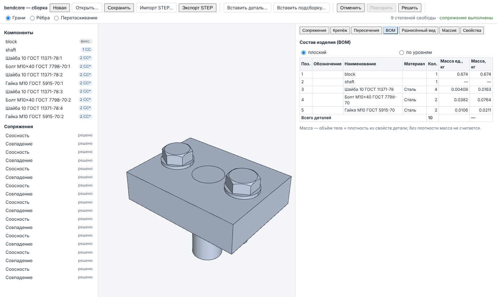

# Интерфейс сборки: WASM-модуль документа сборки и страница `assembly`

Фаза 3 `docs/ROADMAP_GENERAL_CAD.md` (интерфейс). Документ сборки (`bendcore_assembly_document`,
`docs/assembly/ASSEMBLY_DOCUMENT.md`), решатель сопряжений (`docs/assembly/SOLVER.md`) и
библиотека крепежа (`docs/assembly/FASTENERS.md`) собираются в WebAssembly; React-страница
показывает дерево сборки, панель сопряжений с выбором граней и рёбер во вьюпорте,
перетаскивание компонента с перерешением, степени свободы, отчёт пересечений с подсветкой,
BOM, разнесённый вид, библиотеку крепежа и массивы. Вся геометрия — тесселяция деталей ядром
и положения, вычисленные документом; каждое действие интерфейса — вызов документа.



## Состав

| Файл | Назначение |
|---|---|
| `cmake/wasm_assembly.cmake` | цель `bendcore_assembly_wasm` (только Emscripten), тест `wasm_assembly_document`; подключается из `cmake/wasm_kernel.cmake` одной строкой |
| `src/wasm/assembly_bindings.cpp` | embind: реестр документов по handle (`AssemblyHistory` поверх `AssemblyDocument`), функции → `{ok, value}` / `{ok:false, code, message}` |
| `src/wasm/bendcore_assembly_api.mjs`, `.d.mts` | JS API: `loadAssembly`, `AssemblyKernel`, `AssemblyDocumentHandle`; ошибки — `KernelError` |
| `tests/wasm/assembly_document.test.mjs` | проверка API в node: вал во втулке, плита с болтами |
| `tests/assembly-fixtures/` | документы деталей тестов (`block.json`, `shaft.json`, `plate.json`) и скрипт `make_parts.mjs`, который строит их модулем детали |
| `src/ui/assembly/AssemblyApp.tsx` | страница: панель инструментов, дерево, вьюпорт, вкладки панелей, состояние для тестов |
| `src/ui/assembly/AssemblyViewport.tsx` | вьюпорт: все вхождения, выбор граней/рёбер, перетаскивание, подсветка |
| `src/ui/assembly/AssemblyTree.tsx` | дерево: компоненты со степенями свободы, сопряжения с состоянием, массивы |
| `src/ui/assembly/AssemblyPanels.tsx` | панели: сопряжение, крепёж, пересечения, BOM, разнесённый вид, массив, свойства |
| `src/ui/assembly/mateRules.ts`, `assemblyMath.ts`, `labels.ts` | допустимые типы сопряжений, плоскость перетаскивания, направление установки крепежа, числовые тексты `dofText` (RU/EN); подписи — словарь `src/ui/app/messages/assembly.ts` (Jest: `src/ui/assembly/__tests__`) |
| `web/assembly/` | webpack-конфигурация страницы, шаблон, конфигурация Playwright |
| `tests/e2e-assembly/assembly.spec.ts` | сквозной тест Playwright |

## Сборка

```bash
source /root/emsdk/emsdk_env.sh
emcmake cmake -S . -B build-wasm -G Ninja -DCMAKE_BUILD_TYPE=Release \
  -DBENDCORE_WITH_OCCT=ON \
  -DBENDCORE_OCCT_DIR=/home/user/bendcore/third_party/occt-install-wasm-checked \
  -DBENDCORE_EIGEN_DIR=/usr/include/eigen3
cmake --build build-wasm --target bendcore_assembly_wasm
```

Собираются `bendcore_assembly_wasm` и зависимости: `bendcore_fasteners`,
`bendcore_assembly_document`, `bendcore_assembly_v2` (Eigen), `bendcore_modeling_document`
(документ детали — для вставки детали из её JSON), `bendcore_kernel_xcaf` (STEP со структурой),
`bendcore_kernel_healing`, `bendcore_kernel`. `bendcore_kernel_analysis` в модуль не входит (в
WASM нет zlib): массы BOM считает сам документ сборки — объём `BRepGProp` × плотность из
свойств детали (`bom.cpp`). Результат — `build-wasm/wasm_assembly/`: `bendcore_assembly.mjs`
(`-sEXPORT_NAME=createBendcoreAssembly`), `bendcore_assembly.wasm` и копии
`bendcore_assembly_api.mjs/.d.mts`, `bendcore_kernel_api.mjs/.d.mts`. Параметры линковки — как
у модуля детали (`-sINITIAL_MEMORY=128MB`, `-sSTACK_SIZE=8MB`); уровень оптимизации —
`BENDCORE_WASM_ASSEMBLY_OPT` (по умолчанию `Oz`).

### Размер и время

Измерено 2026-11-11, emsdk 6.0.12, OCCT 8.0.1, `Oz`: `.wasm` — 29 238 501 байт (27,9 МиБ),
gzip -9 — 7 927 567 байт (7,6 МиБ); клей `.mjs` — 235 445 байт. Больше модуля детали
(18,8 МиБ) за счёт STEP с XCAF (`TKDESTEP`, OCAF), BRepExtrema (касания) и решателя на Eigen.
Node 22: тест `assembly_document.test.mjs` целиком (5 сценариев, 4 проверки пересечений,
круговые обороты STEP и JSON) — ~5 с; шаг перетаскивания вала (решение с мягкой целью и
развёртка положений) — единицы миллисекунд.

## API JS-модуля

```js
import createBendcoreAssembly from './bendcore_assembly.mjs';
import { loadAssembly } from './bendcore_assembly_api.mjs';

const assembly = await loadAssembly(createBendcoreAssembly);
const doc = assembly.createDocument('Узел');      // или loadDocument(json) → {document, report}, importStep(text)
try {
  const block = doc.insertPart({ name: 'Корпус', format: 'part-json', data: blockJson, fixed: true });
  const shaft = doc.insertPart({ name: 'Вал', format: 'step', data: shaftStep, beside: true });
  doc.element({ path: [shaft.occurrence], kind: 'face', index: 0 });   // {geometry, name, entity (мировая СК)}
  doc.addMate({ type: 'concentric', a: { path: [shaft.occurrence], kind: 'face', index: 0 },
                b: { path: [block.occurrence], kind: 'face', index: 6 } });
  doc.state().solve.totalDof;                       // степени свободы после решения
  doc.dragBegin(shaft.occurrence, [50, 30, 60]);    // захват точки (мировая СК)
  doc.dragMove([40, 40, 60]);                       // {solve, placement, grabbed, placements}
  doc.dragEnd();                                    // один шаг истории
  doc.insertFasteners({ part: [block.occurrence], insertion: [0, 0, -1], radius: 5.5,
    screw: { standard: 'gost-7798', size: 10, length: 40 },
    headWashers: [{ standard: 'gost-11371', size: 10 }], nutWashers: [{ standard: 'gost-11371', size: 10 }],
    nut: { standard: 'gost-5915', size: 10 } });
  doc.interference();  doc.bom('flat');  doc.bom('structured');
  const mesh = doc.tessellate({ skip: [] });        // {meshes: {key: KernelMesh}, occurrences: [{path, mesh, world.matrix}]}
  doc.undo(); doc.redo();
  const json = doc.save();  const step = doc.exportStep({ schema: 'AP242' });  // интерфейс экспортирует AP214 (по умолчанию)
} finally {
  doc.dispose();
}
```

Каждое изменение — одна транзакция `AssemblyHistory::apply` с решением сопряжений в конце
(кроме свойств деталей и разнесённых видов, где решать нечего); ошибка правки или решения
возвращает документ к состоянию до неё и в историю не попадает.

| Метод `AssemblyDocumentHandle` | Вызов документа |
|---|---|
| `state()` | определения (свойства, источник, число граней/рёбер), дерево вхождений (положение, фиксация, подавление, массив, `dof` и `dofShared` для верхнего уровня), сопряжения со `status` (`solved`, `redundant`, `conflicting`, `unsolved`, `broken`, `suppressed`), массивы, разнесённые виды, отчёт решения (подсистемы, избыточные и противоречивые), история |
| `insertPart({name, format: 'part-json' \| 'step', data, placement, properties, fixed, parent, beside})` | `PartDocument::fromJson` + `partDataFromDocument` (карта имён элементов) или `kernel::readStep`; `addPart` + `addOccurrence`; `beside` — габарит детали на 20 мм правее габарита сборки по +X, низ на уровне низа сборки |
| `insertOccurrence({definition, …})` | ещё одно вхождение того же определения |
| `insertSubassembly({source, …})` | `addSubassemblyFromSource`: текст файла подсборки берётся из `AssemblyKernel.registerSource(name, text)` |
| `removeOccurrence`, `setOccurrence(id, {fixed, suppressed, name, designation, placement, color})`, `setProperties(def, {designation, name, material, density})` | правка состава |
| `addMate`, `editMate`, `removeMate`, `setMateSuppressed`, `solve()` | сопряжения: `type` — `coincident`, `concentric`, `distance`, `angle` (значение в градусах), `parallel`, `perpendicular`, `tangent` (`internal`), `rigid`; `alignment` — `closest`, `aligned`, `anti-aligned`; ссылки `{path, kind: face/edge/vertex, index \| name, use: auto/axis/point}` |
| `dragBegin(occ, point)`, `dragMove(target)`, `dragEnd()`, `dragCancel()` | перетаскивание: рабочая копия документа решается `AssemblyDocument::drag` (мягкая цель, затем жёсткие сопряжения); `dragEnd` записывает копию одним шагом «Drag component»; во время перетаскивания правки отклоняются |
| `addPattern({kind: linear \| circular \| feature, seed, …})`, `removePattern` | массивы компонентов (угловой шаг кругового — в градусах) |
| `addExplodedView({name, steps: [{occurrences, direction, distance}]})`, `removeExplodedView` | разнесённые виды |
| `tessellate({params, skip, view, progress})` | сетка каждого определения детали в её СК (ключ — по форме OCCT, сетки повторно не передаются, если ключ в `skip`) и все вхождения с мировой матрицей; `view/progress` — положения разнесённого вида (`explodedPlacements`, документ не меняется) |
| `placements({view, progress})` | только мировые положения (ползунок разнесённого вида) |
| `element(ref)` | тип геометрии элемента, имя из карты элементов, сущность сопряжения в мировой СК |
| `interference(options)` | `checkInterference`: пары `interference` (объём) и `touching` |
| `bom('flat' \| 'structured')` | `flatBom` / `structuredBom` с массами |
| `findHoles`, `insertFasteners` | `findHoleSites` + `insertFastenerStacks`; определения крепежа с тем же обозначением используются повторно (одна позиция BOM); `holes` — только выбранные грани отверстий |
| `undo()`, `redo()`, `save({embedGeometry})`, `exportStep({schema})`, `dispose()` | история, файлы |

`AssemblyKernel`: `fastenerCatalog()` (стандарты: `id` вида `gost-7798`, `iso-4017`, вид
изделия, ГОСТ/ISO, соответствие, ряд размеров, статус сверки таблиц), `describeFastener(spec)`
(обозначение, объём, масса, резьба, размеры модели), `registerSource`, `createDocument`,
`loadDocument`, `importStep`, `info()`.

**Индексы граней и рёбер** сетки определения — индексы `kernel::TopologyIndex` формы детали
(порядок `TopExp::MapShapes`), т. е. те же, что у `ElementRef::face/edge` в сопряжениях: индекс,
выбранный во вьюпорте, сразу становится ссылкой без поиска по геометрии.

**Ошибки** — `KernelError {code, detail}`: неверный аргумент JS → `InvalidInput`; ошибки
документа — с его кодом (например, `Unsupported` для сопряжения, которому не подходит
геометрия, `ParseError` для чужого файла); исключения OCCT → `OperationFailed`; вызов
освобождённого документа → `Disposed`.

## Страница (`AssemblyApp`)

- **Панель инструментов**: Новая, Открыть… (несколько файлов JSON: все регистрируются как
  источники подсборок по имени файла, открывается первый), Сохранить, Импорт/Экспорт STEP,
  Вставить деталь… (документ детали `.json` или `.step/.stp`; первая деталь пустой сборки
  фиксируется, следующие ставятся рядом с габаритом сборки), Вставить подсборку…, Отменить /
  Повторить (подсказка — имя шага; Ctrl+Z, Ctrl+Y, Ctrl+Shift+Z), Решить, режим вьюпорта
  (Грани / Рёбра / Перетаскивание), итог: «N степеней свободы» и состояние решения.
- **Дерево**: компоненты (вложенные вхождения подсборок — с отступом), значок степеней свободы
  («фикс.», «1 СС»; «*» — степени свободы подсистемы из нескольких компонентов: решатель
  считает ранг по подсистеме), при наведении — Фиксировать/Освободить, Подавить/Вкл., удалить;
  сопряжения с состоянием (решено, избыточно, противоречит, не решено, ссылка потеряна,
  подавлено), подавление и удаление; щелчок по сопряжению показывает его элементы в панели;
  массивы.
- **Сопряжение**: щелчки во вьюпорте заполняют слоты A и B (повторный щелчок по элементу
  убирает его); типы, которые не принимают выбранные сущности, недоступны (`mateRules.ts`
  повторяет правила `prepareMate`), предлагается естественный тип (соосность для двух
  цилиндров/осей, совпадение для плоскостей, касание для плоскости и цилиндра); значение
  (мм, °), ориентация, внутреннее касание; два элемента одного компонента — предупреждение.
- **Перетаскивание**: нажатие на деталь начинает `dragBegin`; курсор проецируется на плоскость
  захваченной грани, если она плоская и не видна с ребра (|n·v| > 0,25), иначе на плоскость,
  обращённую к камере; каждый кадр — `dragMove`, вьюпорт получает новые положения; отпускание —
  `dragEnd`. Вал, сопряжённый соосностью и совпадением торца, при этом только поворачивается.
- **Крепёж**: ГОСТ/ISO (смена системы сохраняет конструкцию через стандарт-соответствие),
  болт/винт, размер из ряда таблицы, длина, шайбы под головку и под гайку, гайка; описание
  (обозначение и масса — `describeFastener`, отметка «таблица требует сверки»); щелчок по
  цилиндрической грани отверстия; направление установки — ось отверстия, направленная от камеры
  (головка со стороны наблюдателя); «во все отверстия этого диаметра и направления» или только
  выбранное.
- **Пересечения**: «Проверить» — сводка (пересечения, касания, число пар, отобранных по
  габаритам, объём), список пар; детали с пересечением подсвечиваются красным, касания —
  жёлтым (по флажку); щелчок по паре подсвечивает только её. Любая правка сбрасывает отчёт.
- **BOM**: плоский и по уровням; позиция, обозначение, наименование, материал, количество,
  масса единицы и общая; итог деталей и массы.
- **Разнесённый вид**: шаги «выбранный компонент — направление ±X/±Y/±Z — смещение», создание
  вида, ползунок 0…число шагов (шаг 0,05) — положения `placements({view, progress})`.
- **Массив**: линейный, круговой, по отверстиям детали (исходное отверстие — щелчок по грани).
- **Свойства**: имя вхождения, обозначение, наименование, материал, плотность определения.
- **Состояние для тестов**: `window.bendcoreAssembly.getState()` (статус, ошибка, состояние
  документа, слоты, отверстие, выбор, BOM, отчёт пересечений, разнесённый вид, отчёт решения
  во время перетаскивания, положения), `worldToClient`, `faceClientPoint(path, face)` (видимый
  треугольник грани: первое пересечение луча через его центр — эта грань), `faces(path)`.

## Запуск и тесты

```bash
npm ci --ignore-scripts
BENDCORE_ASSEMBLY_WASM_DIR=build-wasm/wasm_assembly npm run dev:assembly   # http://127.0.0.1:3120/

ctest --test-dir build-wasm -R wasm_assembly_document --output-on-failure
npm run test:assembly-wasm -- --module build-wasm/wasm_assembly
npx jest src/ui/assembly
PLAYWRIGHT_CHROMIUM_EXECUTABLE=/opt/pw-browsers/chromium-1243/chrome-linux64/chrome \
  BENDCORE_ASSEMBLY_WASM_DIR=$PWD/build-wasm/wasm_assembly npm run test:e2e:assembly -- --trace off
# снимок для документации:
BENDCORE_DOC_SCREENSHOT=$PWD/docs/ui/img/assembly.png npm run test:e2e:assembly -- -g fasteners
# документы деталей тестов заново (модуль детали):
node tests/assembly-fixtures/make_parts.mjs --module build-wasm/wasm_modeling
```

### Что проверяется

`tests/wasm/assembly_document.test.mjs` (5 тестов, грани выбираются по геометрии через
`element()`, не по индексу):

- **Вал во втулке** (корпус 80×60×20 с отверстием Ø20, вал Ø20×60, вставлен повёрнутым и
  смещённым): свободный вал — 6 СС, после соосности — 2, после совпадения торца с низом
  корпуса — 1; начало вала (40, 30, 0), ось ∥ Z. Перетаскивание точки обода по дуге на 90°:
  решение выполнено на каждом шаге, захваченная точка в (40, 40, 60) с точностью 1e-3, ось и
  положение начала сохранены (1e-7), поворот 90° (1e-3); отмена возвращает угол. Пересечение:
  одна пара, касание, без пересечения. BOM: объёмы и массы корпуса `80·60·20 − π(10² + 2·5,5²)·20`
  и вала `π·10²·60` при ρ = 7850 (отн. 1e-6). Параллельность поверх соосности и соосность по
  круговому ребру вала (ось через центр) — `redundant`; расстояние 10 поверх совпадения —
  подсистема `Conflicting` с перечнем; подавление возвращает решение; правка совпадения в
  расстояние 5 — z = −5; линейный массив ×3 с шагом 100 — экземпляр в (240, 30, −5), в BOM 3 вала;
  ошибки (сопряжение плоскости с цилиндром соосностью, неизвестный тип, перетаскивание
  фиксированной детали, битый JSON детали) не меняют историю; вставка «рядом» — зазор 20 мм по
  X, низ и центр по Y по габариту сборки.
- **Плита с болтами** (100×60×20, два отверстия Ø11; болт М10×40 ГОСТ 7798 + шайбы ГОСТ 11371 +
  гайка ГОСТ 5915): найдено 2 отверстия глубиной 20; grip 32, выступ 8; положения болта, шайб и
  гайки z = 22 / 20 / 0 / −2 в центрах отверстий; 8 СС (четыре подсистемы «шайба — болт» и
  «шайба — гайка» по 2 СС); пересечений нет, касаний 10; BOM: плита 1, болты 2, шайбы 4, гайки 2,
  объём и масса шайбы `π/4·(21² − 10,5²)·2`, масса плиты по формуле, объём болта в пределах 6 %
  от «стержень + шестигранник», общая масса — сумма строк; разнесённый вид из двух шагов
  (болты +50, гайки −30) на 0,5 и 2 — положения по формуле, документ не изменился;
  тесселяция — 4 сетки на 9 вхождений, спаны граней покрывают все треугольники, повторно
  известные сетки не передаются.
- **Подсборка, JSON, STEP**: плита с болтами сохранена и вставлена дважды как внешняя
  подсборка: плоский BOM — 4 болта, 18 деталей; по уровням — одна строка сборки ×2 с позициями
  1.1…, та же масса; сохранение → загрузка (`AssemblyLoaded`, 18 деталей, та же масса);
  экспорт STEP → импорт — те же 18 положений (1e-6).
- **Ошибки и каталог**: короткий болт, нет отверстия такого радиуса, неизвестный стандарт — без
  записи в историю; постановка в одно выбранное отверстие; отмена до пустого документа, ошибка
  «nothing to undo», повтор; вызов освобождённого документа — `Disposed`; `liveDocuments = 0`.

`tests/e2e-assembly/assembly.spec.ts` (2 теста, ~20 с): вставка корпуса и вала файлами
(корпус фиксирован, вал рядом, 6 СС); щелчки по цилиндру вала и отверстию — предложена
соосность, «Добавить»; щелчки по торцу вала и верху корпуса — совпадение; строка состояния
«1 степень свободы», значок вала «1 СС», вал на оси (40, 30), z = −40. Перетаскивание мышью
точки торца по четверти окружности: во время перетаскивания решение выполнено; после — то же
начало на оси (1e-6), ось поворота Z, угол изменился на 45°…135°, 1 СС, шаг «Drag component».
Крепёж: щелчок по отверстию Ø11, описание «Болт М10×40 ГОСТ 7798-70», постановка — 10
компонентов, болты в (15, 30, 22) и (65, 30, 22); пересечений 0; плотность корпуса 7850 в
свойствах; BOM: корпус 1, вал 1, болт 2, шайба 4, гайка 2, всего 10, масса корпуса по формуле;
снимок экрана. Второй тест: Ctrl+Z / Ctrl+Y (2 ↔ 1 СС), разнесённый вид вала +80 мм на
ползунке 0,5 и 1 (документ не меняется), сохранение в файл, новая сборка и открытие — те же
сопряжения и 1 СС, два элемента одного компонента — кнопка «Добавить» недоступна.

## Выполнение в Web Worker (фаза 5)

Страница вызывает модуль не напрямую, а через воркер (`docs/ui/APP_SHELL.md`): загрузчик
возвращает `WasmClient`, методы API на странице асинхронны (`Promise`), ошибки — тот же
`KernelError`. Долгие вызовы показывают индикатор с кнопкой «Прервать»; после отмены документ
восстанавливается из снимка последнего завершённого изменения. Тестовый хук страницы получил
`idle()` — сквозные тесты читают состояние после него. Синхронный API `src/wasm/*_api.mjs`
не изменился и используется в node-тестах и внутри воркера.

## Ограничения

- Степени свободы показываются по подсистемам решателя: у компонентов, сопряжённых друг с
  другом, — общее число подсистемы (отметка «*»); разложения по компонентам решатель не даёт.
- Внешние подсборки при открытии берутся только из выбранных вместе файлов
  (`registerSource`); детали вставляются со встроенной геометрией, связи с файлами деталей
  (`source`) страница не создаёт.
- Выбор вершин, выбор рамкой и фильтры выбора отсутствуют; перетаскивание — только вхождений
  верхнего уровня (вложенное перетаскивает свою подсборку).
- Плоскость перетаскивания — плоскость грани или камеры; для движений, перпендикулярных
  обеим, нужно несколько жестов.
- Положение вставляемой детали — рядом с габаритом сборки; поворот при вставке — через API
  (`placement`).
- Модуль однопоточный: вызовы идут в Web Worker (`APP_SHELL.md`), страница не блокируется, но
  проверка пересечений больших сборок занимает время (`docs/qa/PERFORMANCE.md`).
- Таблицы крепежа требуют сверки с официальными изданиями (`FASTENERS.md`, раздел 1); панель
  показывает это у стандарта со статусом `verified = false`.
- Сквозной тест есть только для Chromium.
