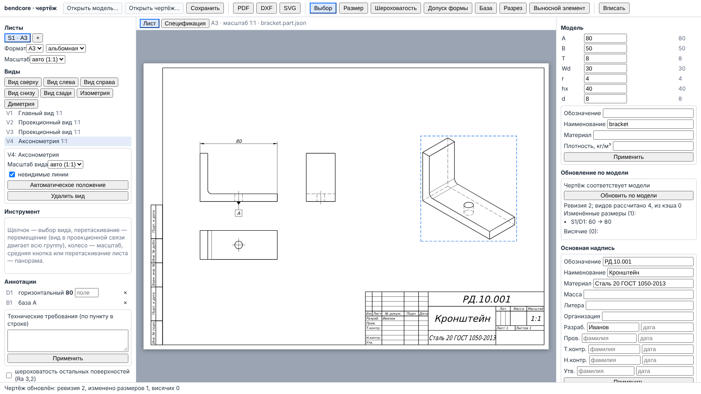

# Редактор чертежа в браузере (`bendcore_drawing_wasm`, `src/ui/drawing/`, `web/drawing/`)

Интерфейс фазы 4 `docs/ROADMAP_GENERAL_CAD.md`: документ чертежа (`docs/drawing/DRAWING_DOCUMENT.md`)
по документу детали или сборки — листы с основной надписью, виды, размеры по выбранным 2D-рёбрам,
шероховатость, допуски формы и расположения, базы, технические требования, позиции, обновление
по модели с отчётом, спецификация, экспорт PDF/DXF/SVG, сохранение и открытие. Вся геометрия —
из ядра: лист на экране — SVG писателя чертежа (`writeSvg`), выбираемые линии — 2D-рёбра видов
(HLR) в координатах листа; JS только отображает их и пересчитывает координаты экрана.



## Состав

| Файл | Назначение |
|---|---|
| `cmake/wasm_drawing.cmake` | цель `bendcore_drawing_wasm` (подключается из `cmake/wasm_kernel.cmake`), копирование JS API и шрифта, тест `wasm_drawing_document` |
| `src/wasm/drawing_bindings.cpp` | привязки embind: сессии чертежа по дескриптору, JSON на границе |
| `src/wasm/bendcore_drawing_api.mjs` / `.d.mts` | JS API (`loadDrawingKernel`, `DrawingKernel`, `DrawingHandle`), ошибки — `KernelError` |
| `src/ui/drawing/DrawingEditorApp.tsx` | страница: панели листов, видов, инструментов, аннотаций, модели, обновления, основной надписи; вкладка спецификации; экспорт |
| `src/ui/drawing/SheetCanvas.tsx` | лист: SVG ядра, слой 2D-рёбер для выбора, масштаб, панорама, перетаскивание видов |
| `src/ui/drawing/sheetGeometry.ts` | преобразования лист ↔ экран, путь SVG по кривой ядра, точка листа → вид → модель, правила выбора рёбер инструментами, имена файлов |
| `src/ui/drawing/printSheet.ts` | документ печати листа (`@page` = формат листа, SVG в мм, шрифт `@font-face`), печать через скрытый `iframe` |
| `src/ui/drawing/drawingLoader.ts` | загрузка модуля и шрифта (ядру — `setFont`, странице — `FontFace`) |
| `web/drawing/` | `webpack.config.js` (порт 3150, вывод сборки WASM — под `/drawing-wasm/`), `index.html`, `playwright.config.ts` |
| `tests/wasm/drawing_document.test.mjs` | проверка API под node на эталонном кронштейне |
| `tests/wasm/fixtures/bracket.part.json`, `make_bracket_part.mjs` | документ детали «кронштейн» (эталонная деталь 1 `docs/modeling/REFERENCE_PARTS.md`) и его генератор через `bendcore_modeling_wasm` |
| `tests/e2e-drawing/drawing_editor.spec.ts` | сценарий Playwright |
| `src/ui/drawing/__tests__/sheetGeometry.test.ts` | Jest |

## Сборка

```bash
source /root/emsdk/emsdk_env.sh
emcmake cmake -S . -B build-wasm-drawing -G Ninja -DCMAKE_BUILD_TYPE=Release \
  -DBENDCORE_WITH_OCCT=ON \
  -DBENDCORE_OCCT_DIR=/home/user/bendcore/third_party/occt-install-wasm-checked \
  -DBENDCORE_EIGEN_DIR=/usr/include/eigen3
cmake --build build-wasm-drawing --target bendcore_drawing_wasm
```

Модуль включает `bendcore_drawing_document` и всё, от чего он зависит: документ детали
(дерево операций, эскизы, топологическое именование), документ сборки, построители видов,
аннотации, спецификацию, писатели PDF/DXF/SVG, ядро OCCT. Результат —
`build-wasm-drawing/wasm_drawing/`: `bendcore_drawing.mjs` (клей, `createBendcoreDrawing`),
`bendcore_drawing.wasm` — **21,7 МБ** (`-Oz`, Release; для сравнения `bendcore_modeling.wasm` —
19 627 734 байт ≈ 18,7 МиБ, `bendcore_kernel.wasm` — 12,6 МБ), JS API, `DejaVuSans.ttf` и `DejaVuSans-LICENSE.txt`.
Линковка — как у `bendcore_modeling_wasm` (`INITIAL_MEMORY=128MB`, стек 8 МБ, рост памяти),
без потоков.

## Шрифт

Писатель PDF встраивает TrueType-шрифт, размеры и основная надпись измеряют текст по его
метрикам (`TrueTypeFont`); в нативной сборке шрифт ищется в системе (`findSystemFont`). У модуля
WASM файловой системы нет, поэтому:

1. CMake находит на машине сборки `DejaVuSans.ttf` (`BENDCORE_DRAWING_FONT_FILE`, поиск в
   `/usr/share/fonts/truetype/dejavu` и др.) и копирует его рядом с модулем вместе с текстом
   лицензии (`/usr/share/doc/fonts-dejavu-core/copyright` → `DejaVuSans-LICENSE.txt`). Лицензия
   DejaVu (Bitstream Vera + public domain изменений) разрешает распространение шрифта, в том
   числе вместе с программой, при сохранении текста лицензии; в git шрифт не хранится.
2. Страница загружает файл шрифта по тому же адресу, что и модуль, и передаёт байты ядру:
   `kernel.setFont(bytes, 'DejaVuSans.ttf')` (`TrueTypeFont::fromBytes`; шрифт с запретом
   встраивания отвергается ядром). Тот же буфер регистрируется как `FontFace('DejaVu Sans')`, и
   SVG листа на экране рисуется теми же глифами, что попадут в PDF.
3. Без `setFont` создать чертёж нельзя: `InvalidInput: no font - call setFont() …`. Если шрифт
   не найден при сборке, CMake выдаёт предупреждение, страница показывает ошибку загрузки
   шрифта. Другой шрифт: `-DBENDCORE_DRAWING_FONT_FILE=/путь/LiberationSans-Regular.ttf`
   (SIL OFL 1.1) — тогда SVG будет ссылаться на семейство «DejaVu Sans», а метрики и PDF — на
   выбранный шрифт.

PDF с полностью встроенным DejaVu Sans весит около 0,8 МБ (`EXPORT.md`).

## JS API

```js
import createBendcoreDrawing from './bendcore_drawing.mjs';
import { loadDrawingKernel } from './bendcore_drawing_api.mjs';
const kernel = await loadDrawingKernel(createBendcoreDrawing);
kernel.setFont(fontBytes);
const drawing = kernel.createFromPart(partJson, { properties: { designation: 'РД.10.001', density: 7850 } });
const F = drawing.addView('S1', { kind: 'base', standard: 'front' });
drawing.addView('S1', { kind: 'projected', standard: 'top' });
const pic = drawing.sheetPicture('S1');           // { svg, width, height, views: [{ edges, bounds, anchor, factor, frame }] }
drawing.addDimension('S1', F, [edgeA, edgeB]);    // индексы pic.views[i].edges[k].index
drawing.setVariable('A', 80);                      // перестроение детали; чертёж не меняется
drawing.updateFromModel();                         // { stale: ['S1/D1: 60 → 80'], dangling: [], … }
const pdf = drawing.exportPdf();                   // Uint8Array
drawing.dispose();
```

Через границу WASM передаётся текст JSON; обёртка разбирает его и бросает `KernelError {code,
detail}` с кодом ошибки ядра (`InvalidInput`, `ParseError`, `OperationFailed`, `Unsupported`, …)
или `Disposed`.

| Метод | Что делает |
|---|---|
| `kernel.createFromPart(json, {path, properties, sheet})` | документ детали (`PartDocument::fromJson` + перестроение) → чертёж с одним пустым листом (А3 альбомный по умолчанию) |
| `kernel.createFromAssembly(json, …)` | документ сборки со встроенной геометрией (`AssemblyDocument::fromJson`) + документ спецификации |
| `kernel.load(drawingJson, modelJson)` | открытие сохранённого чертежа с его моделью, отчёт первого обновления |
| `describe()` | ссылка на модель, листы: формат, масштаб, графы основной надписи (заданные и выведенные), виды (определение, масштаб, надпись, габарит), размеры (тип, значение, текст, состояние, причина), знаки; `balloons` — все позиции на листе (`id: null` — автоматическая), `positions` — ручные позиции (`state: ok/dangling`, номер, точка выноски, полка) |
| `sheetPicture(sheet)` | SVG листа (писатель экспорта) и 2D-рёбра видов в мм листа: тип кривой, видимость, класс, индексы ребра/грани модели; привязка вида (`anchor`, `factor`) и его ориентация (`frame`) |
| `addSheet`, `removeSheet`, `setSheet(sheet, {format, multiplier, orientation, scale, title, technicalRequirements, roughnessRemainder, partsList})` | листы ГОСТ 2.301, масштаб ГОСТ 2.302, графы ГОСТ 2.104 |
| `addView(sheet, {kind, standard, parent, side, axonometry, planePoint, sectionKind, markView, detailCenter, detailRadius, scale, position})` | главный вид (по стандартному виду), проекционный (`standard`: сверху/слева/… — сторона по ГОСТ 2.305 и методу проецирования; или `side`), аксонометрия, разрез (в проекционной связи — с `side`), выносной элемент |
| `moveView(sheet, view, x, y)` | центр вида — в точку листа; вид в проекционной связи двигает всю группу (положение главного вида), вид вне связи — только себя |
| `setView`, `removeView` | масштаб вида вне связи, невидимые линии, положение; удаление вместе с зависимыми видами и аннотациями |
| `addDimension(sheet, view, picks, {offset, tolerance})` | размер по одному или двум выбранным 2D-рёбрам (правила ниже) |
| `setDimension(sheet, id, {offset, tolerance, toleranceDisplay, textOverride, decimals, prefix, suffix})` | изменение размера, поле допуска ISO 286 |
| `addRoughness`, `addTolerance`, `addDatum` | шероховатость ГОСТ 2.309, рамка допуска ГОСТ 2.308, база — на выбранном прямолинейном ребре |
| `setView(sheet, view, {autoBalloons: true})` | позиции ГОСТ 2.109 по спецификации на видимых линиях составных частей этого вида (полки в колонну справа от вида) |
| `addBalloon(sheet, view, pick, {id, at})` | ручная позиция с линией-выноской: точка выноски — на выбранном ребре детали сборки (середина самого длинного видимого прямого участка или середина дуги), полка — в точке листа `at` (по умолчанию на 12 мм правее и 8 мм выше точки выноски); номер — позиция детали этого ребра в спецификации, пересчитывается при каждом обновлении. Автоматические позиции листа пропускают детали, у которых есть ручная. Для чертежа детали — `InvalidInput` |
| `setBalloon(sheet, id, {at})` | перенос полки (`at: null` — на место по умолчанию) |
| `removeAnnotation(sheet, id)` | удаление размера, знака, ручной позиции или размера резьбы |
| `addLocalSection(sheet, view, {points, spline, depth})` | местный разрез ГОСТ 2.305 на главном или проекционном виде: контур — точки листа (переводятся в координаты вида), ломаная или сплайн, глубина — мм от ближайшей к наблюдателю точки модели; проверка контура (≥ 3 точек, без самопересечений) до правки; `removeLocalSection(sheet, view, index)` |
| `addView(sheet, {kind: 'section', …, stepPoints})` | ступенчатый разрез: `planePoint` и ещё точки плоскостей |
| `addDimensionGroup(sheet, view, picks, {mode, direction, offset, spacing})` | размеры цепочкой (`chain`) или от базы (`baseline`, первое ребро — база) ГОСТ 2.307 по ≥ 2 выбранным рёбрам: точки — вершина прямой или центр окружности/дуги (`chainDimensions`, `baselineDimensions` ядра); направление — по первой прямой (вертикальные прямые — горизонтальные размеры); возвращает id |
| `moveDimension(sheet, id, x, y)` | перенос размерного числа в точку листа (`annotations::moveDimensionTo`) |
| `addThreadNote(sheet, view, {at, toleranceField, offset, leaderAngle, textShift})`, `setThreadNote(sheet, id, {…})` | размер резьбы ГОСТ 2.311 у резьбы вида, ближайшей к точке `at` (до линий наружного диаметра или дуги 3/4); обозначение «M10×1,25LH-6H» |
| `undo()`, `redo()` | отмена/повтор последней правки чертежа (`dd::DrawingHistory`); `describe().history` — `canUndo`, `canRedo`, названия правок (имя метода API), глубина |
| `variables()`, `setVariable(name, expr)` | параметры детали; изменение перестраивает деталь и возвращает, что изменится в чертеже (`checkModel`); значение, при котором деталь не строится, отвергается (`OperationFailed`), параметр восстанавливается |
| `setModelProperties({designation, name, material, density})` | свойства детали для основной надписи и массы |
| `checkModel()` / `updateFromModel()` | проверка без обновления / обновление: ревизия, виды пересчитаны и из кэша, изменённые (`stale`) и висячие (`dangling`) размеры и знаки, позиции |
| `specification()` | спецификация ГОСТ 2.106 сборки (для детали — `Unsupported`) |
| `exportPdf({specification})`, `exportSheet(sheet, 'pdf' \| 'dxf' \| 'svg')` | многостраничный PDF (листы чертежа и спецификации), лист в PDF/DXF/SVG |
| `save()`, `saveModel()` | JSON чертежа (`bendcore-drawing`, версия 2) и модели с текущими параметрами |

**Правка — транзакция.** Каждая правка чертежа копирует определения листов, применяет правку и
обновляет документ по снимку модели, который чертёж показывает сейчас (виды — из кэша). Если
правка или обновление не удались (вид не помещается, секущая плоскость не даёт следа, допуск
расположения без базы, ребро не изображено), определения восстанавливаются, ошибка уходит в JS.
Изменение модели чертёж не трогает: новый снимок берёт только `updateFromModel()`.
Успешная правка (и `setModelProperties`) записывается в историю отмены под именем метода; отказ
не записывается. `undo`/`redo` восстанавливают определения и обновляют чертёж по показанному
снимку; если обновление не удалось, шаг откатывается. Изменение параметров модели
(`setVariable`) и «Обновить по модели» в историю не входят. История живёт в сессии модуля:
открытие файла, «Заменить модель…» и восстановление после «Прервать» начинают её заново.

**Размер по рёбрам** (`addDimension`, решение в ядре, `drawing_bindings.cpp`):

| Выбор | Размер |
|---|---|
| окружность | диаметр (`⌀`) по ребру |
| дуга | радиус (`R`) |
| два очерка одного цилиндра | диаметр по грани (вид сбоку) |
| две непараллельные прямые | угол |
| две вертикальные (на листе) прямые, прямая и окружность, две окружности по горизонтали | горизонтальный (расстояние по x листа: точки — вершина ребра или центр окружности) |
| две горизонтальные прямые и т. п. | вертикальный |
| параллельные наклонные прямые | ошибка `InvalidInput` (расстояние между наклонными прямыми не ставится) |

Размерная линия ставится снаружи вида: горизонтальный — над видом, если точки в его верхней
половине, иначе под ним; вертикальный — слева или справа. Значение размера — из геометрии вида
(`evaluateDimension`), не из параметров модели; ссылки — устойчивые имена элементов модели.

## Файл чертежа

Один файл `<имя>.bcdrw.json` (`src/ui/drawing/drawingFile.ts`) — и на стартовой странице
оболочки, и в редакторе чертежа:

```json
{
 "format": "bendcore-drawing-file", "version": 1,
 "modelName": "кронштейн.bcpart.json",
 "drawing": "<JSON bendcore-drawing — DrawingHandle.save()>",
 "model": "<JSON bendcore-part или bendcore-assembly — DrawingHandle.saveModel()>"
}
```

**Почему модель встроена, а не задана относительной ссылкой.** Страница в браузере не может
открыть файл по пути — только файлы, которые выбрал пользователь; черновики, последние файлы и
передача «деталь → чертёж» между вкладками хранят по одному тексту на документ; чертёж должен
открываться ровно на той модели, по которой рассчитаны виды и ссылки размеров (`load` сверяет
хэш модели и сообщает изменения). Ссылка на файл модели потребовала бы при каждом открытии
выбирать два файла и не давала бы гарантии, что выбран нужный. Цена — копия модели в файле
чертежа: изменения, сделанные в файле детали после создания чертежа, чертёж не видит сам.
Для этого есть «Заменить модель…»: чертёж загружается на выбранный более новый файл модели
(`DrawingKernel.load`), отчёт показывает изменённые и висячие размеры; при сохранении в файл
попадает новая модель. Оба документа хранятся строками JSON, а не вложенными объектами, чтобы
ядро получало их байт в байт (числа не проходят через double JavaScript). Нативный формат ядра
(`bendcore-drawing` с `model.path` относительно каталога, `fileModelLoader`) не изменился — это
формат документа чертежа внутри файла и в нативных инструментах.

**Миграция.** Прежний редактор сохранял два файла `*.drawing.json` (`bendcore-drawing`) и
`*.part.json` / `*.assembly.json`. Пара, выбранная вместе («Открыть чертёж…» или «Открыть
файл…» на стартовой странице), открывается как один чертёж с именем `<имя>.bcdrw.json`;
сохранение пишет новый формат. Чертёж прежнего формата без модели — понятная ошибка
(«выберите оба файла»). Черновики и последние файлы прежней оболочки (`{ text: чертёж, model }`)
переводятся при восстановлении (`migrateDrawingDocument`). Файл новой версии формата или с
полями неверного типа — ошибка с причиной.

## Интерфейс

- **Панель инструментов**: «Открыть модель…» (JSON детали или сборки), «Открыть чертёж…»
  (файл `.bcdrw.json` или пара прежнего формата), «Заменить модель…», «Сохранить» (один файл
  `.bcdrw.json`; имя — по обозначению из основной надписи латиницей, иначе по имени модели),
  экспорт PDF (все листы), DXF и SVG (текущий лист) — скачивание файла; инструменты: выбор,
  размер, шероховатость, допуск формы, база, позиция (только для сборки), разрез, выносной
  элемент; «Вписать».
- **Позиции** (ГОСТ 2.109): у выбранного вида сборки — флажок «позиции по спецификации»
  (`setView(…, {autoBalloons})`); инструмент «Позиция» — щелчок по линии детали (точка
  выноски), затем щелчок на листе — место полки (`addBalloon`). Ручные позиции — в списке
  аннотаций с номером («позиция 2»), кнопками «полку — на место по умолчанию» и «удалить»;
  висячая позиция (ребро не видно, деталь подавлена) отмечается. Номера синхронизированы со
  спецификацией: вкладка «Спецификация» показывает у каждой позиции, сколько раз она есть на
  листе, и список позиций без номера на листе.
- **Отмена/повтор**: кнопки «Отменить»/«Повторить» (подсказка — название правки) и Ctrl+Z,
  Ctrl+Y / Ctrl+Shift+Z (`useHotkeys`; в полях ввода клавиши не перехватываются).
- **Печать**: «Печать» — SVG текущего листа (`exportSheet(…, 'svg')`) в документе печати
  `printDocument`: `@page { size: W mm H mm; margin: 0 }` по формату листа, корневой `<svg>` W×H
  мм (1 единица = 1 мм), шрифт DejaVu Sans подключён `@font-face` по адресу модуля; печать —
  `print()` скрытого `iframe`. В диалоге печати нужен масштаб «100 %/фактический размер» —
  размер страницы задаёт документ. «PDF листа» — текущий лист в PDF 1:1 (MediaBox = формат).
  Тестовый хук `window.bendcoreDrawingPrintHook(html)` получает документ вместо диалога.
- **Местный разрез**: инструмент «Местный разрез» — щелчки по точкам границы на виде (контур
  показывается поверх листа), замыкание — щелчок у первой точки, «Готово» или Enter; поля
  «Глубина, мм» и «Сплайн». Разрезы вида — в его свойствах с кнопкой удаления.
- **Ступенчатый разрез**: в инструменте «Разрез» «Плоскости: ступенчатый разрез» — щелчки по
  точкам плоскостей на виде, затем «Создать разрез» (или Enter).
- **Цепочка / От базы**: щелчки по рёбрам одного вида (прямые — их вершина, окружности — центр),
  затем «Проставить» или Enter; поля отступа и шага (от базы).
- **Размер резьбы**: инструмент «Размер резьбы» — щелчок у изображения резьбы; поле допуска
  («6H») в панели; в списке аннотаций — обозначение и поле допуска (Enter или уход с поля).
- **Перетаскивание**: в режиме «Выбор» у размерных чисел и полок ручных позиций — маркеры;
  перетаскивание маркера и отпускание вызывает `moveDimension` / `setBalloon`.
- **Лист**: SVG ядра на белом листе, над ним прозрачный слой рёбер видов. Колесо — масштаб вокруг
  курсора (0,2…60 пикс/мм), средняя кнопка или перетаскивание свободного места листа в режиме
  выбора — панорама. В режиме выбора щелчок по виду выбирает его (рамка), перетаскивание
  перемещает: во время перетаскивания показывается контур вида (всей проекционной группы, если
  вид в связи), при отпускании вызывается `moveView`.
- **Инструменты рёбер**: размер — два щелчка по рёбрам одного вида создают размер; одна
  окружность/дуга — кнопка «Размер» или Enter; щелчок по выбранному ребру снимает выбор, Esc —
  отмена. Шероховатость, допуск, база — один щелчок по прямолинейному ребру; параметры знака —
  в панели «Инструмент» (метод и параметр шероховатости; характеристика ГОСТ 2.308, значение,
  базы; буква базы).
- **Разрез**: щелчок по виду задаёт точку секущей плоскости (точка вида → точка модели
  `x·right + y·up`), положение разреза — сторона от вида (проекционная связь) или вне связи.
  **Выносной элемент**: щелчок — центр окружности, радиус — в панели.
- **Левая панель**: листы (вкладки, добавление, формат, ориентация, масштаб), виды (кнопки
  главного, проекционных видов сверху/слева/справа/снизу/сзади, изометрии и диметрии; список;
  свойства выбранного вида — масштаб вне связи, невидимые линии, автоматическое положение,
  удаление), аннотации (список размеров со значением и полем допуска, знаки, удаление),
  технические требования, знак «остальное».
- **Правая панель**: параметры модели (изменение — Enter или уход с поля), свойства детали;
  «Обновление по модели» — состояние («Модель изменилась: видов к пересчёту …» или «Чертёж
  соответствует модели»), кнопка «Обновить по модели», отчёт: ревизия, виды пересчитанные и из
  кэша, изменённые размеры («S1/D1: 60 → 80»), висячие размеры и знаки с причиной; основная
  надпись — графы 1–4, 9 и подписи (пустые графы 1, 2, 3, 5 заполняются из модели — подсказка
  в поле).
- **Вкладка «Спецификация»**: таблица ГОСТ 2.106 сборки по разделам с колонкой «на листе»
  (число позиций с этим номером на текущем листе) и сводкой «На листе позиций: N · позиций в
  спецификации: M», «Без позиции на листе: …»; для детали — причина, почему спецификации нет;
  для сборки — флажок перечня составных частей на листе.
- Строки интерфейса — словарь `src/ui/app/messages/drawing.ts` (RU/EN, `docs/ui/APP_SHELL.md`,
  «Локализация»).
- **Строка состояния**: результат последнего действия; ошибка ядра — с кодом (`role="alert"`).
- `window.bendcoreDrawingEditor` — состояние страницы для тестов (описание документа, отчёт,
  выбор).

## Изменения модулей чертежа (C++)

Нужны были для интерфейса и сделаны минимально, с тестами:

- `DrawingDocument`: допуски формы и расположения (`ToleranceItem`) и базы (`DatumItem`) на
  линиях видов — раньше в документе их не было (только функции построения знаков).
  Положение — как у шероховатости: самый длинный видимый прямолинейный участок изображения
  ребра, сторона — наружу от центра габарита вида; рамка допуска — горизонтально в 12 мм от
  линии, соединительная линия со стрелкой; база — треугольник на линии. Ссылки переразрешаются
  при обновлении, не найденный элемент — висячий знак в отчёте. Формат файла — массивы
  `tolerances`, `datums` в листе (необязательные: прежние файлы версии 2 читаются). Тест
  `DrawingDocumentIo.EmptySheetTolerancesAndDatums`.
- Лист без видов допустим (рамка и основная надпись, масштаб графы 6 — заданный или 1:1):
  новый чертёж до первого вида.
- `views::ViewCache` в WebAssembly без потоков (`__EMSCRIPTEN__` без `__EMSCRIPTEN_PTHREADS__`)
  не создаёт рабочих потоков и считает вид в вызывающем потоке; кэш и статистика те же
  (нативная сборка не изменилась).
- `DrawingDocument` (фаза 5): ручные позиции `BalloonItem {id, view, edge, at?}` в листе
  (`SheetDef::balloons`, массив `balloons` листа в файле — необязательный, прежние файлы
  версии 2 читаются; версия формата не менялась). При обновлении ссылка на ребро
  переразрешается, точка выноски — `pickPoint` видимого изображения ребра (как у
  автоматических позиций), владелец ребра — `ModelSnapshot::edgeOwner`, номер —
  `Specification::positionOf`; результат — `ComputedSheet::manualBalloons` (nullopt — висячая,
  причина в `UpdateReport::dangling`), рисуется `balloonGeometry`. Автоматические позиции листа
  пропускают определения с ручной позицией. Позиции на чертеже детали — `InvalidInput`.
  Тест `DrawingDocumentAssembly.ManualPositionFollowsTheSpecification`; биндинги `addBalloon`,
  `setBalloon`, `describe().sheets[].positions`.

## Как тестировать

```bash
npm ci --ignore-scripts
ctest --test-dir build-wasm-drawing -R wasm_drawing_document --output-on-failure
npm run test:drawing-wasm -- --module build-wasm-drawing/wasm_drawing
npx jest src/ui/drawing
PLAYWRIGHT_CHROMIUM_EXECUTABLE=/opt/pw-browsers/chromium-1243/chrome-linux64/chrome \
  npm run test:e2e:drawing -- --trace off
# снимок для документации:
BENDCORE_DOC_SCREENSHOT=$PWD/docs/ui/img/drawing_editor.png npm run test:e2e:drawing -- --trace off
# страница: BENDCORE_DRAWING_WASM_DIR=build-wasm-drawing/wasm_drawing npm run dev:drawing  → http://127.0.0.1:3150/
# документ детали для тестов заново (тот же объём, проверка формулой):
node tests/wasm/fixtures/make_bracket_part.mjs --module build-wasm-drawing/wasm_modeling
```

**Node** (`drawing_document.test.mjs`, кронштейн A = 60, B = 50, T = 8, Wd = 30, r = 4, d = 8):
шрифт обязателен и проверяется; пустой лист А3 (420×297, текст основной надписи в SVG); виды
спереди, сверху, слева (метод первого угла: сверху — под главным, слева — справа от него) и
изометрия — размеры габаритов видов = A×B, глубина Wd, проекционная связь (совпадение
границ), виды внутри рамки; размеры по рёбрам, выбранным по геометрии 2D-рёбер: A = 60
(горизонтальный, над видом), B = 50, ⌀8 (с полем H7 — «⌀8H7»), R4 по дуге скругления, 90°;
шероховатость, база, параллельность к базе, плоскостность, технические требования, подписи;
допуск без нужной базы и знак на окружности отвергаются без изменения чертежа; A = 80, d = 10 →
`checkModel` сообщает об изменении, до обновления значения прежние, обновление: ревизия 2,
4 вида пересчитаны, «S1/D1: 60 → 80», «8 → 10», B не изменился, «⌀10H7»; повторное обновление
— 0 расчётов, 4 из кэша; перемещение проекционного вида двигает группу (центры всех трёх видов
на тот же вектор), изометрия — отдельно в заданную точку; разрез «А–А» и выносной элемент «Б
(…)» (габарит = окружность × масштаб); экспорт: PDF начинается с `%PDF-`, заканчивается `%%EOF`,
`pdfinfo` — 1 страница A3, `pdftotext` — обозначение, наименование, материал, фамилия, 80,
технические требования; DXF — пары групп, `0 EOF`, AC1015, `$LIMMAX` = 420, 297,
`$INSUNITS` = 4, тексты размеров и знаков; при `BENDCORE_PYTHON_EZDXF` — `ezdxf` (`audit` без
ошибок); SVG — `viewBox` листа; сохранение → загрузка — тот же JSON, модель с A = 80; тот же
чертёж с исходной моделью (A = 60) — «80 → 60»; деталь, которая не строится (d = 0), —
отказ с восстановлением параметра; ошибки аргументов, неизвестные листы и виды, масштаб вне
ряда, А4×2, повторный главный вид, удалённый дескриптор.

**Jest** (`sheetGeometry.test.ts`): вписывание листа, обратимость лист ↔ экран, масштаб вокруг
курсора и его пределы, пути SVG (концы дуг по углам, флаг большой дуги), точка листа → вида →
модели, вид под точкой, правила выбора рёбер инструментами, имена файлов.

**Playwright** (`drawing_editor.spec.ts`): пользователь открывает `bracket.part.json`, добавляет
главный вид, виды сверху и слева и изометрию; в инструменте «Размер» щёлкает по крайним
вертикальным рёбрам главного вида (экранные точки — середины элементов слоя рёбер) — размер
D1 = 60, текст «60» на листе ядра; ставит базу щелчком по нижней линии; заполняет обозначение,
наименование, материал, разработчика — тексты на листе; перетаскивает изометрию на 40×20 пикс —
вид сдвинут на 40/zoom и −20/zoom мм, главный вид на месте; меняет A на 80 — «Модель
изменилась», размер прежний; «Обновить по модели» — в отчёте «S1/D1: 60 → 80», висячих нет,
размер 80, на листе «80»; снимок экрана; экспорт PDF — скачанный файл начинается с `%PDF-`,
`pdfinfo`: 1 страница A3, `pdftotext`: «80», «РД.10.001», «Иванов»; экспорт DXF скачивается.

**Playwright** (`assembly_balloons.spec.ts`): узел вала (втулка `block.json`, вал `shaft.json`,
в двух отверстиях Ø11 болт ГОСТ 7798 M10×40, шайбы ГОСТ 11371, гайка ГОСТ 5915) собирается в
тесте модулем сборки (`tests/assembly-fixtures/shaft_unit.mjs`: соосность и совпадение, крепёж
`insertFasteners`) и открывается в редакторе. Спецификация: 5 позиций, на листе ни одной;
флажок «позиции по спецификации» — по одной выноске на каждую позицию 1…5; инструмент
«Позиция»: щелчок по верхней линии вала, щелчок справа от вида — ручная позиция P1 с номером 2
(позиция вала), полка в точке щелчка, автоматическая позиция вала исчезла, номеров по-прежнему
5, на листе ядра текст «2»; вкладка «Спецификация» — у каждой позиции «на листе» 1, позиций
без номера нет; «Сохранить» — один `.bcdrw.json` (`bendcore-drawing-file`, модель
`bendcore-assembly`, в чертеже позиция P1); открыт другой документ, затем этот файл — P1 с
номером 2; удаление P1 возвращает автоматическую позицию вала.

**node** (`tests/wasm/drawing_document.test.mjs`, «positions»): тот же узел; спецификация
сверяется с построением (позиции 1–5, количества 1, 1, 2, 2, 4); автоматические номера —
{1…5}; ручная позиция на верхней линии вала — номер 2, совпадает с автоматическим номером этой
детали, точка выноски на линии, полка в заданной точке; `setBalloon` переносит полку и
возвращает её на место по умолчанию (+12, +8 мм); сохранение и `load` сохраняют позицию;
силуэт и неизвестный индекс — `InvalidInput`; удаление возвращает автоматическую позицию;
на чертеже детали `addBalloon` — `InvalidInput`. Нативный тест
`DrawingDocumentAssembly.ManualPositionFollowsTheSpecification` — то же на уровне
`DrawingDocument` и висячая позиция после подавления вала.

**node** («local section, undo/redo, chain and baseline, drag», «thread dimension»): местный
разрез 14×6 вокруг отверстия Ø8 кронштейна глубиной 15 (плоскость через ось) — стенки
отверстия x = 36, 44 из штриховых становятся видимыми на 6 мм, контур в координатах вида, в DXF —
слой HATCH; `undo` — JSON чертежа как до правки, `redo` — как после, три отмены до пустого листа,
отказ «нечего отменять», отвергнутая правка (глубина 0, самопересечение) не записывается, новая
правка очищает повтор; цепочка по рёбрам x = 0, T, A — 8 и 52 на одной линии, от базы — 8 и 60
с шагом 8; `moveDimension` — число в точке указателя, значение то же, `undo` возвращает;
деталь `threaded_block.part.json` (`make_threaded_block_part.mjs`, объём против формулы) —
`addThreadNote` у резьбы → «M10×1,25LH-6H» в описании и в SVG, `setThreadNote` 7H, неверный
класс, отмена, удаление, аксонометрия без резьбы — отказ.

**Playwright** (`drawing_tools.spec.ts`): кронштейн — четыре щелчка инструмента «Местный
разрез» (глубина 15) и «Готово»: разрез в описании, видимые линии стенок отверстия; Ctrl+Z —
разреза нет, Ctrl+Y — есть; «Цепочка» и «От базы» по трём вертикальным рёбрам — 8, 52 и 8, 60;
перетаскивание маркера размера 60 на (30, −20) пикс — число сдвинуто на (30, 20)/zoom мм;
«Печать» (хук) — документ с `@page { size: 420mm 297mm }` и SVG 420×297 мм, Chromium печатает
его в PDF (`page.pdf`, `preferCSSPageSize`) — `pdfinfo`: 1 страница 1190,55 × 841,89 пт (±1 пт);
«PDF листа» — 1 страница A3; деталь с резьбой — «Размер резьбы» щелчком у резьбы с полем 6H →
«M10×1,25LH-6H» в списке и на листе, 7H в списке → «…-7H».

**Jest** (`printSheet.test.ts`): `@page` и размеры SVG = формат (А3, А4, дробные), один
`width`/`height` у корня, `viewBox` сохранён, `@font-face`, экранирование заголовка; контур
местного разреза (двойной щелчок, замыкание у первой точки, путь SVG); выбор рёбер цепочки.

**Jest** (`drawingFile.test.ts`): упаковка и распаковка байт в байт (в том числе число 2^63+1),
ошибки формата, пара прежнего формата, имена файлов, миграция черновиков.

## Выполнение в Web Worker (фаза 5)

Страница вызывает модуль не напрямую, а через воркер (`docs/ui/APP_SHELL.md`): загрузчик
возвращает `WasmClient`, методы API на странице асинхронны (`Promise`), ошибки — тот же
`KernelError`. Долгие вызовы показывают индикатор с кнопкой «Прервать»; после отмены документ
восстанавливается из снимка последнего завершённого изменения. Тестовый хук страницы получил
`idle()` — сквозные тесты читают состояние после него. Синхронный API `src/wasm/*_api.mjs`
не изменился и используется в node-тестах и внутри воркера.

## Ограничения

- Модуль большой (21,7 МБ wasm): содержит моделирование детали, сборку и OCCT целиком;
  отдельная загрузка модели и чертежа в разные модули потребовала бы передачи форм между ними.
- Расчёт видов в WASM — в одном потоке (без `pthread`, т. е. без требований COOP/COEP к
  серверу): добавление вида кронштейна — десятки миллисекунд, первое открытие детали — около
  0,5 с; тяжёлые модели блокируют страницу на время HLR.
- Перемещение вида в проекционной связи двигает всю группу (связь сохраняется построением);
  зазор между видами группы задаётся настройкой документа `viewGap`, а не перетаскиванием.
- Размеры ставятся только по рёбрам (ребро, окружность, дуга, очерки цилиндра); точки привязки
  к отдельным вершинам и размер между наклонными параллельными прямыми — в API ядра есть, в
  интерфейсе нет. Число, вынесенное за выносные линии (короткий размер), при перетаскивании
  сдвигается только поперёк размерной линии; размер не переносится через изображение на другую
  сторону.
- Печать: Chromium округляет размер страницы до целых CSS-пикселей (до 0,26 мм); масштаб
  печати («100 %») выбирает пользователь в диалоге браузера.
- Отмена/повтор не охватывают изменение параметров модели и обновление по модели; история не
  сохраняется в файл и теряется при «Прервать».
- Сторона знаков (шероховатость, допуск, база) — наружу от центра габарита вида; у вогнутых
  контуров (внутренняя полка кронштейна) знак может оказаться со стороны материала.
- Сборка открывается только со встроенной геометрией деталей (файлы деталей по путям в браузере
  не читаются).
- Свойства детали хранятся в документе чертежа (в формате документа детали их нет).
- Выравнивание ручных полок позиций в строку/колонну не делается (полка перетаскивается мышью).
  Номер ставится на деталь самой сборки; деталь внутри подсборки позиции не получает (висячая
  позиция «нет позиции в спецификации»).
- Файл чертежа хранит копию модели: изменения файла детали после создания чертежа приходят
  только через «Заменить модель…».
