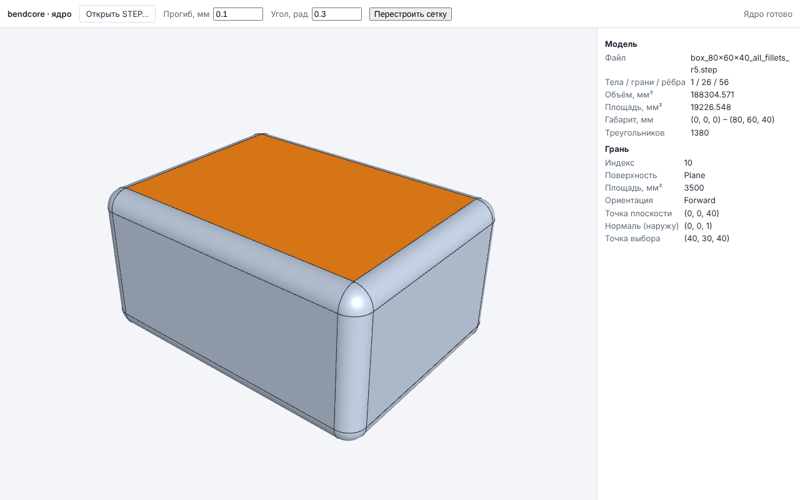

# Вьюпорт ядра: WASM-модуль `bendcore_kernel_wasm` и просмотр STEP в браузере

Фаза 0, п. 5 `docs/ROADMAP_GENERAL_CAD.md`, фронтенд-часть. Ядро (`bendcore_kernel`,
`docs/kernel/KERNEL_CORE.md`) собирается в WebAssembly и работает в браузере и в node:
чтение STEP, свойства формы, тесселяция. React-компонент показывает сетку ядра в three.js,
выбирает грани лучом и показывает их свойства, полученные от ядра.



## Состав

| Файл | Назначение |
|---|---|
| `cmake/wasm_kernel.cmake` | цель `bendcore_kernel_wasm` (только Emscripten), тест `wasm_kernel_corpus` |
| `src/wasm/kernel_bindings.cpp` | embind: реестр форм по handle, функции ядра → `{ok, value}` / `{ok:false, code, message}` |
| `src/wasm/bendcore_kernel_api.mjs`, `.d.mts` | JS API: `loadKernel`, `Kernel`, `KernelShape`, `KernelError`, `faceOfTriangle` |
| `tests/wasm/kernel_corpus.test.mjs` | проверка модуля в node по корпусу `tests/corpus/generated/` |
| `src/ui/kernel/KernelViewport.tsx` | вьюпорт three.js: грани, рёбра, выбор и подсветка грани |
| `src/ui/kernel/KernelViewerApp.tsx` | страница: открыть STEP, параметры сетки, панели «Модель» и «Грань» |
| `src/ui/kernel/kernelLoader.ts` | загрузка модуля в браузере |
| `src/ui/kernel/edgeBuffers.ts` | упаковка полилиний рёбер в один буфер `LineSegments` (+ Jest-тест) |
| `web/kernel-viewer/` | webpack-конфигурация страницы (на основе `webpack.web.js`), шаблон, конфигурация Playwright |
| `tests/e2e-kernel/kernel_viewport.spec.ts` | сквозной тест Playwright |

## Сборка

```bash
export EMSDK=/root/emsdk PATH=/root/emsdk/upstream/emscripten:$PATH   # или source emsdk_env.sh
emcmake cmake -S . -B build-wasm-kernel -G Ninja -DCMAKE_BUILD_TYPE=Release \
  -DBENDCORE_WITH_OCCT=ON \
  -DBENDCORE_OCCT_DIR=/home/user/bendcore/third_party/occt-install-wasm \
  -DBENDCORE_EIGEN_DIR=/home/user/bendcore/third_party/eigen-5.0.0
cmake --build build-wasm-kernel --target bendcore_kernel_wasm
```

OCCT для WASM собирается `third_party/build_occt_wasm.sh` (`docs/kernel/OCCT_BUILD.md`,
раздел 3). Собирается только цель `bendcore_kernel_wasm` и её зависимость `bendcore_kernel`;
остальные цели корневого `CMakeLists.txt` при этом не нужны (предупреждение о заглушке
Eigen к ним и относится).

Результат — `build-wasm-kernel/wasm_kernel/`:

| Файл | Что это |
|---|---|
| `bendcore_kernel.mjs` | клей Emscripten: `-sMODULARIZE=1 -sEXPORT_ES6=1 -sEXPORT_NAME=createBendcoreKernel -sENVIRONMENT=web,node` |
| `bendcore_kernel.wasm` | модуль; ищется рядом с клеем через `import.meta.url` |
| `bendcore_kernel_api.mjs`, `bendcore_kernel_api.d.mts` | копии JS API (POST_BUILD), чтобы node и браузер импортировали всё из одного каталога |

Параметры линковки: `-lembind --no-entry -sALLOW_MEMORY_GROWTH=1 -sINITIAL_MEMORY=64MB
-sSTACK_SIZE=4MB`, исключения `-fexceptions` (как у OCCT для WASM). Уровень оптимизации —
кэш-переменная `BENDCORE_WASM_KERNEL_OPT` (по умолчанию `Oz`).

### Размер

Измерено 2026-11-07, emsdk 6.0.12, OCCT 8.0.1 (`occt-install-wasm`, 29 тулкитов, Release):

| `BENDCORE_WASM_KERNEL_OPT` | `.wasm`, байт | gzip -9, байт | клей `.mjs` (gzip) |
|---|---|---|---|
| `Oz` (по умолчанию) | 12 625 582 (12,0 МиБ) | 3 793 177 (3,6 МиБ) | 168 676 (29 264) |
| `O2` | 14 968 320 (14,3 МиБ) | 3 934 054 (3,8 МиБ) | 169 755 |

Основная часть — STEP (TKDESTEP + TKXSBase, см. `OCCT_BUILD.md`) и BRepMesh; булевых
операций в модуле нет, поэтому он меньше пробной программы из `OCCT_BUILD.md`.
Время в node 22 (`Oz`): инициализация модуля ~130 мс, чтение STEP скруглённого бруска
(64 КБ, 26 граней) ~430 мс, тесселяция (0,1 мм / 0,3 рад, 1380 треугольников) ~85 мс.

## API JS-модуля

```js
import createBendcoreKernel from './bendcore_kernel.mjs';
import { loadKernel, KernelError, faceOfTriangle } from './bendcore_kernel_api.mjs';

const kernel = await loadKernel(createBendcoreKernel);
const shape = kernel.readStep(new Uint8Array(bytes));   // KernelShape
try {
  shape.counts();             // { solids, shells, faces, edges, vertices }
  shape.volumeProperties();   // { volume, centerOfMass: [x,y,z] }, мм³
  shape.surfaceProperties();  // { area, centroid }, мм²
  shape.boundingBox();        // { min: [x,y,z], max: [x,y,z] }, мм
  shape.checkValidity();      // { valid, issues: string[] }
  shape.faceTypes();          // ['Plane', 'Cylinder', ...] по индексу грани
  shape.edgeTypes();          // ['Line', 'Circle', ...] по индексу ребра
  shape.face(3);              // { index, surfaceType, orientation, area, centroid, parameters }
  const mesh = shape.tessellate({ linearDeflection: 0.1, angularDeflection: 0.3 });
  // mesh.positions, mesh.normals: Float32Array (xyz на вершину)
  // mesh.indices: Uint32Array (тройки, против часовой стрелки снаружи)
  // mesh.faceSpans: Uint32Array троек (faceIndex, firstIndex, indexCount)
  // mesh.edges: [{ edgeIndex, points: Float32Array }]
  // mesh.missingFaces, mesh.missingEdges: Uint32Array
  faceOfTriangle(mesh.faceSpans, triangleIndex);  // индекс грани или -1
} finally {
  shape.dispose();
}
kernel.info();                // { occtVersion: '8.0.1', liveShapes }
```

Индексы граней и рёбер — `TopologyIndex` ядра: одинаковы в `faceTypes()`, `face(i)`,
`faceSpans` и `edges`. Значения и ошибки функций — как у C++ API (`KERNEL_CORE.md`); типы —
`bendcore_kernel_api.d.mts`.

`face(i).parameters` — параметры поверхности в глобальных координатах
(`BRepAdaptor_Surface`): плоскость — `origin`, `normal` (наружу из материала, у грани
`REVERSED` развёрнута); цилиндр — `radius`, `axisOrigin`, `axisDirection`; конус —
`referenceRadius`, `semiAngle` (рад), `apex`, ось; сфера — `radius`, `center`; тор —
`majorRadius`, `minorRadius`, ось; B-сплайн — `uDegree`, `vDegree`, `uPoles`, `vPoles`;
`Other` — пустой объект. `area` грани — `BRepGProp` по этой грани.

Параметры `tessellate`: `linearDeflection` (мм, по умолчанию 0,1), `angularDeflection`
(рад, 0,5), `relative` (false), `requireAllFaces` (true). Тесселяция однопоточная
(`inParallel` всегда false: модуль без `-pthread`).

### Время жизни форм

Формы хранятся в реестре внутри модуля; JS получает целый handle (`shape.handle`).
`dispose()` освобождает форму (вместе с её триангуляцией и индексом топологии), повторный
вызов ничего не делает. Сборщик мусора JS формы **не** освобождает: каждую `readStep`
нужно закрыть `dispose()`. `kernel.info().liveShapes` — число живых форм (тест проверяет,
что после всех проверок оно 0). Массивы сетки — копии (не ссылаются на память WASM) и
остаются действительными после `dispose()` и роста памяти.

### Ошибки

Каждая ошибка — `KernelError` (`extends Error`): `code` — код ядра (`InvalidInput`,
`InvalidShape`, `OperationFailed`, `ParseError`, `IoError`, `Unsupported`) или `Disposed`
(вызов на освобождённой форме); `detail` — текст ядра; `message` — `"<code>: <detail>"`.
Исключения C++ через границу WASM не проходят: привязки возвращают `{ok:false, code,
message}`, исключения OCCT (`Standard_Failure`) и `std::exception` перехватываются и
становятся `OperationFailed`. Примеры: не-STEP или пустой буфер → `ParseError`; не
`Uint8Array` → `InvalidInput`; `face(n)` вне диапазона → `InvalidInput`; прогиб ≤ 0 →
`InvalidInput`; форма без тел для `volumeProperties()` → `InvalidInput`.

## Вьюпорт (`KernelViewport`, `KernelViewerApp`)

- **Геометрия** — только из ядра: `positions`, `normals`, `indices` идут в один
  `BufferGeometry` как есть (без пересчёта нормалей). Для каждой тройки `faceSpans`
  создаётся группа отрисовки (`addGroup(firstIndex, indexCount)`), у сетки два материала:
  обычный и подсветка. Рёбра — один `LineSegments`: точки полилиний ядра подряд, индексы
  соединяют соседние точки одной полилинии (`edgeBuffers.ts`). Грани рисуются с
  `polygonOffset`, чтобы рёбра были видны поверх.
- **Выбор**: щелчок без перетаскивания (≤ 4 px) → `Raycaster.intersectObject` →
  `faceIndex` треугольника (three.js r128 для индексированной геометрии даёт номер
  треугольника) → `faceOfTriangle(faceSpans, t)`: двоичный поиск по `firstIndex` диапазонов,
  O(log n). Щелчок мимо модели снимает выбор.
- **Подсветка**: у группы выбранной грани `materialIndex = 1`, без перестроения буферов.
- **Панель «Грань»**: `shape.face(i)` — тип поверхности, площадь, ориентация, параметры
  поверхности, точка попадания. Панель «Модель»: число тел/граней/рёбер, объём (только при
  наличии тел), площадь, габарит, число треугольников.
- **Камера**: `OrbitControls` (three/examples), Z вверх, изометрический вид по ограничивающей
  сфере сетки при открытии файла; отрисовка по событию (без постоянного цикла).
- **Открытие файла**: `<input type=file>` → `File.arrayBuffer()` → `kernel.readStep`.
  Прежняя форма освобождается после успешного чтения новой. «Перестроить сетку» вызывает
  `tessellate` с новыми прогибами для той же формы.
- **Состояние для тестов**: `window.bendcoreKernelViewer.getState()` (статус ядра, ошибка,
  сводка модели, выбор) и `worldToClient(x, y, z)` — экранные координаты точки модели в
  текущем виде. Тест проверяет выбор по состоянию, а не по пикселям.

## Запуск и тесты

```bash
npm ci --ignore-scripts                     # один раз (electron и прочие postinstall не нужны)

# Страница: http://127.0.0.1:3100/ (модуль отдаётся из build-wasm-kernel/wasm_kernel под /kernel/)
BENDCORE_KERNEL_WASM_DIR=build-wasm-kernel/wasm_kernel npm run dev:kernel-viewer

# Модуль в node (корпус): ctest или npm
ctest --test-dir build-wasm-kernel -R wasm_kernel_corpus --output-on-failure
npm run test:kernel-wasm -- --module build-wasm-kernel/wasm_kernel

# Логика UI (Jest)
npx jest src/ui/kernel

# Сквозной тест (Playwright поднимает webpack dev server сам)
PLAYWRIGHT_CHROMIUM_EXECUTABLE=/opt/pw-browsers/chromium-1243/chrome-linux64/chrome \
  npm run test:e2e:kernel
# снимок экрана для этой страницы:
BENDCORE_DOC_SCREENSHOT=$PWD/docs/ui/img/kernel_viewport.png npm run test:e2e:kernel
```

Тест модуля зарегистрирован в **ctest** (`wasm_kernel_corpus`, `cmake/wasm_kernel.cmake`):
он зависит от результата сборки CMake, а `--module`/`--corpus` подставляются из путей
сборки; `npm run test:kernel-wasm` — тот же файл для запуска без ctest (по умолчанию
`build-wasm-kernel/wasm_kernel`). Используется встроенный `node:test`, внешних пакетов нет.

`PLAYWRIGHT_CHROMIUM_EXECUTABLE` нужен, когда браузер для версии `@playwright/test` из
`package-lock.json` не скачан (в облачной среде предустановлен Chromium 1243). WebGL в
headless-режиме — через SwiftShader (`--use-angle=swiftshader`).

### Что проверяется

`tests/wasm/kernel_corpus.test.mjs` (21 тест, ~4 с) — для каждой из 13 моделей корпуса
против `manifest.json` (значения по формулам из размеров, не измерения OCCT): объём,
площадь (относительно 1e-6), габарит (1e-4 мм), число граней и тел; типы граней по
построению модели (коробка — 6 плоскостей, цилиндр — 2 плоскости и цилиндр, тор, сфера,
усечённый конус и т. д.), радиусы цилиндров и сферы; сумма площадей граней = площадь
формы; сетка: одна тройка `faceSpans` на грань, диапазоны подряд и покрывают все индексы,
индексы в пределах вершин, нет `missingFaces`, объём сетки по теореме Гаусса — Остроградского
= объём по формуле с точностью 0,5 % (замкнутость и наружный обход); `faceOfTriangle` для
первого и последнего треугольника каждой грани. Отдельно: нормали граней коробки наружу и
их площади (1200/2000/6000), полуугол конуса `atan((R−r)/h)`, ошибки (`ParseError`,
`InvalidInput`, `Disposed`), `liveShapes = 0` в конце.

`tests/e2e-kernel/kernel_viewport.spec.ts` (4 теста, ~14 с): загрузка ядра; открытие
`box_100x60x20.step` через поле файла, щелчок в центр верхней грани (50, 30, 20) → плоскость
с нормалью (0, 0, 1) и площадью 6000; в центр передней (50, 0, 10) → нормаль (0, −1, 0),
2000; щелчок по фону снимает выбор; `cylinder_r20_h50.step` — щелчок по боковой стороне →
`Cylinder`, радиус 20, площадь 2π·20·50; `box_80x60x40_all_fillets_r5.step` — верхняя грань
площадью 70·50 и снимок экрана (1280×800, `deviceScaleFactor: 1`); файл не STEP → на
странице `ParseError`.

## Ограничения

- Только STEP и только геометрия (как `readStep` ядра): без имён, цветов и структуры
  сборки (XCAF — отдельная задача); сборка показывается как один компаунд, грани всех
  вхождений нумеруются подряд.
- Однопоточный модуль: без `-pthread` (для него нужны заголовки COOP/COEP), BRepMesh без
  параллельного режима. Чтение и тесселяция выполняются в главном потоке и блокируют
  страницу на время вызова (сотни миллисекунд для корпуса); перенос модуля в Web Worker —
  отдельный шаг.
- Размер модуля (3,6 МиБ gzip) задаёт время первой загрузки; сервер должен отдавать `.wasm`
  с `Content-Type: application/wasm` (для потоковой компиляции) и сжатием.
- Выбор — только граней; рёбра и вершины рисуются, но не выбираются. Выбор нескольких
  граней нет.
- Формы не освобождаются сборщиком мусора — только `dispose()` (страница освобождает
  прежнюю форму при открытии новой и при размонтировании).
- Сетка в `float`: при координатах ~1e3 мм погрешность вершин ~1e-4 мм (`KERNEL_CORE.md`).
- Типы three.js в проекте — собственные объявления `src/declarations.d.ts` (пакета
  `@types/three` нет); в них добавлены используемые вьюпортом члены (`addGroup`, `groups`,
  `boundingSphere`, `intersectObject`, массив материалов `Mesh`, модуль `OrbitControls`).
- Сквозной тест есть только для Chromium.
