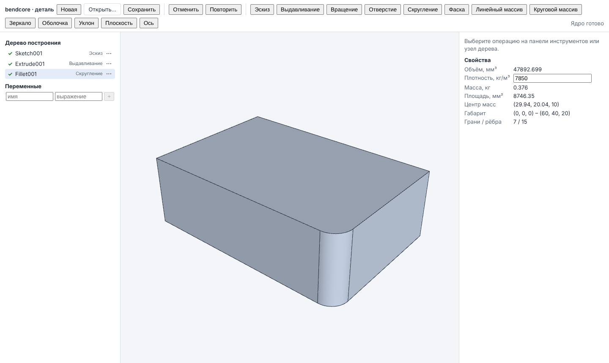

# Интерфейс моделирования детали: WASM-модуль документа и страница `part-modeler`

Фаза 1, п. 7 `docs/ROADMAP_GENERAL_CAD.md`. Документ детали (`bendcore_modeling_document`,
`docs/modeling/PART_DOCUMENT.md`) собирается в WebAssembly; React-страница показывает дерево
построения, панели операций с полями-выражениями и предпросмотром, выбор граней и рёбер во
вьюпорте ядра, отмену/повтор, переменные, массовые свойства, сохранение и открытие файла.
Вся геометрия — тесселяция результата документа ядром; каждое действие интерфейса — вызов
документа.



## Состав

| Файл | Назначение |
|---|---|
| `cmake/wasm_modeling.cmake` | цель `bendcore_modeling_wasm` (только Emscripten), тест `wasm_modeling_document`; подключается из `cmake/wasm_kernel.cmake` |
| `src/wasm/modeling_bindings.cpp` | embind: реестр документов по handle, функции документа → `{ok, value}` / `{ok:false, code, message}` |
| `src/wasm/bendcore_modeling_api.mjs`, `.d.mts` | JS API: `loadModeling`, `ModelingKernel`, `PartDocumentHandle`; ошибки — `KernelError` из `bendcore_kernel_api.mjs` |
| `tests/wasm/modeling_document.test.mjs` | проверка API в node: 3 эталонные детали, правка дерева, транзакции, ошибки |
| `src/ui/modeling/PartModelerApp.tsx` | страница: панель инструментов, дерево, вьюпорт, панель операции, свойства, переменные |
| `src/ui/modeling/FeatureTree.tsx` | дерево построения с состояниями, маркером отката и контекстным меню |
| `src/ui/modeling/FeaturePanel.tsx` | панель операции по описанию типа из каталога ядра |
| `src/ui/modeling/featureForm.ts`, `sketchDimensions.ts`, `treeActions.ts`, `labels.ts` | логика форм, размеры эскиза, действия дерева (меню — ключи `menu.*`), порядок панели инструментов `toolbarTypes`: известные типы по порядку, затем любые другие типы каталога ядра под их подписью или именем ядра (новая операция ядра появляется без правки интерфейса); подписи — словарь `src/ui/app/messages/part.ts` (RU/EN, `docs/ui/APP_SHELL.md`, «Локализация») (Jest: `src/ui/modeling/__tests__`) |
| `src/ui/kernel/KernelViewport.tsx`, `edgePick.ts` | вьюпорт ядра, расширенный выбором рёбер, подсветкой нескольких элементов и наложением (Jest: `edgePick.test.ts`) |
| `web/part-modeler/` | webpack-конфигурация страницы, шаблон, конфигурация Playwright |
| `tests/e2e-modeling/part_modeling.spec.ts` | сквозной тест Playwright |
| `tests/e2e-modeling/phase2_features.spec.ts` | сквозные тесты операций фазы 2 (кинематика, по сечениям, ребро, резьбовое отверстие, новое тело и булева между телами) |

## Сборка

```bash
export EMSDK=/root/emsdk PATH=/root/emsdk/upstream/emscripten:$PATH
emcmake cmake -S . -B build-wasm-modeling -G Ninja -DCMAKE_BUILD_TYPE=Release \
  -DBENDCORE_WITH_OCCT=ON \
  -DBENDCORE_OCCT_DIR=/home/user/bendcore/third_party/occt-install-wasm-checked \
  -DBENDCORE_EIGEN_DIR=/usr/include/eigen3
cmake --build build-wasm-modeling --target bendcore_modeling_wasm
```

Собираются `bendcore_modeling_wasm` и его зависимости (`bendcore_modeling_document`,
`_features`, `_sketch`, `bendcore_kernel`, `bendcore_kernel_healing`, `bendcore_sketch2d`,
PlaneGCS, `bendcore_formula`). Результат — `build-wasm-modeling/wasm_modeling/`:
`bendcore_modeling.mjs` (клей, `-sEXPORT_NAME=createBendcoreModeling`), `bendcore_modeling.wasm`
и копии `bendcore_modeling_api.mjs/.d.mts`, `bendcore_kernel_api.mjs/.d.mts`. Параметры
линковки — как у `bendcore_kernel_wasm` (`KERNEL_VIEWPORT.md`), кроме `-sINITIAL_MEMORY=128MB`
и `-sSTACK_SIZE=8MB` (булевы операции и скругления рекурсивнее чтения STEP). Уровень
оптимизации — `BENDCORE_WASM_MODELING_OPT` (по умолчанию `Oz`).

### Размер и время

Измерено 2026-11-08, emsdk 6.0.12, OCCT 8.0.1, `Oz`: `.wasm` — 19 627 734 байт (18,7 МиБ),
gzip -9 — 5 663 974 байт (5,4 МиБ); клей `.mjs` — 202 754 байт. Больше модуля ядра (12,0 МиБ)
за счёт булевых операций, скруглений, смещений (оболочка), `TKFeat` и PlaneGCS; STEP в модуль
не входит. Node 22: скругление одного ребра бруска с перестроением — ~80 мс; тест
`modeling_document.test.mjs` целиком (3 детали, 15 сценариев изменения размеров,
сохранение/загрузка, правка дерева) — ~7 с.

## API JS-модуля

```js
import createBendcoreModeling from './bendcore_modeling.mjs';
import { loadModeling, KernelError, faceOfTriangle } from './bendcore_modeling_api.mjs';

const modeling = await loadModeling(createBendcoreModeling);
modeling.catalog();   // типы операций: parameters, references, options, links, hasSketch
const doc = modeling.createDocument();          // или modeling.loadDocument(json) → {document, report}
try {
  doc.setVariable('W', '60');
  const sketch = modeling.sketchTemplate({ profiles: [{ kind: 'rectangle', x: 0, y: 0, width: 'W', height: 40 }] });
  doc.addFeature({ type: 'Sketch', id: 'Profile', options: { plane: 'XY' }, sketch });
  doc.addFeature({ type: 'Extrude', id: 'Body', parameters: { distance: 20 }, links: { sketch: 'Profile' } });
  doc.rebuild();                                // {recomputed, reused, fromCache, failed}
  const mesh = doc.tessellate('final', { linearDeflection: 0.05 });   // как KernelShape.tessellate
  const ref = doc.makeReference('final', 'edge', edgeIndex);         // {name, kind, signature}
  doc.addFeature({ type: 'Fillet', parameters: { radius: 5 }, references: { edges: [ref] } });
  doc.rebuild();
  doc.properties('final', 7850);   // {counts, volume, centerOfMass, mass (кг), area, boundingBox}
  doc.undo(); doc.redo();
  const json = doc.save({ includeCache: false });                    // "bendcore-part" v3
} finally {
  doc.dispose();
}
```

| Метод `PartDocumentHandle` | Вызов документа |
|---|---|
| `variables()`, `setVariable`, `removeVariable` | переменные: `{name, expression, value, error}` |
| `features()`, `feature(id)` | узлы по порядку: `index, id, type, label, suppressed, state` (`ok`, `warning`, `error`, `suppressed`, `rolled-back`), `messages`, `parameters` (выражения), `values` (вычисленные), `options`, `links`, `references`, `referenceReports` (`method`: exact/history/signature/broken), `hasBody`, у эскиза `sketch` (данные как в файле) и `sketchResult` (`dof`, `solverStatus`, `regions`, …), у плоскости/оси `datum` |
| `state()` | `size, rollback, canUndo, canRedo, inTransaction, undoHistory, redoHistory` |
| `addFeature(spec, position?)` | `FeatureSpec`: `type, id, label, parameters, options, links, references, sketch, suppressed`; возвращает id |
| `editFeature(id, edits)` | `setLabel/setParameter/setOption/setLink/setReferences/setSketch/setSuppressed` одной записью истории «Edit <id>» (вне открытой транзакции); ошибка любой правки откатывает все |
| `removeFeature`, `moveFeature(id, index)`, `setSuppressed`, `setRollback(pos \| null)` | правка дерева |
| `beginTransaction(name)`, `commitTransaction()`, `abortTransaction()` | транзакции (после `abort` — `rebuild()`) |
| `undo()`, `redo()`, `rebuild()` | отчёт перестроения |
| `makeReference(target, kind, index)` | ссылка на элемент цели по индексу: текущее имя из карты элементов + сигнатура |
| `element(target, kind, index)` | запись карты элементов: `name, origin, feature, aliases, signature` |
| `tessellate(target, params)` | сетка цели с `faceSpans` и полилиниями рёбер; пустое дерево — пустая сетка |
| `properties(target, density?)` | объём и центр масс (если есть тела), площадь, габарит, число элементов; масса, кг = V·1e-9·ρ при ρ в кг/м³ |
| `save({includeCache})`, `dispose()` | файл, освобождение |

**Цели** (`target`): `final` — последнее валидное тело активной части дерева;
`before:<id>` — тело на входе узла; `after:<id>` — тело узла с телом в состоянии ok/warning;
`sketch:<id>` — грани выбранных областей эскиза. Индексы граней и рёбер цели — порядок
`TopExp::MapShapes`: они совпадают с `faceSpans`/`edges[].edgeIndex` её тесселяции и с картой
элементов, поэтому индекс, выбранный во вьюпорте, превращается в имя
(`G[Body](Profile:V1_2)`) без поиска по геометрии.

**Шаблоны эскиза** (`sketchTemplate`, C++ `SketchBuilder`): `rectangle` (закреплённый угол,
горизонтальность/вертикальность, размеры Distance), `circle` (закреплённый центр, Radius),
`polygon` (закреплённые вершины), `point` (закреплённая точка — центр отверстия). Числа —
выражения (строка или число). Несколько профилей дают один эскиз (кольцо из двух окружностей).

**Ошибки** — `KernelError {code, detail}`: неверный аргумент JS (не тот тип, нет поля,
неизвестный вид элемента, индекс вне диапазона, неизвестная цель) → `InvalidInput`; ошибки
документа — с его кодом (`InvalidInput` для неверного выражения или несуществующего узла,
`Unsupported` для неизвестного типа, `ParseError` для чужого файла); исключения OCCT и
`std::exception` → `OperationFailed`; вызов освобождённого документа → `Disposed`. Ошибка
построения узла (нет тела, сломанная ссылка, конфликт эскиза) исключением не является: узел
получает состояние `error` с сообщением.

## Страница (`PartModelerApp`)

- **Панель инструментов**: Новая, Открыть… (файл JSON → `loadDocument`), Сохранить (`save()` →
  загрузка файла), Отменить/Повторить (подсказка — имя записи истории), кнопки типов операций
  из каталога ядра: эскиз, выдавливание/вырез (опция «Режим»), вращение, отверстие,
  скругление, фаска, линейный и круговой массивы, зеркало, оболочка, уклон, плоскость, ось,
  затем остальные типы каталога: операции над телами, по сечениям, ребро, кинематика,
  резьбовое отверстие (подписи — словарь `part.ts`; примитивы `Box`, `Cylinder` на панель не
  выводятся).
- **Дерево построения**: узлы по порядку, отметка состояния (✓ ок, ! предупреждение, ✕ ошибка,
  – подавлен, · за маркером), сообщения узла; меню «⋯» или правый щелчок: Редактировать,
  Подавить/Включить, Удалить, Перенести выше/ниже, Откатить до этой операции
  (`setRollback(index + 1)`); маркер отката с кнопкой «Снять». Выбор эскиза в дереве
  показывает его области полупрозрачным наложением (`tessellate('sketch:<id>')`).
- **Панель операции** строится по каталогу типа: параметры — поля-выражения (переменные
  документа, `+ - * / ^`, функции; после предпросмотра рядом вычисленное значение), опции —
  списки, связи — выбор из более ранних узлов допустимого типа (по умолчанию последний
  подходящий), ссылки — слоты «Выбрать во вьюпорте». Новый эскиз — форма контура
  (прямоугольник, окружность, полилиния «x; y» по строке, **открытая траектория**) и параметры размещения (плоскость
  XY/XZ/YZ/грань/вспомогательная, смещение, начало); редактирование эскиза — его размеры
  (координаты закреплённых точек, Distance/Radius/Angle), структура не меняется, поэтому имена
  граней и рёбер и ссылки ниже по дереву сохраняются.
- **Открытая траектория** (`pathSketch`, `sketchDimensions.ts`) — путь кинематики и контур
  ребра: по строке на вершину, «x; y» — отрезок от предыдущей вершины, «x; y; cx; cy[; cw|ccw]»
  — дуга вокруг центра (cx, cy) до (x, y) (по умолчанию против часовой стрелки; дуга не может
  быть первой строкой). Вершины и центры — закреплённые точки (размеры эскиза в панели
  правки), отрезки и дуги — кривые; данные эскиза строит интерфейс, без шаблона ядра. Выбор
  этой формы ставит опции эскиза `contour = open` (`withTemplateKind`, `featureForm.ts`;
  другие формы — `closed`).
- **Предпросмотр**: открытие панели начинает транзакцию; «Предпросмотр» добавляет узел (или
  применяет правки) и перестраивает — вьюпорт, свойства и состояние узла показывают результат;
  «ОК» применяет и фиксирует транзакцию (одна запись истории); «Отмена» — `abortTransaction()`
  и перестроение (результаты из пула, без пересчёта).
- **Выбор во вьюпорте**: при активном слоте вьюпорт показывает тело на входе узла
  (`before:<id>`, до первого предпросмотра — `final`), щелчок выбирает грань или ребро по
  виду слота; повторный щелчок убирает элемент; выбранные подсвечены. Ребро: полилинии
  рёбер ядра проецируются на экран, берётся ближайший отрезок в пределах 6 px
  (`edgeCandidates`), затем проверка глубины — точка отрезка, ближайшая к лучу курсора
  (`closestPointOnSegmentToRay`), не дальше первого пересечения луча с гранями (иначе ребро
  закрыто). Без открытой панели щелчок по грани показывает её имя в «Свойствах».
- **Отмена/повтор**: Ctrl+Z, Ctrl+Y (и Ctrl+Shift+Z) вне полей ввода и при закрытой панели.
- **Свойства**: объём, плотность (кг/м³, по умолчанию 7850), масса, площадь, центр масс,
  габарит, число граней/рёбер.
- **Переменные**: список с выражениями и значениями, правка по выходу из поля, добавление и
  удаление.
- **Камера**: кадрирование только по первому телу после открытия/создания документа, чтобы
  правки не сбивали вид.
- **Состояние для тестов**: `window.bendcorePartModeler.getState()` (статус, ошибка, узлы,
  состояние документа, свойства, панель с выбранными именами, показываемая цель) и
  `worldToClient(x, y, z)`.

Готовые React-панели `src/features/modeling` (Pad, Pocket, Fillet, …) не используются: их
поля не совпадают с параметрами операций ядра (например, `preserveEdges` у скругления, тип
глубины без условий окончания ядра), а панель по каталогу ядра показывает ровно то, что
операция принимает.

## Запуск и тесты

```bash
npm ci --ignore-scripts
BENDCORE_MODELING_WASM_DIR=build-wasm-modeling/wasm_modeling npm run dev:part-modeler   # http://127.0.0.1:3110/

ctest --test-dir build-wasm-modeling -R wasm_modeling_document --output-on-failure
npm run test:modeling-wasm -- --module build-wasm-modeling/wasm_modeling
npx jest src/ui/modeling src/ui/kernel
PLAYWRIGHT_CHROMIUM_EXECUTABLE=/opt/pw-browsers/chromium-1243/chrome-linux64/chrome \
  npm run test:e2e:modeling -- --trace off
# снимок для документации:
BENDCORE_DOC_SCREENSHOT=$PWD/docs/ui/img/part_modeling.png npm run test:e2e:modeling -- -g fillet
```

### Что проверяется

`tests/wasm/modeling_document.test.mjs` (6 тестов): эталонные детали
`docs/modeling/REFERENCE_PARTS.md` — крышка со скруглениями (4 скругления рёбер, отверстие
на грани, массив 2×2), втулка с фасками (кольцо из двух окружностей, фаски наружной и
внутренней кромок), литая бобышка с уклоном (уклон 4 граней от нейтральной) — строятся через
JS API; рёбра и грани выбираются по геометрии сетки (точки полилиний, вершины треугольников),
ссылки — `makeReference` по индексу. Объём против формулы (отн. 1e-6) в исходном состоянии и
в 15 сценариях изменения размеров; возврат к исходным значениям — объём бит в бит; транзакция
изменения двух размеров: `undo()` без пересчёта (`recomputed` пуст) и с исходным объёмом
бит в бит, `redo()`; сохранение → загрузка (те же узлы, состояния, ссылки, объём 1e-9,
документ остаётся параметрическим) и загрузка с кэшем BRep (тела из кэша). Правка дерева:
имя бокового ребра `G[Body](Profile:V1_2)`, скругление следует за изменением размера эскиза
(`editFeature` с новыми данными эскиза, ссылка `exact`), подавление, откат, перенос выше тела
(состояние `error`), удаление и его отмена; предпросмотр выреза в транзакции и
`abortTransaction()`; масса и площадь по формулам; ошибки с кодами; каталог; `liveDocuments = 0`.

`tests/e2e-modeling/part_modeling.spec.ts` (2 теста, ~10 с): эскиз прямоугольника 60×40 →
выдавливание 20 (объём 48 000); скругление R5 — щелчок по ребру (60, 0, 10) во вьюпорте даёт
ссылку `G[Extrude001](Sketch001:V1_2)`, предпросмотр в транзакции и ОК — объём
`W·D·H − (1 − π/4)·r²·H`; правка размера эскиза 60 → 80 из дерева — объём по формуле, все
узлы ок; Ctrl+Z — прежний объём, Ctrl+Y — новый; снимок экрана. Второй тест: подавление (нет
тела) и отмена кнопкой, откат до эскиза и снятие маркера, неверное выражение →
`InvalidInput` на странице и отмена панели, сохранение в файл (формат v3), новая деталь и
открытие файла — тот же объём.

### Операции фазы 2 (`phase2_features.spec.ts`, 4 теста, ~45 с)

Все входы задаются панелями из каталога ядра; объём в «Свойствах» сверяется с формулой,
отмена и повтор — кнопками и Ctrl+Z / Ctrl+Y.

1. Кинематика: окружность r = 5 на XY; открытая траектория на XZ `0; 0`, `0; 30`,
   `20; 50; 20; 30; cw` (опция «Контур» сама становится «открытый»); связи «Эскиз» и «Эскиз
   траектории» — объём `πr²(30 + π/2·20)` (отн. 1e-6); правка радиуса профиля 5 → 6 из
   дерева — объём следует; отмена/повтор.
2. По сечениям: окружности R20 (z = 0) и R10 (смещение 30), «Сечение 1/2», «линейчатая» —
   `π·30/3·(R1² + R1R2 + R2²)`; отмена (тела нет) и повтор.
3. Ребро и резьбовое отверстие: уголок из двух выдавливаний (40×20×5 и 5×20×40); открытый
   контур `5; 25`, `22; 5` в плоскости y = 10 (XZ, смещение −10) → «Ребро» толщиной 2 (+340);
   «Резьбовое отверстие»: слот «Грань» активен, щелчок по верхней грани основания, M8,
   длина резьбы 0, насквозь — минус `π·6,75²/4·5`; отмена/повтор.
4. Новое тело и булева между телами: пластина 40×30×10; окружность r = 5 → «Выдавливание» в
   режиме «новое тело» на 30 — объём двух тел `12000 + 750π`; «Булева операция тел»: цель —
   щелчок по верхней грани пластины, инструменты — «Выбрать во вьюпорте» и щелчок по боковой
   грани стойки, «вычитание» — `12000 − 250π`; отмена/повтор.

## Выполнение в Web Worker (фаза 5)

Страница вызывает модуль не напрямую, а через воркер (`docs/ui/APP_SHELL.md`): загрузчик
возвращает `WasmClient`, методы API на странице асинхронны (`Promise`), ошибки — тот же
`KernelError`. Долгие вызовы показывают индикатор с кнопкой «Прервать»; после отмены документ
восстанавливается из снимка последнего завершённого изменения. Тестовый хук страницы получил
`idle()` — сквозные тесты читают состояние после него. Синхронный API `src/wasm/*_api.mjs`
не изменился и используется в node-тестах и внутри воркера.

## Ограничения

- Панель «Эскиз» задаёт эскиз шаблонами (прямоугольник, окружность, полилиния, точка) и правкой
  размеров; рисование мышью с ограничениями — редактор эскиза («Нарисовать эскиз», «Редактировать
  эскиз» в меню узла), `SKETCH_EDITOR.md`. Эскиз панели не рисуется поверх модели до
  предпросмотра (наложение — грани областей построенного эскиза).
- Ссылки в панели редактирования, выбранные ранее, показываются именами без подсветки
  (индекс в показанной цели известен только для выбранных в этой сессии панели).
- Связь операции нельзя очистить правкой (у документа нет удаления связи); необязательные
  связи задаются при добавлении.
- Выбор вершин не поддерживается; выбор рамкой и фильтры выбора отсутствуют.
- Плотность не хранится в файле детали (в формате v3 нет поля материала) — это поле страницы.
- Модуль однопоточный: в оболочке (`APP_SHELL.md`) вызовы идут в Web Worker и страницу не
  блокируют, но операции одного документа выполняются последовательно.
- Документы не освобождаются сборщиком мусора — только `dispose()`.
- Сквозной тест есть только для Chromium.
- Открытая траектория задаётся вершинами в панели (или рисуется в редакторе эскиза); выбор
  рёбер модели как траектории (`path = edges`) работает через слоты, но сквозным тестом не
  покрыт. Массивы и зеркало тел, удаление тела, оболочка, уклон — проверены через API модуля
  (`tests/wasm/modeling_document.test.mjs`), без сквозного теста страницы.
