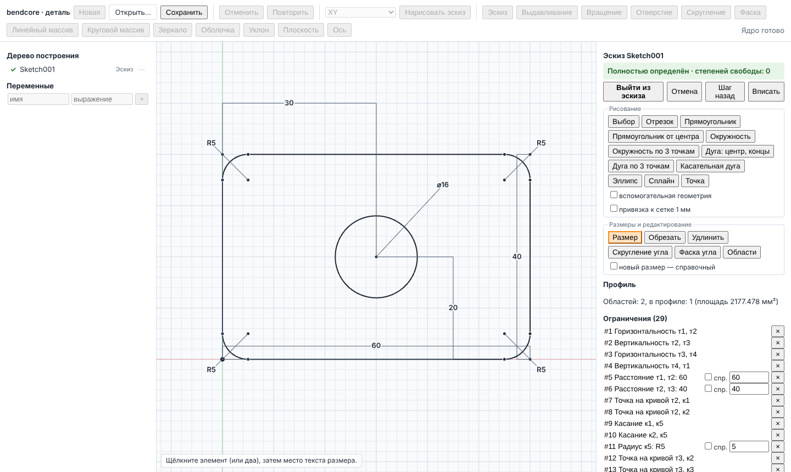

# Редактор эскиза с ограничениями

Страница моделирования детали (`PART_MODELING_UI.md`) получила редактор эскиза уровня
SolidWorks/КОМПАС: рисование мышью с привязками и автоматическими ограничениями, ограничения и
размеры с полями-выражениями, перетаскивание с перерешением, индикация определённости из
диагностики ядра, инструменты редактирования ядра, выбор областей профиля. Геометрия на экране —
решение PlaneGCS и кривые OCCT из ядра; интерфейс меняет только данные эскиза (`SketchData`
документа, `PART_DOCUMENT.md`) и вызывает ядро.



## Состав

| Файл | Назначение |
|---|---|
| `src/wasm/sketch_editor_bindings.cpp` | `docSketchSolve`, `docSketchEdit`: решение данных эскиза в контексте узла и инструменты редактирования |
| `src/wasm/modeling_bindings_internal.hpp` | общие помощники обеих частей модуля (реестр документов, `{ok, value}`, преобразования JS ↔ C++) |
| `src/wasm/modeling_bindings.cpp` | `sketchResult.placement` (система координат эскиза) в описании узла |
| `src/wasm/bendcore_modeling_api.mjs`, `.d.mts` | `PartDocumentHandle.solveSketch`, `editSketch`, типы `SketchSolution`, `SketchTool` |
| `src/ui/modeling/sketch/SketchEditor.tsx` | режим эскиза: инструменты, панель ограничений, размеры, список конфликтов, профиль |
| `src/ui/modeling/sketch/SketchCanvas.tsx` | вид по нормали: тело (three.js, ортографическая камера) и слой SVG с сеткой, областями, кривыми, точками, размерами |
| `src/ui/modeling/sketch/snap.ts` | привязки |
| `src/ui/modeling/sketch/projectPick.ts` | выбор ребра или грани тела в виде эскиза (инструмент «Проекция рёбер») |
| `src/ui/modeling/sketch/drawTools.ts` | инструменты рисования: щелчки → точки, кривые и автоматические ограничения |
| `src/ui/modeling/sketch/sketchModel.ts` | добавление и удаление с перенумерацией, применимые ограничения, подсветка конфликтов |
| `src/ui/modeling/sketch/dimensionLayout.ts`, `sketchLabels.ts` | оформление размеров, выбор типа размера по месту текста, описание ограничений (`describeConstraint`); подписи инструментов, ограничений, привязок и ошибок построения — словарь `src/ui/app/messages/sketch.ts` (RU/EN) |
| `src/wasm/dxf_sketch_bindings.cpp` | `dxfSketch`: DXF (`bendcore_dxf`) → данные эскиза, слои, единицы, совмещение концов |
| `src/ui/modeling/sketch/DxfImportPanel.tsx`, `dxfImport.ts` | панель «Импорт DXF» редактора эскиза: параметры, сводка ответа ядра |
| `tests/wasm/sketch_editor.test.mjs` | node: новые поля API на эталонных эскизах |
| `tests/wasm/dxf_sketch.test.mjs`, `tests/dxf/sketch/` | node: импорт DXF из файлов ezdxf и `bendcore_drawing_v2`, площадь и объём против формул |
| `tests/e2e-modeling/dxf_import.spec.ts` | Playwright: DXF-контур → эскиз → выдавливание, объём против формулы |
| `src/ui/modeling/sketch/__tests__/sketchEditorLogic.test.ts` | Jest: привязки, инструменты, выбор, удаление, размеры |
| `src/ui/modeling/sketch/__tests__/sketchTools.test.ts` | Jest: размер смещения (ведущий/ведомые) при удалении и в подписях, выбор ребра/грани для проекции |
| `tests/e2e-modeling/sketch_editor.spec.ts` | Playwright: сценарий пользователя |
| `tests/e2e-modeling/sketch_tools.spec.ts` | Playwright: эквидистанта со скруглением, обрезка эллипса, круговой массив, проекция грани и её пересчёт |

## API ядра

### `doc.solveSketch(featureId, sketch, options?) → SketchSolution`

Узел эскиза документа при открытом контуре, конфликте ограничений или во время рисования
целиком переходит в состояние `error` и геометрии не даёт. Редактору нужно решение именно в
этих состояниях, поэтому модуль решает данные эскиза сам, не меняя документ, в контексте узла
`featureId`:

- выражения вычисляются с переменными документа;
- система PlaneGCS строится так же, как в узле (`BoundSketch`, те же операнды, проверки
  положительности, правило справочных размеров); совпадение проверяет node-тест (dof,
  определённость, значения размеров, площадь области против `properties('sketch:…')`);
- система координат — из последнего результата узла; до первого успешного построения базовые
  плоскости XY/XZ/YZ со смещением ставятся напрямую (эскиз на грани или вспомогательной
  плоскости требует построенного узла — иначе `InvalidInput` с сообщением узла);
- точки проецированных кривых закреплены в положениях последнего результата узла.

Результат:

| Поле | Смысл |
|---|---|
| `converged`, `status`, `dof`, `definition` | сходимость, строка sketch2d, степени свободы, `fully-defined` / `under-defined` / `over-defined` |
| `conflicting`, `redundant`, `partiallyRedundant` | номера ограничений (с 1, порядок `sketch.constraints`) |
| `points[]` | решённые координаты, `fixed`, `defined` (определена ли точка) |
| `curves[]` | по сущностям: `type`, `construction`, `defined`, `polyline` (Float64Array x, y по кривой OCCT: окружности и дуги — шаг ≤ 3,75°, сплайн — 24 отрезка на полюс), `midpoint` (середина по параметру у незамкнутых), `center`, `radius` |
| `intersections[]` | попарные пересечения кривых (`Geom2dAPI_InterCurveCurve`) — цели привязки |
| `constraintValues`, `residuals` | значения размеров (справочных — измеренные), невязки |
| `profile` | `issues` (`checkSketchCurves`), `regions`: внешний контур (`entities`), дыры, площадь, глубина, `material`, `selected` (по правилу `sketch.regions` узла), `selector` (сущность, выбирающая ровно эту область), треугольники грани в координатах эскиза; `null` при конфликте/несходимости и с `lite` |
| `sketch` | данные, у которых свободные точки и начальные радиусы перенесены в решение (выражения размеров и закреплённых точек не меняются) |
| `placement` | `origin`, `xDirection`, `yDirection`, `normal` |

`options.drag = {point, x, y}` — перетаскивание: временная закреплённая точка в (x, y) и
ограничения `DistanceX/Y` = 0 к перетаскиваемой точке — обе координаты, иначе только X, иначе
только Y (точка, которая может двигаться лишь вдоль одного направления, следует за курсором в
нём); попытка засчитывается при сходимости без конфликтов, иначе положения восстанавливаются.
Диагностика всегда из финального решения без временной геометрии. Закреплённую точку тянуть
нельзя (`InvalidInput`). `options.lite` — без пересечений и профиля (предпросмотр при рисовании
и перетаскивании).

Записываемые координаты не используют экспоненциальную запись (парсер выражений её не знает):
значения меньше 1e-9 записываются как 0.

### `doc.editSketch(featureId, sketch, tool) → SketchEditOutcome`

Инструменты `bendcore::modeling` (`sketch_tools.hpp`, `SKETCH.md`) над решённым эскизом:
`trim`/`extend` (`entity`, `pick`; все виды кривых), `offset` (`chain`, `distance`, `bothSides`,
`corners`: `extend` | `round`; ответ `dimension` — номер размера смещения), `mirror` (`entities`,
`axis`), `linear-pattern` (`entities`, `step`, `count`), `circular-pattern` (`entities`,
`center` — точка, `count`, `angle` — шаг, °), `fillet` (`a`, `b`, `radius`), `chamfer` (`a`,
`b`, `d1`, `d2`). Эскиз с конфликтом не редактируется (`InvalidInput`). Результат переводится
обратно в `SketchData`: удалённые точки и сущности выбрасываются с перенумерацией (точки,
сущности, ограничения, `regions`), существующие ограничения сохраняют выражения и признак
справочного размера, новые — числовые значения. Возвращаются `created`, `modified` (новые номера),
`removed` (прежние), новые точки и ограничения. Ведомое ограничение `offset-distance` хранит в `c`
номер ведущего размера (перенумеровывается вместе с ним; удаление ведущего удаляет ведомые).

### `doc.projectToSketch(featureId, sketch, elements, options?) → SketchProjectOutcome`

Проекция рёбер модели из редактора: `elements` — `[{kind: 'edge' | 'face', index}]` тела, на
котором рисуется эскиз (цель `before:<featureId>`, то же тело, что показано в редакторе); грань
даёт все свои рёбра. Каждое ребро проецируется `projectEdge` (`SKETCH_PROFILE.md`, 26 случаев) в
систему координат узла и становится ссылкой слота `projected` узла (топологическое имя через
`makeReference`; уже имеющаяся ссылка переиспользуется) и кривой данных эскиза с `projection` =
номер ссылки (`projectedDefinition`: отрезок, окружность, дуга, эллипс, дуга эллипса, сплайн с
узлами и весами проекции). Ссылки узла меняются сразу (внутри транзакции редактора: «Отмена»
откатывает и их), данные эскиза возвращаются. При каждом перестроении узел заново находит рёбра
по истории имён и проецирует их (`projectedPins`): точки кривой закреплены в проекции, радиус
окружности и малая полуось эллипса — тоже; у сплайна число полюсов должно сохраниться. Рёбра,
перпендикулярные плоскости, пропускаются (`skipped`). `options.construction` — вспомогательная
геометрия. Ответ: `sketch`, `created` (номера кривых), `skipped` (индексы рёбер), `references`
(число ссылок слота).

### `modeling.dxfSketch(bytes, options?) → DxfSketchImport` — импорт DXF

Функция модуля (не документа): файл DXF (`Uint8Array` или строка) читает `bendcore_dxf`
(`docs/drawing/DXF_IMPORT.md`), переводит в мм и превращает кривые в данные эскиза. Геометрию
строит ядро; интерфейс только выбирает параметры и показывает ответ.

| Параметр | Смысл |
|---|---|
| `layers` | имена слоёв (без учёта регистра); по умолчанию — все слои, не замороженные и не выключенные (отрицательный цвет); неизвестное имя — `InvalidInput` |
| `units` | код `$INSUNITS`, заменяющий единицы файла |
| `defaultUnits` | код единиц только для файла без `$INSUNITS` (панель передаёт 4 — мм); без него такой файл — `InvalidInput` «no $INSUNITS» |
| `tolerance` | мм, по умолчанию 0,001: концы ближе допуска — одна точка эскиза |
| `fixed` | импортированные точки закреплены |
| `paperSpace` | читать и примитивы пространства листа (группа 67) |
| `into` | данные эскиза, к которым добавляются импортированные (точки, кривые, ограничения сохраняются) |

Преобразование: LINE → отрезок; ARC → дуга против часовой стрелки (как в DXF); CIRCLE →
окружность; LWPOLYLINE и POLYLINE → отрезок на прямой сегмент и дуга на сегмент с выпуклостью
(`bulgeToArc`; сегмент по часовой стрелке становится дугой против часовой от конца к началу);
замкнутая полилиния — с замыкающим сегментом. Совмещение концов: сетка с шагом допуска, точка
сравнивается с точками своей и восьми соседних ячеек; совпавшая точка сохраняет положение
первой (контур смещается не больше чем на допуск). Отрезки и дуги короче допуска пропускаются
(`degenerate`). Ограничения не создаются: совпадение концов выражено общей точкой.

Ответ: `sketch`, `layers` (имя, цвет, заморожен, выключен, число кривых, выбран), `version`,
`fileUnits` (0 — нет), `units`, `mmPerUnit`, `imported` (отрезки, дуги, окружности, полилинии,
их сегменты, вырожденные), `entities` (номера новых кривых), `points`, `merged`, `openEnds`
(точки, которыми кончается ровно один отрезок или дуга — незамкнутые места контура),
`ignored` (тексты, пространство листа, невыбранные слои), `skipped` (типы, которые читатель не
поддерживает: SPLINE, ELLIPSE, INSERT, HATCH…), `warnings` читателя, `bounds`.

### `sketchResult` узла

Поля `definition`, `redundant`, `pointDefined`, `entityDefined`, `constraintValues` (из
`SKETCH.md`) проверены node-тестом на эталонных эскизах; добавлено `placement`.

## Интерфейс

- **Вход**: «Нарисовать эскиз» на панели (плоскость XY/XZ/YZ или «выбранная грань» — грань,
  выбранная щелчком во вьюпорте) — транзакция «Эскиз», узел с пустыми данными, перестроение,
  режим эскиза; существующий эскиз — «Редактировать эскиз» в меню узла дерева (транзакция
  «Изменить эскиз: …»). **Выход** — правка данных узла, перестроение детали, фиксация
  транзакции (одна запись отмены). «Отмена» — откат транзакции (новый эскиз исчезает).
- **Вид**: плоскость эскиза по нормали — тело на входе узла (`before:<id>`) в системе
  эскиза под ортографической камерой, поверх — слой SVG. Колесо — масштаб к курсору, средняя
  или правая кнопка — сдвиг, «Вписать». Сетка 1-2-5·10ⁿ мм не чаще 12 px, оси X/Y и начало.
- **Привязки** (`snap.ts`, радиус 8 px): точка (конец, центр, точка) → пересечение → середина →
  начало координат → кривая → горизонталь/вертикаль от предыдущей точки инструмента → сетка
  1 мм (флажок). Маркер с подписью привязки.
- **Рисование**: отрезок/полилиния (цепочка до Esc или двойного щелчка), прямоугольник по углам
  и от центра, окружность (центр–радиус, 3 точки), дуга (центр–концы, 3 точки, касательная),
  эллипс (центр, конец оси, точка на эллипсе; большая ось — длиннее), сплайн (полюса, Enter —
  завершить; степень min(3, n − 1), зажатые равномерные узлы), точка. Флажок «вспомогательная
  геометрия». Предпросмотр — кривые из решения ядром пробных данных (`lite`).
- **Автоматические ограничения**: привязка к точке — та же точка; к началу координат —
  закреплённая точка (0, 0); к середине — `midpoint`; к кривой — `point-on`; к пересечению —
  два `point-on`; отрезок в пределах 2° от оси — `horizontal`/`vertical`; прямоугольник — 4 H/V,
  от центра — ещё `symmetric-point` углов относительно центра; окружность с ободом на точке —
  `point-on`; касательная дуга — `tangent` с кривой, из конца которой она начинается.
- **Ограничения**: «Выбор» (Shift — добавить), панель предлагает применимые к выбору
  (`applicableConstraints`): совпадение, горизонтальность, вертикальность, параллельность,
  перпендикулярность, касание, равенство, симметрия (две точки и ось, три точки), середина,
  точка на кривой, концентричность, закрепление, поворот, и размеры — расстояние, по X/Y, до
  кривой, радиус, диаметр, угол, длина дуги, полуоси эллипса. Удаление (Delete) с
  перенумерацией, переключение вспомогательной геометрии, «Шаг назад» (Ctrl+Z) внутри эскиза.
- **Размеры**: инструмент «Размер» — щелчок по элементу (или двум), затем по месту текста;
  окружность — диаметр, дуга — радиус, отрезок — длина, две точки — по месту текста: выше/ниже
  обеих — по X, правее/левее — по Y, иначе — расстояние. Новый размер сначала добавляется
  справочным, ядро измеряет его, поле-выражение показывает значение; Enter — управляющий
  размер с введённым выражением (переменные документа). Флажок «новый размер — справочный».
  Текст размера перетаскивается (смещение хранится на время работы страницы), двойной щелчок —
  правка выражения; в списке — значение, «спр.» (справочный ⇄ управляющий по измеренному
  значению), удаление.
- **Перетаскивание**: свободную точку можно тянуть в «Выборе» — каждое движение решается ядром с
  `drag`, отпускание фиксирует решение.
- **Индикация**: статус «Полностью определён / Недоопределён / Переопределён» и число степеней
  свободы; определённые элементы чёрные, недоопределённые синие, операнды конфликтующих
  ограничений красные, избыточных — оранжевые (`definitionState`); список конфликтующих и
  избыточных ограничений, их строки и тексты размеров подсвечены.
- **Редактирование** (ядро): обрезка и удлинение — щелчок по кривой (любой вид: отрезок, дуга,
  окружность, эллипс, дуга эллипса, сплайн; режущими служат все кривые, включая проекции);
  скругление и фаска угла — щелчок по вершине двух отрезков (радиус, катеты — поля);
  эквидистанта (поле «Эквидистанта, мм», флажок «в обе стороны», «Углы: продлить / скруглить»;
  один размер «Смещение», остальные смещения показаны как «= размер #k» и следуют за ним), зеркало
  (ось — отрезок, выбранный последним), линейный массив, круговой массив (центр — выбранная
  точка) — кнопки для выбора. Копии зеркала и массивов связаны симметрией, сдвигом или поворотом
  точек и равенством радиусов / малых полуосей — следуют за исходными.
- **Проекция рёбер**: инструмент «Проекция рёбер» — щелчок по ребру тела (в пределах 8 px) или
  по грани (ближайшая к наблюдателю под курсором) в виде редактора (`projectPick.ts`) вызывает
  `projectToSketch`; новые кривые выбраны, их точки закреплены. Флажок «вспомогательная
  геометрия» действует и на проекции. После изменения модели и перестроения проекция
  пересчитывается.
- **Профиль**: замечания профиля, число областей и площадь выбранных; инструмент «Области» —
  щелчок внутри области (по треугольникам ядра) включает/исключает её (`sketch.regions` через
  `selector`), выбранные залиты.
- **Импорт DXF** («Импорт DXF…» под кнопками эскиза): выбор файла `.dxf`; ядро отвечает
  слоями файла (флажки, по умолчанию — не замороженные и не выключенные), единицами («из файла
  ($INSUNITS = …)» или выбор мм, см, дм, м, мкм, дюйм, фут, мил; для файла без единиц — мм и
  предупреждение), допуском совпадения концов и флажком «закрепить точки». Каждое изменение
  заново спрашивает ядро; сводка — число отрезков, дуг, окружностей, полилиний, точек и
  совмещённых концов, габарит, «Все контуры замкнуты» или «Незамкнутых концов: N»,
  неподдерживаемые типы, пропущенные тексты и примитивы листа. «Вставить в эскиз» — ядро
  добавляет кривые к текущим данным (`into`), редактор решает их одним шагом истории эскиза
  («Шаг назад» убирает весь импорт), выделяет незамкнутые концы и вписывает вид. Ошибки ядра —
  локализованным текстом (`APP_SHELL.md`, «Сообщения ядра»).
- **Состояние для тестов**: `window.bendcoreSketchEditor.getState()` (определённость, dof,
  ограничения с измеренными значениями и состоянием, точки, кривые, области, сообщение) и
  `sketchToClient(x, y)`; `bendcorePartModeler.getState().sketchMode`.

## Запуск и тесты

Сборка WASM — `PART_MODELING_UI.md` (цель `bendcore_modeling_wasm`, теперь из двух файлов
привязок).

```bash
ctest --test-dir build-wasm-modeling -R wasm_sketch_editor --output-on-failure
npm run test:sketch-editor-wasm -- --module build-wasm-modeling/wasm_modeling
npx jest src/ui/modeling
PLAYWRIGHT_CHROMIUM_EXECUTABLE=/opt/pw-browsers/chromium-1243/chrome-linux64/chrome \
  npm run test:e2e:modeling -- --trace off
# снимок для документации:
BENDCORE_DOC_SCREENSHOT=$PWD/docs/ui/img/sketch_editor.png npm run test:e2e:modeling -- -g rounded
```

`tests/wasm/sketch_editor.test.mjs` (14 тестов): прямоугольник 60×40 — `fully-defined`, dof 0,
все точки и сущности определены, значения размеров; без ширины — dof 1, свободны ровно точки 1,
2 и три стороны; лишняя ширина 60 — `over-defined`, избыточность #5/#7, состояние `warning`;
50 — конфликт #5 и #7 и ошибка узла с теми же номерами; справочная диагональ — √(60² + 40²),
эскиз определён; решение совпадает с узлом (dof, определённость, значения), углы — в
аналитических положениях, площадь области = площади грани документа; перетаскивание угла
(75, 3) — угол в (75, 0), противоположный следует, площадь 75·40, диагностика без временных
ограничений; прямоугольник с окружностью — области 2400 − 64π и 64π, выбор диска через
`selector`; открытый профиль и пересечение двух отрезков (5, 5); система координат XZ со
смещением 7 до и после построения узла; ошибки (операнд, отрицательный размер, не эскиз,
неизвестный инструмент); переменные в выражениях. `editSketch`: четыре скругления R5 —
`fully-defined`, площадь 60·40 − (4 − π)·25, объём выдавливания и объём после смены ширины на 80;
фаска 6×4 (−12 мм²), обрезка отрезка по стороне, зеркало, линейный массив окружностей.

`sketch_editor.spec.ts` (2 теста, ~10 с): (1) прямоугольник от начала координат (привязка
«начало координат», 4 H/V, dof 2), размеры 60 и 40, скругления R5 четырёх углов, окружность и её
диаметр 16, положение центра по X (30) и Y (20) от угла — статус «Полностью определён», dof 0,
все кривые определены, две области; снимок; размер 70 между теми же углами — конфликт: статус
переопределён, номер в списке конфликтов, строка и текст размера красные, точки угла красные;
«спр.» — измеряет 60, снова определён; выбор областей (диск, пластина); выход, выдавливание 10 —
объём (W·H − (4 − π)r² − πd²/4)·D; «Редактировать эскиз», двойной щелчок по размеру 60 → 80,
выход — объём для 80, узлы ок. (2) полилиния с автоматическими H/V, все инструменты кривых,
касательная дуга с `tangent`, прямоугольник от центра с `symmetric-point`, панель ограничений
для двух отрезков (равенство), перетаскивание конца полилинии с сохранением вертикальности,
обрезка окружности секущим отрезком, «Шаг назад», «Отмена» — эскиз не создан.

## Выполнение в Web Worker (фаза 5)

Страница вызывает модуль не напрямую, а через воркер (`docs/ui/APP_SHELL.md`): загрузчик
возвращает `WasmClient`, методы API на странице асинхронны (`Promise`), ошибки — тот же
`KernelError`. Долгие вызовы показывают индикатор с кнопкой «Прервать»; после отмены документ
восстанавливается из снимка последнего завершённого изменения. Тестовый хук страницы получил
`idle()` — сквозные тесты читают состояние после него. Синхронный API `src/wasm/*_api.mjs`
не изменился и используется в node-тестах и внутри воркера.

### Импорт DXF

```bash
python3 tests/dxf/sketch/make_sketch_fixtures.py tests/dxf/sketch      # фикстуры ezdxf (нужен ezdxf)
node tests/dxf/sketch/make_drawing_fixture.mjs --modeling build-wasm-all/wasm_modeling \
  --drawing build-wasm-all/wasm_drawing                                 # лист bendcore_drawing_v2
ctest --test-dir build-wasm-all -R wasm_dxf_sketch --output-on-failure
npx jest src/ui/modeling/sketch/__tests__/dxfImport.test.ts
npx playwright test -c web/part-modeler/playwright.config.ts dxf_import --trace off
```

`tests/wasm/dxf_sketch.test.mjs` (5 тестов): `plate_inch.dxf` (ezdxf, дюймы) — контур 4 × 2 дюйма
из четырёх отдельных LINE с зазорами 2·10⁻⁵ дюйма совмещается в 4 точки, `openEnds` пуст, слои
(замороженный не выбран, линия листа не считается), отверстие ⌀0,5 дюйма; площадь области и
объём выдавливания — `(8 − π·0,25²)·25,4²` с оценкой погрешности периметр × зазор; допуск
меньше зазоров — 6 незамкнутых концов; `units`, `paperSpace`, `fixed`. `slot_mm.dxf` — паз из
LWPOLYLINE с выпуклостями ±1 в обоих направлениях обхода (`50·20 + π·10²`, габарит с крайними
точками дуг), скруглённый прямоугольник из LINE и ARC (`60·40 − (4 − π)·25`, 8 совмещений), три
контура — три тела; SPLINE и ELLIPSE в `skipped`. `outline_r12.dxf` (R12, ANSI_1251, слой
«КОНТУР», без `$INSUNITS`) — без единиц ошибка, с мм — квадрат 30 с сегментом выпуклости 0,5
(площадь `900 + r²/2·(θ − sin θ)`), см — в 10 раз больше. `into` и ошибки (слой, допуск, код
единиц, ParseError, не байты). `plate_drawing.dxf` — лист чертежа `bendcore_drawing_v2` с видом
сверху пластины 60 × 40 с отверстиями ⌀16 и ⌀10 в масштабе 2,5:1: из всех слоёв ровно один
даёт контур внутри вида с двумя окружностями; размеры, диаметры и площадь — размеры детали ×
масштаб.

`dxf_import.spec.ts` (2 теста, ~40 с): (1) эскиз XY → «Импорт DXF…» → `plate_inch.dxf`: единицы
«дюйм» из файла, слой FROZEN не выбран, со слоем DIMS — «Незамкнутых концов: 2», без него —
«Все контуры замкнуты», 5 кривых, 4 совмещения, габарит; допуск 0,0001 — 6 незамкнутых концов;
«Вставить» → одна область с площадью по формуле; выход, «Выдавливание» 10 — объём по формуле;
отмена и повтор детали. (2) ParseError открытия файла детали — локализованный текст и код в
подробностях; R12 без единиц — предупреждение, мм, переключение на см; паз из `slot_mm.dxf`
только со слоем SLOT, отрицательный допуск блокирует вставку, площадь паза; «Шаг назад» убирает
весь импорт; «Отмена».

`sketch_editor.test.mjs` (новые тесты): эквидистанта прямоугольника со скруглением −5 — 8 кривых,
один размер `offset-distance`, `fully-defined`, площадь кольца 2d(W + H) + πd², ведомые значения
= 5, после d = 8 — по формуле, узел строится; окружность R12 в обе стороны на 2 — радиусы 10 и 14,
длины 2π(r ± d); проекция верхней грани коробки L × 40 × 10 в эскиз на высоте 10 — 4 отрезка и
4 ссылки, вертикальное ребро пропущено, повтор переиспользует ссылки, площадь 2400, выдавливание
5 — объём L·40·15, после L = 80 — объём и площадь в редакторе по новой длине.

`sketch_tools.spec.ts` (Playwright): прямоугольник 60 × 40 → эквидистанта −5 со скруглением —
статус «Полностью определён», площадь кольца по формуле, правка размера смещения на 8 — площадь
по формуле; эллипс, пересечённый отрезком, обрезан до дуги; круговой массив окружности 6 × 60° —
центры по формуле; эскиз на верхней грани коробки — «Проекция рёбер» щелчком по грани, выход,
выдавливание — объём, затем длина коробки 60 → 80 — объём по новой длине.

## Ограничения

- Сплайн задаётся полюсами (контрольными точками), а не интерполяцией через щёлкнутые точки.
- Смещения текстов размеров не хранятся в файле детали (в формате v3 нет места для них) —
  только на время работы страницы.
- Перетаскиваются точки; перетаскивание кривой целиком и изменение радиуса мышью отсутствуют.
  Рамочного выбора нет.
- Эскиз на грани или вспомогательной плоскости, узел которого ещё ни разу не построился, не
  открывается (неизвестна система координат). Внутри редактора проекции закреплены в положениях
  последнего построения узла (новые — в положении при создании); модель во время редактирования
  не меняется, поэтому это одно и то же. Проецируются рёбра тела перед эскизом (`before:<id>`);
  выбор — по сетке тела, ребро, видимое «с торца», проецируется в точку и пропускается.
- Обрезка и удлинение сплайна, эквидистанта сплайна и эллипса — правила и ограничения
  `SKETCH.md`.
- Касательная дуга продолжает последнюю кривую, кончающуюся в выбранной точке.
- Каждое изменение решается заново (в Web Worker, `APP_SHELL.md`); при перетаскивании и предпросмотре
  используется облегчённое решение (`lite`).
- Импорт DXF: SPLINE, ELLIPSE, блоки (INSERT), штриховки и размеры не читаются (`bendcore_dxf`,
  `docs/drawing/DXF_IMPORT.md`) — панель перечисляет их в сводке; тексты не импортируются.
  Ограничения (горизонтальность, касание и т. п.) не распознаются: импортированный эскиз
  недоопределён, кроме случая «закрепить точки». Совмещаются только концы в пределах допуска,
  пересечения и наложения кривых не разрезаются. Импортированные точки не совмещаются с точками,
  уже бывшими в эскизе.
